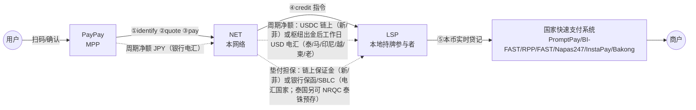

# 01 · 总体架构

## 1.1 要解决的问题

日本游客到东南亚，最常遇到的场景是：小店、夜市、摊位、出租车只贴着本国国家二维码（Thai QR、QRIS、DuitNow、VietQR、QR Ph、KHQR…），不收日本信用卡；而日本人手机里最常用的钱包 PayPay 在当地扫不了这些码。

现状（截至 2026-10 的公开信息）：
* PayPay 的"海外支払いモード"已上线**韩国**（2025-09-30，经 Alipay+ / ZeroPay）和**台湾**（2026-04-27，经 HIVEX / TWQR），手续费为"网络方/收单方汇率 + 3.85%"，**东南亚尚未开通**；
* 东盟各国之间的国家码已大量双边互联（泰国最多），但**日本不在这张网里**。日本侧现有的都是**入境**受理：印尼 QRIS（2025-08-17 起）、柬埔寨 KHQR（2025-07-04 起）用户在日本扫 JPQR Global（只限张贴 JPQR Global 码的商户，QRIS 首批 35 家，多在大阪世博会场；日本商户普遍张贴的是 PayPay 等各家自有码）；泰国用户在日本出示 MyPrompt QR（CPM，Krungsri 等泰国银行 + NETSTARS/NTT DATA）；东南亚钱包经 Alipay+ 在 PayPay 商户付款。日本钱包**出境**扫东南亚国家码尚无已上线通道（日本→印尼 QRIS 方向 BI 称已获日本 FSA 许可，但截至 2026-10 未见任何日本钱包宣布接入，见下文 Netstars）；
* **Alipay+ 的国家码覆盖分两类**：
  * 韩国 ZeroPay、新加坡 SGQR（经 NETS）、马来西亚 DuitNow（经 PayNet）、柬埔寨 KHQR、菲律宾 QR Ph（经 PPMI，2026-09）以交换机或码运营方为受理侧，已对**多个/成批** Alipay+ 钱包开放。上线时公开的名单：ZeroPay 首批 6 个、SGQR 首批 6 个（2023-04）、DuitNow 8 个以上（2023-10，占入境 > 80%）、KHQR 12 个（2024-10）、QR Ph 未查到；名单中均未见 PayPay。PayPay 在这些国家开通取决于 PayPay 与 Ant 的商务决定（推断）；
  * 泰国 PromptPay、越南 VietQR、印尼 QRIS 的 Alipay 国家码线目前只见**中国 Alipay 用户**可用；截至 2026-10 未检出对其他钱包开放的公告（未检出，不是官方否定）。PromptPay 本身互联很广（东盟多国、香港 FPS、经 SCB 的韩国 GLN），但其他 Alipay+ 钱包在泰国只能扫 KTC、2C2P、Antom 等收单方发出的码，日本钱包扫 PromptPay 国家码目前没有通道；
* **Alipay+ 的结算**：标准是合同约定的银行法币（钱包 T+1、收单方 T+2），但已有稳定币清算先例：2024-11 起新加坡 StraitsX × Alipay+ × Grab 在 Avalanche 上用 XSGD + PBM 清结算、商户收 SGD。Ant 还参与 MAS BLOOM、持有 MiCA EMT（BREUR），并据报与 Circle 合作（双方未证实）。所以"机构间稳定币结算"本身**不是差异化**；
* **HIVEX**（TBCASoft，软银等出资）是最接近本方案的现有网络：区块链底层、已连通 PayPay 双向（台湾），2025-08 与 StraitsX 签"StableLink"稳定币结算 MOU；2026-09-30 起把 Binance Pay 接到 PayPay 线下加盟店（海外 Binance 用户付款、商户收日元、零接入，见 [11 章](11-inscreen-stablecoin-acceptance.md)），说明它已在做"稳定币钱包付当地商户"的入境方向；但东南亚国家码覆盖很弱（只查到菲律宾 RCBC 合作）；
* **其他竞争者与替代通道**：
  * **Netstars / JPQR Global**：METI–BI、METI–NBC 框架下的日方交换（switching）运营方，**不是钱包**。入境方向（KHQR 2025-07、QRIS 2025-08）只覆盖张贴 JPQR Global 码的商户（QRIS 首批 35 家，多在大阪世博会场，此后未见公开商户数）；日本商户普遍张贴的是 PayPay 等各家自有码，外国钱包在日本主要经 Alipay+、HIVEX 扫 PayPay 商户码。出境方向（日本用户扫 QRIS / KHQR）需要日本钱包接入：BI 称日本→印尼方向已获日本 FSA 许可，KHQR–JPQR 二期在计划中（日方结算行据单一报道为 SMBC，未核实），但截至 2026-10 未见 PayPay、au PAY 等任何日本钱包宣布接入。因此它目前不是有效的替代通道；它缺的日本钱包一端，正是本网络可以补的（作为日方发行侧聚合者把 PayPay 等接入，并做 FX/结算）。另外，Netstars 在日本国内是上市（东证 Growth）的收单聚合商（StarPay），2026-07-13 推出面向日本商户的 Stablecoin Pay（USDC/USDT/JPYC，商户费率 0.98%，日元结算），在日本商户受理稳定币上是直接竞品（见 [11 章](11-inscreen-stablecoin-acceptance.md)）；
  * **加密钱包扫国家码**：Bitget Wallet / Bitget 交易所、RedotPay 已支持扫越南 VietQR、菲律宾 QR Ph（用户付 USDT/USDC，由未公开的本地出款方走 InstaPay/NAPAS 付本币；Bitget 声明不在这些法域作为支付服务商运营），RedotPay 还计划接 SGQR、PromptPay、DuitNow。这是直接竞品，也是监管风险信号；
  * **PayPay × Visa**（2026-02 合作；据二手分析为 NFC/QR 全球受理增加路径，具体条款未查到）：可能成为 PayPay 的另一条出境路线，替代部分国家码需求；
  * **Lightnet × SCB**（2024-10）：泰国稳定币跨境转账服务，而 SCB 正是泰国的候选伙伴。

本方案：做一个"**稳定币版 Alipay+**"——
* **前台**与 Alipay+ 同构：钱包（MPP）只对接我们一套 API，就能让用户扫多个国家的国家码；
* **商户侧**直接用各国国家码与国家快速支付系统，商户零改造、照常收本币；
* **后台**用"**机构间稳定币**"（USDC，枢纽在新加坡）做跨境清结算资产，效果因国而异：
  * 新加坡、菲律宾的伙伴链上收 USDC：7×24、可日内多次（小时级）结算、可编程、可审计；
  * 泰国、马来西亚、印尼、越南、柬埔寨、老挝（含 Phase 1 首选的泰国）的伙伴仍收**工作日 USD 电汇**，由境内银行换汇（T+0–T+1 工作日）。稳定币在这些国家只带来枢纽侧多国共享流动性和链上批次存证，**不带来伙伴侧 7×24**，还多出 JPY→USDC→USD 两次兑换（10 章假设约 15 bps）。这些国家是否经 USDC 中转，由 10 章 10.6 的法币基准对照决定；
* **差异化**：日本钱包可扫泰、越、印尼国家码（Netstars / JPQR Global 只有在日本钱包接入后才会削弱这一点，见上文）+ 锁定报价（电汇国家以境内结算行书面承诺锁价为前提，见 1.6）+ 链上结算国家的日内结算。

## 1.2 角色

| 角色 | 是谁 | 职责 | 资金/资产 |
|---|---|---|---|
| **MPP**（钱包） | PayPay 等日本钱包 | 用户 KYC、扫码 UI、扣减用户日元余额、对用户承担"為替取引"责任 | 日元 |
| **NET**（本网络） | INSPAY 的网络运营主体（建议设在新加坡；枢纽客户全在新加坡境外，须持 MPI 牌照或交由持牌机构做稳定币兑换与托管，见 1.6、06 章） | 国家码识别与路由、商户名查询、锁汇报价、风控、交易编排、清结算规则、对账、争议 | 稳定币金库；链上保证金（仅链上结算的伙伴） |
| **LSP**（本地结算伙伴） | 各国国家快速支付系统的持牌参与者：银行或持牌电子钱包；或国家交换机的跨境网关（NITMX、PayNet、NETS 等） | 用本币向商户实时入账；对接本国交换机；商户名查询；本币头寸管理；本地合规申报 | 本币（新加坡、菲律宾伙伴收 USDC，其他国家伙伴收 USD 电汇） |
| **LP**（流动性/出入金方） | 持牌交易所、OTC、稳定币发行方的机构铸赎通道、银行 FX 台 | JPY↔USDC、USDC↔USD/本币兑换报价与成交；电汇国家的在岸本币兑换由目的国境内结算行完成 | 稳定币、法币 |
| **商户** | 任意贴国家码的商户 | 无需签约、无需新设备 | 本币 |

## 1.3 分层架构

```
┌──────────────────────────────────────────────────────────────────────────────┐
│ ① 接入层（MPP 侧）  REST API + Server SDK（码识别规则下发、签名、幂等）        │
│    identify / quote / pay / inquiry / cancel / notify / refund / 结算文件       │
├──────────────────────────────────────────────────────────────────────────────┤
│ ② 国家码互通层     EMVCo TLV 解析 · CRC · 各国 profile（GUID→方案→商户/收单字段）│
│                    P2M/P2P 判别 · 静态/动态 · 附加数据 · 商户名查询回显          │
├──────────────────────────────────────────────────────────────────────────────┤
│ ③ 路由与交换层     交换机级 / 收单行级路由键 → LSP 适配器                        │
│                    报文转换（ISO 20022 pacs.008 / ISO 8583 / 交换机私有 API）    │
│                    超时、查询、冲正、U 状态处理                                  │
├──────────────────────────────────────────────────────────────────────────────┤
│ ④ 汇率与流动性层   两段 firm RFQ（JPY→USDC→本币）· 锁价 · 取整规则 · 金库再平衡   │
├──────────────────────────────────────────────────────────────────────────────┤
│ ⑤ 清结算层         复式账本 · 结算周期净额 · MPP 日元收款（银行电汇）            │
│                    偿付 LSP：链上 USDC（新/菲）或离岸出金后 USD 电汇（其他六国）  │
│                    垫付担保：链上保证金合约（新/菲）/ 银行保函·NRQC 泰铢预存     │
│                    四方对账                                                      │
├──────────────────────────────────────────────────────────────────────────────┤
│ ⑥ 风控与合规       制裁/PEP 筛查 · 限额（按国家/通道复刻发卡侧限额）· 交易监控   │
│                    Travel Rule（机构间稳定币转账）· 外汇申报 · 数据本地化          │
└──────────────────────────────────────────────────────────────────────────────┘
```

参考实现对应：①`src/api` ②`src/emvco` + `src/schemes` ③`src/payments` + `src/adapters` ④`src/fx` ⑤`src/ledger` + `src/settlement` + `contracts/` ⑥`src/adapters/mock.ts`（`RuleScreening` 示意）。商户名查询（07 章 7.4.0）参考实现尚未实现。

## 1.4 资金流与信息流（一笔交易）



* 实线 = 每笔实时；虚线 = 每个结算周期一次；
* 结算周期因国而异：新加坡、菲律宾可日内多次；电汇国家按工作日日结（Phase 1 泰国：泰国工作日日结，截止时间与节假日日历对齐结算行，不做小时结）；
* 用户和商户都不接触稳定币；稳定币只出现在网络枢纽与 LP、以及稳定币可落地司法辖区的 LSP（新加坡、菲律宾）之间（见 04 章 4.2、4.10）。电汇国家伙伴的负净额（退款多于付款）也经离岸出金方以电汇回收，不向其收取稳定币。

## 1.5 接入各国国家码的四种路径

调研显示，日本与东盟的国家码联通只有入境方向（见 1.1），政府层面也只有少数安排（METI 与印尼央行（2022-12）、柬埔寨央行（2023-12）签的 JPQR 互操作 MoC，另有 NBC–PJA MoU；日方执行主体是私营的 Netstars，日本央行不是当事方，不是"央行间"安排）。日本钱包要扫东南亚国家码，有四条路径（B 分两种），覆盖面与难度不同：

| 路径 | 做法 | 覆盖面 | 难度/周期 | 先例 |
|---|---|---|---|---|
| **A. 交换机跨境网关** | 作为"境外方案/网络"接入该国交换机的跨境平台，指定本地结算行 | 该国参与跨境受理银行发出的全部商户码，不是字面上的每个商户（马来西亚：开通 DuitNow 的商户自动受理；泰国：中国线开通时只受理 BBL、KTB、KBank、ICBC Thai、SCB、BAAC 六家银行的商户码，其他入境线是否同样受限、是否受理 tag 29 个人码未核实） | 需交换机与央行认可，商务周期长 | Alipay+（PayNet 2023、NITMX 2025-10 仅中国 Alipay 用户）、UnionPay、Tenpay、BC Card、Wise（PayNet 2026）、NPCI（PayNet，2026-02 签约、未确认上线）；NITMX 现有跨境线的泰方结算行：Bangkok Bank（中国、香港线）、Krungthai（中国线）、KBank（老挝线）、CIMB Thai（马来西亚线） |
| **B1. 收单行 on-us** | 和一家本地收单行/钱包签入境受理协议，只付它自己发出的商户码 | 只覆盖该行商户码（泰国：除 tag 31 外，还须按 tag 30 Biller ID 前 13 位税号识别该行的码——这一段也可能是 biller 自身的税号，识别规则须与合作行确认；参考实现目前只按 tag 31 生成收单行路由键） | 快 | Alipay+ 与各地收单方（泰国 KTC、2C2P、Antom 等） |
| **B2. 发卡侧赞助行（issuer-sponsor）** | 由一家本国快速支付系统直连成员，代境外钱包向任意国家码商户发起贷记 | 技术上可覆盖该国全部国家码商户（受该行能力与交换机规则限制） | 中：须央行/交换机确认"境外发起"交易的口径与外汇定性 | 韩国 GLN × KB 国民 × 泰国 SCB（2023-12，SCB 称覆盖全国 Thai QR 商户；现状未核实）；菲律宾 issuer-sponsor 设想（05 章 5.9） |
| **C. 借道现有网络** | 接入 Alipay+、HIVEX 等，由其路由；印尼、柬埔寨还可经 METI–BI、METI–NBC 框架下的 Netstars / JPQR Global 交换（缺日本钱包一端） | 取决于对方 | 最快，但 FX、费用、数据不在自己手里 | PayPay 韩国（Alipay+）、台湾（HIVEX）；JPQR Global 目前只有入境方向（印尼、柬埔寨用户在日本扫码，只限张贴其码的少数商户） |
| **D. 多边平台** | Nexus（NGP，目标 2027 上线） | 首版只做账户到账户，商户 QR 是未来扩展；日本不是成员，源/目的 PSP 须是成员国 IPS 参与者，日本钱包无法作为 PSP 接入 | 允许持牌第三方 FX Provider：INSPAY 最多以新加坡持牌实体申请 FXP 角色，不解决日本钱包扫码；日本加入前不是 PayPay 的扫码通道 | — |

**建议**：
* **泰国（Phase 1）**：先走 **B**，优先与 SCB 谈 **B2**（GLN 先例），Krungsri（MUFG 集团，已有日本合作）作备选，但中国线开通时 BAY 商户码仍"待上线"；只能做 **B1** 时，按 tag 30 Biller ID 前 13 位税号识别合作行商户码（也可能是 biller 自身税号，规则须与合作行确认），不只看 tag 31。用试点的交易数据与合规记录去谈 **A**；Krungsri、SCB 没有做 NITMX 跨境线结算行的先例，A 阶段把 KTB、BBL、KBank 列为结算行候选。泰国伙伴收 USD 电汇，稳定币只在枢纽侧；
* **新加坡、马来西亚、越南、菲律宾、老挝**与泰国结构相同，只是本地轨道和码字段不同；**印尼、柬埔寨**可经 Netstars / JPQR Global 交换（出境方向尚无日本钱包，本网络作为日方发行侧聚合者把 PayPay 接入，见 05 章 5.5、5.7），由当地银行按本币直接汇率（LCS）报价，路由、FX 与结算都与泰国不同；
* **C**（Alipay+/HIVEX）作为过渡覆盖与对照组；**D** 只跟踪 P2M 时间表与 FXP 资格规则。

各国具体路径见 [05](05-country-playbooks.md)。

## 1.6 关键设计决策

| 决策 | 选择 | 理由 |
|---|---|---|
| 稳定币在哪一层 | 只做机构间结算资产 | 泰国（SEC 2022 禁令、BOT 2026"持牌 PSP 只处理泰铢"）、马来西亚（数字资产不是支付工具、林吉特不得离岸）、印尼、越南、老挝等均禁止或不承认加密资产作为支付手段；新加坡有"稳定币清算、商户收本币"的监管先例（StraitsX × Alipay+ × Grab、dtcpay） |
| 稳定币↔本币在哪兑换 | 新加坡等离岸枢纽 + 目的国境内持牌银行 | 泰铢、林吉特、印尼盾等不可离岸交割，本币必须由境内持牌机构兑换；稳定币不进入这些国家境内（新加坡、菲律宾伙伴可直接链上收 USDC） |
| 电汇国家是否经 USDC 中转 | 未定：以 10 章 10.6 法币基准对照的实测报价决定 | 泰、马、印尼、越、柬、老的伙伴侧仍是 USD 电汇；经 USDC 中转多两次兑换（约 15 bps，假设），换来的只是枢纽侧共享流动性与链上存证 |
| 日本侧结构 | PayPay 作为為替取引主体；网络主体在境外；PayPay 以日元电汇结算；**网络的日本实体不经手日元** | 对齐 PayPay 现有 Alipay+/HIVEX 结构；2026-06-01 起"跨境收纳代行"纳入资金移动业规制，日本实体代收日元可能需要资金移动业登録（B2B 大额需第一种认可）。JPY→USDC 放在离岸完成：日本境内外国稳定币只能由登记的電子決済手段等取引業者经手（目前公开资料只见 SBI VC Trade，2025-03-04 登记），其条款允许在外国稳定币总预托额超过上限时限制新的预托与购买；另有报道称境内转移每笔约 100 万日元上限，但府令原文未核实，可能与"国外電子決済手段移転等調書"混淆——后者是取引業者向国外转移超过 100 万日元时提交的税务报告，不是上限（以上需日本律师确认） |
| 日元腿（MPP → 网络） | 日元银行电汇（PayPay T+1） | JPYC 每次发行 ≤ 100 万日元且禁止短时连续申请，只用于小额 PoC，不承载 PayPay 日净额；Phase 2+ 再评估信托型日元稳定币（JPYSC 上公链流通后、三大行共同币开放支付/跨境场景后，最早 2027） |
| 网络主体牌照（新加坡） | 申请 MPI（跨境汇款 + DPT 服务）；或交由持牌的 StraitsX / dtcpay 做稳定币兑换与托管，网络只做规则与技术 | 枢纽向 PayPay 收日元、持有并转出 USDC、向境外 LSP 付款，客户全在新加坡境外；不持 PS Act 牌照即落入 DTSP 制度（FSMA 第 9 部分，2025-06-30 生效、无过渡期）。新加坡法律意见是 Phase 0 阻断项（06 章 6.3） |
| 结算模型 | 周期净额，周期按国家定 | 链上伙伴（新/菲）可日内多次/小时级；电汇伙伴（泰/马/印尼/越/柬/老）按工作日日结，Phase 1 泰国不做小时结（经 USD 电汇做不到小时结，且 10 章电汇费按批分摊，批次越多每笔成本越高）；平衡链上成本、兑换次数与 LSP 信用敞口（见 04 章） |
| 垫付担保 | 链上伙伴：链上保证金合约（审计前只用于新/菲）。电汇伙伴：结算行的银行保函/SBLC，或由网络离岸主体申请加入 BOT 的 NRQC 计划、在其非居民泰铢账户（NRBA）中持有泰铢预存池（相当于 04 章 4.3 模型 C；NRQC 是 BOT 对非居民的资格，不是账户类型） | 规模 ≈ G_i ×（c + d）× k，d = LSP 发现声明/结算逾期并停止垫付所需时间（链上 1 个周期；电汇 ≥ 1 个工作日 + 最长连休）。LSP 规则：最新签名声明或 settle 逾期超过一个周期即停止为本网络垫付；未被签名声明覆盖的入账不受保护。合约已有 `recordReceipt`（伙伴签名的电汇收款回执计入已付），但 `claim()` 支付 USDC，与"稳定币不入境"矛盾，除非索偿权由 LSP 的离岸关联主体持有（见 04 章 4.4） |
| FX | 持牌 LP firm RFQ，不用 AMM | 最佳执行、可 KYC 的对手方、合规。LP firm quote 只有 30–60 秒有效：要么按笔/按分钟与 LP 背靠背成交（点差较高），要么批量成交并设敞口限额与对冲（周期末才成交会留下最长约 3–4 天的敞口；泰铢、林吉特、印尼盾只能在岸对冲）。电汇国家的本币腿须由境内结算行书面承诺"交易日锁价、T+n 交割"，否则不向用户承诺锁定汇率（见 04 章 4.6） |
| 商户名查询 | Phase 1 必需 | 泰国很多商户码不带 tag 59，防贴码诈骗依赖回显；identify 时同步调用 LSP 查询（超时 ≤ 1 s），查不到则提示用户人工核对，并对该码执行首笔限额（07 章 7.4.0；参考实现尚未实现） |
| 个人码与准现金 | 默认不承接 | 本网络的合规与风控选择，不是既有通道的技术限制（见 02 章 2.4）；参考实现对个人码返回 `P2P_NOT_SUPPORTED`，对 MCC 4829/6010/6011/6012/6051 返回 `MCC_NOT_SUPPORTED` |
| CPM（商户扫用户码） | 不做 | 东南亚 POS 不认外国钱包码；国家码体系以 MPM 为主 |

## 1.7 和 Alipay+ / HIVEX 的对比

| | Alipay+ | HIVEX（TBCASoft） | 本方案 |
|---|---|---|---|
| 钱包侧接入 | 一套 API + 码识别 SDK（`identifyCode` / `inquiryCodeRules` / `userInitiatedPay`） | 定制集成 | 同构：一套 API + 国家码 profile 下发 |
| 商户侧 | 国家交换机作为一个大 ACQP（ZeroPay、NETS、PayNet、Bakong、PPMI），已对多个/成批 Alipay+ 钱包开放（公开名单中未见 PayPay）；泰、越、印尼的国家码线目前只见中国 Alipay 用户可用 | 台湾 TWQR（经 FISC，清算行玉山）；韩国、菲律宾为合作/MOU | 各国交换机跨境网关/持牌参与者，直接用国家码；**差异化重点是泰、越、印尼** |
| 结算资产 | 银行法币为主（合同约定）；钱包侧默认 T+1、收单侧默认 T+2，结算汇率 = 交易汇率，收单侧承担 wallet interchange 与网络费。已有稳定币清算个案：新加坡 StraitsX × Grab 线用 XSGD（2024-11）；Ant 的 Whale / HSBC 代币化存款 / BREUR 定位在集团内部 treasury 或关联方批发 | 区块链底层；自称 2023 年起用稳定币技术清算，2025-08 与 StraitsX 签 StableLink MOU | 枢纽侧 USDC。新/菲伙伴链上收 USDC、可日内多次结算，有链上保证金；其他六国伙伴收工作日 USD 电汇（日结），担保用银行保函/SBLC（泰国另可用 NRQC 泰铢预存）。结算单附链上 tx hash 或电汇参考号 |
| FX 定价 | 网络方 | 网络方/收单方 | 两段 firm RFQ（LP 报价 30–60 秒有效），可拆分展示；成交方式与敞口控制见 1.6 |
| 与 PayPay 关系 | 已合作（韩国出境、日本入境收单）；收单侧向钱包付 wallet interchange | 已合作（台湾）、软银系 | 需 BD。价值主张：泰、越、印尼国家码覆盖 + 锁定报价 + 链上结算国家的日内结算。网络汇差与网络费加在用户价格上（10 章 10.1），PayPay 的 3.85% 不变，网络省下的成本不会自动变成 PayPay 毛利；PayPay 从 Alipay+ 下"收 interchange"变成"付网络费"，BD 须给出对标 Alipay+ 的钱包分润方案（例如从网络费中返还 x bps），并在 10 章 10.7 测算分润后的网络贡献 |

> 其他竞争者与替代通道（Netstars / JPQR Global、加密钱包、PayPay × Visa、Lightnet × SCB）见 1.1，风险评估见 [06](06-compliance-risk.md) 章 R8。

## 1.8 非功能要求

| 项 | 目标 |
|---|---|
| 可用性 | 前台 identify/quote/pay ≥ 99.95%；结算层故障不影响前台（LSP 垫付由担保覆盖：链上伙伴用链上保证金，电汇伙伴用银行保函/SBLC（泰国另可用 NRQC 泰铢预存）；未被签名声明覆盖的入账不受保护） |
| 时延 | identify < 300 ms（不含商户名查询；需查询时 LSP inquiry 超时 ≤ 1 s）；quote < 500 ms；pay 同步窗口 ≤ 8 s（超时返回 U） |
| 一致性 | pay 幂等（`paymentRequestId` 必填，同一 id 换了 `quoteId` 返回 `IDEMPOTENCY_CONFLICT`）；报价与支付不超过码自身的有效期（过期返回 `QR_EXPIRED`）；U 状态不自动解冻；账本每笔分录按币种借贷平衡；四方对账日清 |
| 安全 | mTLS + 报文签名；密钥 HSM/MPC；声明签名密钥轮换走 `claimDelay` 时间锁（合约 `proposeSigner` / `activateSigner`），生产前还须补暂停/守护多签、伙伴停用与审计；稳定币提现白名单与多签 |
| 个人数据跨境 | 最小化：LSP 只收付款人姓名、国家和网络内部 payerRef。PayPay 把付款人信息提供给境外网络与 LSP，属个人信息保护法第 28 条"向外国第三方提供"：须取得用户同意（告知接收国制度与接收方保护措施），或接收方具备同等体制；网络与 PayPay 签数据处理协议，明确"委托"还是"第三方提供"；目的国（越南 PDPL、泰国 PDPA、印尼 GPN 境内处理、菲律宾 DPA）逐国确认（06 章 6.7，需律师确认） |
| 运营 | 上线前与赞助行/NITMX、PayPay 海外模式做认证与 UAT；7×24 值班与事故分级；统一结算截止时间（建议 UTC 15:00 = JST 24:00）与日、泰、新节假日日历；LSP SLA（贷记结果、查询、文件交付、冲正）；对账差异 T+1 分派、T+3 关闭（见 08 章；数值为假设） |
| 可替换性 | 结算资产、链、LP、LSP 均为可插拔适配器；任一稳定币或链不可用时可降级为法币电汇执行同一套净额 |
