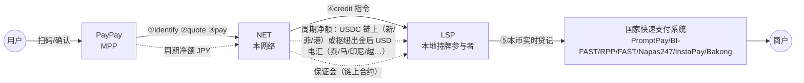

# 01 · 总体架构

## 1.1 要解决的问题

日本游客到东南亚，最常遇到的场景是：小店、夜市、摊位、出租车只贴着本国国家二维码（Thai QR、QRIS、DuitNow、VietQR、QR Ph、KHQR…），不收日本信用卡；而日本人手机里最常用的钱包 PayPay 在当地扫不了这些码。

现状（截至 2026-10 的公开信息）：
* PayPay 的"海外支払いモード"已上线**韩国**（2025-09-30，经 Alipay+ / ZeroPay）和**台湾**（2026-04-27，经 HIVEX / TWQR），手续费为"网络方/收单方汇率 + 3.85%"，**东南亚尚未开通**；
* 东盟各国之间的国家码已大量双边互联（泰国最多），但**日本不在这张网里**：日本侧只有 JPQR Global 的**入境**受理（印尼 QRIS 2025-08 起、柬埔寨 KHQR 2025-07 起，在日本扫 JPQR），日本钱包**出境**扫东南亚国家码没有现成通道；
* **Alipay+ 的覆盖分两类**：韩国 ZeroPay、新加坡 SGQR（经 NETS）、马来西亚 DuitNow（经 PayNet）、柬埔寨 KHQR、菲律宾 QR Ph（经 PPMI，2026-09）已对**全部 Alipay+ 钱包**开放——PayPay 作为 Alipay+ 钱包方，技术上随时可能在这些国家开通；而泰国 PromptPay、越南 VietQR、印尼 QRIS 在央行间框架下**只开放给中国 Alipay 走廊**。Alipay+ 的结算仍是银行法币（钱包 T+1、收单方 T+2），公开资料未见改用稳定币；
* **HIVEX**（TBCASoft，软银等出资）是最接近本方案的现有网络：区块链底层、已连通 PayPay 双向（台湾），2025-08 与 StraitsX 签"StableLink"稳定币结算 MOU，但东南亚国家码覆盖很弱（只查到菲律宾 RCBC 合作）。

本方案：做一个"**稳定币版 Alipay+**"——
* **前台**与 Alipay+ 同构：钱包（MPP）只对接我们一套 API，就能让用户扫多个国家的国家码；
* **商户侧**直接用各国国家码与国家快速支付系统，商户零改造、照常收本币；
* **后台**把跨境清结算资产从"代理行电汇 + 各国预付头寸"换成"**机构间稳定币**"，7×24、分钟级、可编程、可审计。

## 1.2 角色

| 角色 | 是谁 | 职责 | 资金/资产 |
|---|---|---|---|
| **MPP**（钱包） | PayPay 等日本钱包 | 用户 KYC、扫码 UI、扣减用户日元余额、对用户承担"為替取引"责任 | 日元 |
| **NET**（本网络） | INSPAY 的网络运营主体（建议设在新加坡等离岸司法辖区，见 06 章） | 国家码识别与路由、锁汇报价、风控、交易编排、清结算规则、对账、争议 | 稳定币金库、链上保证金 |
| **LSP**（本地结算伙伴） | 各国国家快速支付系统的持牌参与者：银行或持牌电子钱包；或国家交换机的跨境网关（NITMX、PayNet、NETS 等） | 用本币向商户实时入账；对接本国交换机；本币头寸管理；本地合规申报 | 本币 |
| **LP**（流动性/出入金方） | 持牌交易所、OTC、稳定币发行方的机构铸赎通道、银行 FX 台 | JPY↔USDC、USDC↔本币兑换报价与成交 | 稳定币、法币 |
| **商户** | 任意贴国家码的商户 | 无需签约、无需新设备 | 本币 |

## 1.3 分层架构

```
┌──────────────────────────────────────────────────────────────────────────────┐
│ ① 接入层（MPP 侧）  REST API + Server SDK（码识别规则下发、签名、幂等）        │
│    identify / quote / pay / inquiry / cancel / notify / refund / 结算文件       │
├──────────────────────────────────────────────────────────────────────────────┤
│ ② 国家码互通层     EMVCo TLV 解析 · CRC · 各国 profile（GUID→方案→商户/收单字段）│
│                    P2M/P2P 判别 · 静态/动态 · 附加数据 · 商户名查询回显          │
├──────────────────────────────────────────────────────────────────────────────┤
│ ③ 路由与交换层     交换机级 / 收单行级路由键 → LSP 适配器                        │
│                    报文转换（ISO 20022 pacs.008 / ISO 8583 / 交换机私有 API）    │
│                    超时、查询、冲正、U 状态处理                                  │
├──────────────────────────────────────────────────────────────────────────────┤
│ ④ 汇率与流动性层   两段 firm RFQ（JPY→USDC→本币）· 锁价 · 取整规则 · 金库再平衡   │
├──────────────────────────────────────────────────────────────────────────────┤
│ ⑤ 清结算层         复式账本 · 结算周期净额 · 稳定币链上偿付 LSP · MPP 日元收款    │
│                    链上保证金合约（LSP 垫付风险兜底） · 四方对账                  │
├──────────────────────────────────────────────────────────────────────────────┤
│ ⑥ 风控与合规       制裁/PEP 筛查 · 限额（按国家/通道复刻发卡侧限额）· 交易监控   │
│                    Travel Rule（机构间稳定币转账）· 外汇申报 · 数据本地化          │
└──────────────────────────────────────────────────────────────────────────────┘
```

参考实现对应：①`src/api` ②`src/emvco` + `src/schemes` ③`src/payments` + `src/adapters` ④`src/fx` ⑤`src/ledger` + `src/settlement` + `contracts/` ⑥`src/adapters/mock.ts`（`RuleScreening` 示意）。

## 1.4 资金流与信息流（一笔交易）



* 实线 = 每笔实时；虚线 = 每个结算周期一次；
* 用户和商户都不接触稳定币；稳定币只出现在网络枢纽与 LP、以及稳定币可落地司法辖区的 LSP 之间（见 04 章 4.2、4.10）。

## 1.5 接入各国国家码的四种路径

调研显示，一个**没有政府间双边安排**的国家（日本）的钱包要扫东南亚国家码，有四条路径，覆盖面与难度不同：

| 路径 | 做法 | 覆盖面 | 难度/周期 | 先例 |
|---|---|---|---|---|
| **A. 交换机跨境网关** | 作为"境外方案/网络"接入该国交换机的跨境平台，指定本地结算行 | 该国全部参与跨境受理的商户码（马来西亚：开通 DuitNow 的商户自动受理；泰国：参与银行的商户码） | 需交换机与央行认可，商务周期长 | Alipay+（PayNet 2023、NITMX 2025 仅 Alipay）、UnionPay、Tenpay、NPCI、BC Card、Wise（PayNet 2026） |
| **B. 单一收单行/钱包合作（on-us）** | 和一家本地银行/钱包签入境受理协议 | 只覆盖该行发出的商户码 | 快 | 韩国 GLN × 泰国 SCB；Alipay+ 与各地收单方 |
| **C. 借道现有网络** | 接入 Alipay+、HIVEX 等，由其路由 | 取决于对方 | 最快，但 FX、费用、数据不在自己手里 | PayPay 韩国（Alipay+）、台湾（HIVEX） |
| **D. 多边平台** | Project Nexus / Nexus Global Payments（2027 年目标上线） | 设计上以账户到账户为主 | 取决于 NGP 是否向私营网络开放 | — |

**建议**：先用 **B** 在 1–2 个国家打通全链路（含稳定币结算），用交易数据与合规记录去谈 **A**；**C** 作为过渡覆盖与对照组；跟踪 **D**。各国具体路径见 [05](05-country-playbooks.md)。

## 1.6 关键设计决策

| 决策 | 选择 | 理由 |
|---|---|---|
| 稳定币在哪一层 | 只做机构间结算资产 | 泰国（SEC 2022 禁令、BOT 2026"持牌 PSP 只处理泰铢"）、马来西亚（数字资产不是支付工具、林吉特不得离岸）、印尼、越南、老挝等均禁止或不承认加密资产作为支付手段；新加坡有"稳定币清算、商户收本币"的监管先例（StraitsX × Alipay+ × Grab、dtcpay） |
| 稳定币↔本币在哪兑换 | 新加坡等离岸枢纽 + 目的国境内持牌银行 | 泰铢、林吉特、印尼盾等不可离岸交割，本币必须由境内持牌机构兑换；稳定币不进入这些国家境内 |
| 日本侧结构 | PayPay 作为為替取引主体；网络主体在境外；PayPay 以日元电汇结算；**网络的日本实体不经手日元** | 对齐 PayPay 现有 Alipay+/HIVEX 结构；2026-06-01 起"跨境收纳代行"纳入资金移动业规制，日本实体代收日元可能需要资金移动业登録（B2B 大额需第一种认可）；日本境内外国稳定币转移据报道有每笔约 100 万日元上限且超过 100 万日元需提交调书（需日本律师确认） |
| 结算模型 | 周期净额 + 链上保证金，周期可缩到小时级 | 平衡链上成本、兑换次数与 LSP 信用敞口（见 04 章） |
| FX | 持牌 LP firm RFQ，不用 AMM | 最佳执行、可 KYC 的对手方、合规 |
| 个人码 | 默认不承接 | 合规与风控（见 02 章 2.4） |
| CPM（商户扫用户码） | 不做 | 东南亚 POS 不认外国钱包码；国家码体系以 MPM 为主 |

## 1.7 和 Alipay+ / HIVEX 的对比

| | Alipay+ | HIVEX（TBCASoft） | 本方案 |
|---|---|---|---|
| 钱包侧接入 | 一套 API + 码识别 SDK（`identifyCode` / `inquiryCodeRules` / `userInitiatedPay`） | 定制集成 | 同构：一套 API + 国家码 profile 下发 |
| 商户侧 | 国家交换机作为一个大 ACQP（ZeroPay、NETS、PayNet、Bakong、PPMI，全钱包开放）；泰越印尼只有中国走廊 | 台湾 TWQR（经 FISC，清算行玉山）；韩国、菲律宾为合作/MOU | 各国交换机跨境网关/持牌参与者，直接用国家码；**差异化重点是泰、越、印尼** |
| 结算资产 | 银行法币；钱包侧默认 T+1、收单侧默认 T+2，结算汇率 = 交易汇率，收单侧承担 wallet interchange 与网络费（公开资料未见改用稳定币；Ant 的 Whale / HSBC 代币化存款 / BREUR 定位在集团内部 treasury） | 区块链底层；自称 2023 年起用稳定币技术清算，2025-08 与 StraitsX 签 StableLink MOU | 机构间稳定币 + 链上保证金，日内多次结算，结算单附链上 tx hash |
| FX 定价 | 网络方 | 网络方/收单方 | 两段 RFQ，可拆分展示，可给 MPP 更低点差 |
| 与 PayPay 关系 | 已合作（韩国出境、日本入境收单） | 已合作（台湾）、软银系 | 需 BD；价值主张是更低成本 + 东南亚国家码覆盖 |

## 1.8 非功能要求

| 项 | 目标 |
|---|---|
| 可用性 | 前台 identify/quote/pay ≥ 99.95%；结算层故障不影响前台（LSP 垫付由保证金覆盖） |
| 时延 | identify < 300 ms；quote < 500 ms；pay 同步窗口 ≤ 8 s（超时返回 U） |
| 一致性 | pay 幂等；U 状态不自动解冻；账本每笔分录按币种借贷平衡；四方对账日清 |
| 安全 | mTLS + 报文签名；密钥 HSM/MPC；稳定币提现白名单与多签；最小化个人数据跨境 |
| 可替换性 | 结算资产、链、LP、LSP 均为可插拔适配器；任一稳定币或链不可用时可降级为法币电汇执行同一套净额 |
