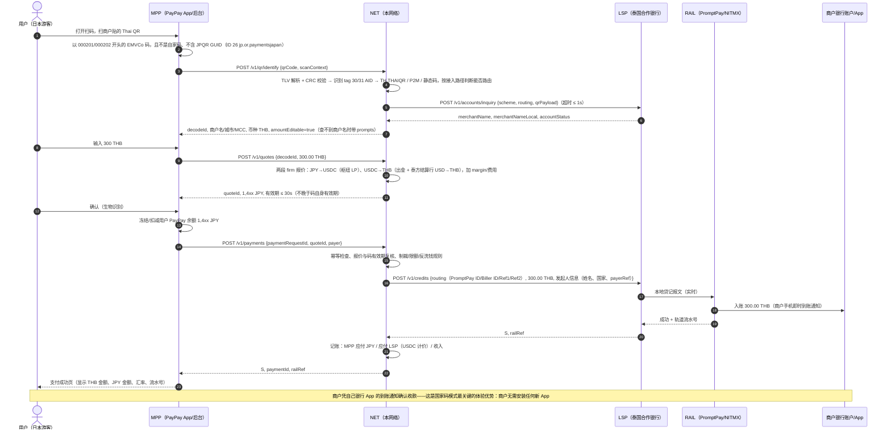
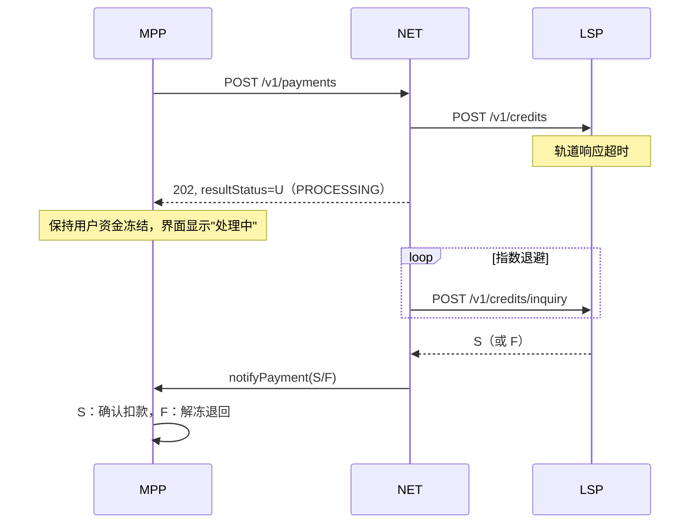
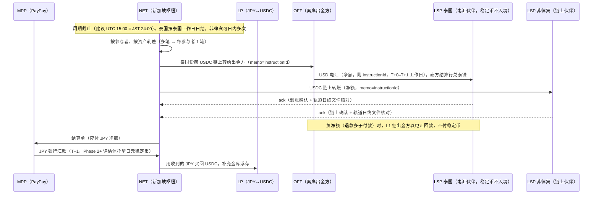

# 03 · 交易流程

本章用"PayPay 用户在曼谷路边店扫 Thai QR"为主线，说明一笔交易从扫码到商户入账、再到结算的完整时序，以及静态码/动态码、超时、退款、争议等分支。新加坡、马来西亚、越南、菲律宾、老挝与泰国结构相同，只有本地轨道和码字段不同；印尼、柬埔寨的推荐路径要经日方 Netstars/JPQR Global 枢纽（METI–BI、METI–NBC 框架）：印尼由 LCS 框架下的 ACCD 银行按本币直接汇率报价；柬埔寨的汇率安排未查到（推断由当地银行按本币报价，与印尼类似）。两国的路由、FX 和结算都与泰国不同（见 [05 各国接入手册](05-country-playbooks.md) 5.5、5.7）。

参与方缩写：
* **MPP**：钱包（Mobile Payment Provider），例：PayPay
* **NET**：本网络（路由 + 汇率 + 清结算 + 规则），主体与 USDC 金库在新加坡枢纽
* **LSP**：本地结算伙伴（Local Settlement Partner），目的国的本地持牌参与者（银行或持牌电子钱包），是国家快速支付系统的直连成员；Phase 1 泰国即合作银行（B2 赞助行或 B1 收单行，见 3.1 要点 0）
* **RAIL**：目的国国家快速支付系统 / 交换机（例：泰国 NITMX 运营的 PromptPay）
* **LP**：持牌流动性提供方（稳定币 ↔ 法币做市/兑换）
* **OFF**：离岸出金方（USDC → USD，向电汇国家的 LSP 电汇）

## 3.1 主流程（静态码，最常见）

要点：
0. **能付哪些码取决于接入路径**（[01 章 1.5](01-architecture.md#15-接入各国国家码的四种路径)）：
   * **B1 收单行 on-us**：只能付合作行自己发出的商户码，`identify` 对其他银行的码返回 `NO_ROUTE`，钱包提示"该店暂不支持"。识别合作行的码要看 tag 30 Biller ID 前 13 位税号（也可能是 biller 自身税号，规则须与合作行确认），不能只看 tag 31（参考实现目前只按 tag 31 的银行代码生成收单行路由键 `TH:ACQ:<代码>`；只有 tag 31、没有 tag 30 的码按收单行级路由，置信度 0.7）。
   * **B2 发卡侧赞助行（issuer-sponsor）**：由一家 PromptPay 直连成员代 PayPay 向任意 Thai QR 商户发起贷记，技术上可覆盖全国商户码；先例是韩国 GLN × KB 国民 × SCB（2023-12，SCB 称覆盖全国 Thai QR 商户，现状未核实）。须 BOT/NITMX 确认"境外发起"交易的口径与外汇定性。泰国推荐 B2（SCB）→ A，Krungsri 作备选（B1 或 B2，见 [05 章 5.2](05-country-playbooks.md)）。
   * **A 交换机跨境网关**：覆盖参与跨境受理银行发出的全部商户码，不是字面上的每个商户。中国线开通时只受理 BBL、KTB、KBank、ICBC Thai、SCB、BAAC 六家银行的商户码；其他入境线是否同样受限、是否受理 tag 29 个人码，未核实。
   * 无论哪条路径，本网络默认不承接个人码（tag 29，返回 `P2P_NOT_SUPPORTED`）和准现金 MCC 4829/6010/6011/6012/6051（返回 `MCC_NOT_SUPPORTED`），这是合规选择（[02 章 2.4](02-qr-interoperability.md)）。tag 30 的跨境 AID `A000000677012006` 疑为境外商户展示泰式码供泰国游客付款，识别但拒绝，待 BOT/NITMX 确认。
1. **商户零改造**：商户贴的是本国国家码，钱到的是自己原有的银行账户/钱包，到账通知来自自己的银行 App。网络不需要"签约商户"；覆盖面由接入路径决定（要点 0）。
2. **用户只看到日元**：用户余额里扣的是日元；稳定币只在机构之间流转——NET ↔ LP、NET → 离岸出金方，以及 NET ↔ 链上收款的 LSP（新加坡、菲律宾）。泰国 LSP 收的是枢纽出金后的 USD 电汇，不接触稳定币；用户和商户也都不接触加密资产——这是在多数东南亚国家合规可行的前提（见 [06 合规](06-compliance-risk.md)）。
3. **LSP 先垫付本币**：第 17–18 步 LSP 用自己在本地轨道的本币头寸给商户入账，之后在结算周期由 NET 偿付（泰国：泰国工作日日结、USD 电汇；新加坡、菲律宾：USDC 链上，见 3.6）。垫付风险的担保：电汇伙伴用结算行的银行保函/SBLC（泰国也可用 NRQC 泰铢预存）；链上保证金合约在审计前只用于链上伙伴（新加坡、菲律宾），见 [04 章 4.4](04-stablecoin-settlement.md)。
4. **商户名查询是 Phase 1 必需**：泰国很多商户码不带 tag 59，防贴码诈骗依赖回显。第 5–6 步在 identify 时同步调用 LSP 的 `POST {lsp}/v1/accounts/inquiry`（[07 章 7.4.0](07-api-spec.md)，泰国经 NITMX/结算行查询）；查不到商户名时 identify 返回 `prompts` 让用户人工核对，并对该码执行首笔限额。**参考实现尚未实现这一步。**
5. **接口名与报文**：图中用 07 章规范的接口名。参考实现的识别接口路径是 `POST /v1/qr/decode`；报文也与规范不同（金额为最小单位整数字符串——请求 `amount`、响应 `amountMinor`——而非 `{currency, value}` 对象；时间为毫秒时间戳；没有 `result{}` 对象，见 07 章 7.6）。对接以 07 章规范为准。
6. **付款人数据最小化**：网络传给 LSP 的只有付款人姓名、国家、网络内部 `payerRef` 与发起钱包机构；PayPay 向境外网络与 LSP 提供个人数据属个人信息保护法第 28 条"向外国第三方提供"，见 [06 章 6.7](06-compliance-risk.md)（需律师确认）。参考实现目前只读顶层 `payerRef`，贷记指令里没有发起人信息。

## 3.2 动态码

动态码（`01`=`12`）由商户 POS/收银系统按单生成，含金额（`54`）和单据参考号（`62` 的 bill number / reference label / terminal label，或泰国 bill payment 的 Ref1/Ref2、QRIS 的 transaction ID 等）。

差异：
* `identify` 返回 `amountEditable=false`，钱包不可修改金额；
* LSP 发起贷记时**必须原样回传参考号**，商户 POS 才能通过其收单行/交换机的回执自动把订单标为已付；
* 码内有效期（KHQR `99-01`、PayNow `04`；马来西亚社区资料称动态码约 60 秒，码内无有效期字段，以收单方返回为准）：`identify` 时已过期即拒绝（`QR_EXPIRED`）；decode 会话和报价的 `expiresAt` 都不晚于码自身有效期减安全余量（参考实现默认 5 秒），`pay` 前再校验一次——**锁汇有效期必须短于码有效期**；
* 码内金额按轨道精度校验（印尼 QRIS 只收整数印尼盾、柬埔寨 KHQR 只收整数瑞尔，超精度返回 `INVALID_QR`；用户输入的静态码金额同理，返回 `AMOUNT_PRECISION`），并复刻轨道单笔上限（例：菲律宾 InstaPay ₱50,000，超出返回 `AMOUNT_LIMIT`）；
* 有小费提示（`55`=`01`）时钱包显示小费输入框；固定服务费（`55`=`02`，`56`）自动加到金额里。

## 3.3 超时与"未知"状态（U）

跨境链路最大的工程风险是**状态不确定**：LSP 已向轨道发送贷记，但没在同步窗口内拿到结果。

规则：
* **U 状态下绝不自动解冻用户资金**，否则会出现"商户已到账、用户也拿回钱"的资金损失；
* NET 对 LSP 的查询 2s/4s/8s… 退避，超过 T+1 仍未知进入人工对账（与 LSP 用轨道日终文件核对）；参考实现的 `resolvePending()` 逐笔查询处理中的交易，由调用方定时触发，退避节奏未实现；
* MPP 超时后可用同一 `paymentRequestId` 重试（必填，1–64 位可打印 ASCII），网络返回首次结果；同号携带不同 `quoteId` 返回 `IDEMPOTENCY_CONFLICT`；
* `cancel` 只在网络尚未开始处理该 `paymentRequestId` 时成功（参考实现记下墓碑，之后迟到的同号 `pay` 返回 `PAYMENT_CANCELLED`），或该笔已明确失败；处理中或 U 状态返回 `CANCEL_NOT_ALLOWED_PROCESSING`，只能等终态；已成功返回 `CANCEL_NOT_ALLOWED_REFUND`，只能走 3.4 退款。

## 3.4 退款

国家快速支付系统大多**没有"退款"报文**——它们只做贷记推送。因此退款路径是：

1. 商户在其收单行/LSP 渠道发起退款（若该商户就是 LSP 自己的商户），或通过网络提供的商户退款工具（需要商户在 LSP 处登记）；
2. 若商户不是 LSP 的客户（例如商户的银行是 A 行，LSP 是 B 行），退款只能由商户用自己银行 App 向 LSP 的专用回款账户做一笔反向贷记，附原 `paymentId`/`railRef`；LSP 匹配后调用 `POST /v1/lsp/refunds`（LSP 身份签名，`refundRequestId` 幂等）；
3. NET 按约定的退款汇率规则把本币退款折算回日元，`notifyRefund` 给 MPP，MPP 退回用户余额；
4. 退款冲减网络对该 LSP 的应付；周期内退款多于付款（负净额）时，链上伙伴以 USDC 回款，泰国等电汇伙伴经离岸出金方以电汇回款，不向其收取稳定币（3.6）。

**退款汇率规则**（需要和 MPP 约定，参考实现采用 A）。现有做法可作参照：据马来西亚银行 FAQ，DuitNow 跨境退款金额可能因 PayNet 汇率变动而与原付款不同（推断按退款时汇率反向贷记，FX 风险由付款人承担）；Alipay+ 的结算单沿用原交易汇率（这是结算口径，其退款汇率规则未查到）。
* A. **按原交易汇率退本金**，费用不退（参考实现按退款占原交易的比例退回日元本金，部分退款累计后与全额退款一致）；用户体验最好，但网络从原交易到退款期间持有 FX 敞口（见 [04 章 4.6](04-stablecoin-settlement.md)）；
* B. 按退款时的汇率；
* C. 全额 ≤ X 天内按原汇率，之后按当时汇率（混合方案；卡组织实际做法未核实）。

## 3.5 争议（用户说"付了但商户说没收到"）

* 先查 `railRef`：轨道已成功即商户已入账，提供轨道流水号给商户核对（多数情况是商户看错账户或通知延迟）；
* 若轨道流水显示入账到与码不符的账户（码被篡改/贴码诈骗），按 [06 章 6.5](06-compliance-risk.md) 的贴码诈骗措施处理（处置流程待补）：冻结收款账户的后续交易、通过 LSP 走本国轨道的争议/追索流程；
* 国家快速支付系统一般**没有卡组织式的 chargeback**，因此风控前置（商户名查询回显（3.1 要点 4）、地理位置、商户账户黑名单、首次交易限额）比事后追索重要。

## 3.6 结算（每个结算周期）

* **结算频率因国而异**：链上伙伴（新加坡、菲律宾）收 USDC，可 7×24、日内多次甚至小时级结算。电汇伙伴（泰国、马来西亚、印尼、越南、柬埔寨、老挝，含 Phase 1 泰国）收的是枢纽出金后的工作日 USD 电汇加境内兑换（T+0–T+1 工作日），伙伴侧没有 7×24，节假日照样停摆。Phase 1 泰国按泰国工作日日结，截止时间与节假日日历对齐结算行，不做小时结（经 USD 电汇做不到小时结，而且 10 章电汇费按批分摊，批次越多每笔越贵）。周末/节假日的垫付缺口：网络离岸主体可申请加入 BOT 的 NRQC 计划，在其非居民泰铢账户（NRBA）中持有泰铢预存池（[04 章 4.3](04-stablecoin-settlement.md) 模型 C）。
* **LSP 垫付敞口与担保**：LSP 在周期内用本币垫付，NET 在周期末偿付。担保规模 ≈ G ×（c + d）× k：c 为结算周期，d 为 LSP 发现声明/结算逾期并停止垫付所需时间（链上 1 个周期；电汇 ≥ 1 个工作日 + 最长连休）。LSP 规则：最新签名声明或 settle 逾期超过一个周期即停止为本网络垫付。链上伙伴用链上保证金合约，电汇伙伴用结算行保函/SBLC（泰国也可用 NRQC 泰铢预存）（04 章 4.4、4.5）。
* **金库浮存**：NET 金库需要的 USDC 浮存 ≈ 一个周期内所有 LSP 的应付净额 + 安全垫；MPP 付日元有 T+1 时滞，这段时间是 NET 的流动性占用（04 章 4.5 有测算方法）。电汇国家经 USDC 中转要多两次兑换（JPY→USDC→USD，10 章假设约 15 bps），是否值得由 10 章 10.6 的法币基准对照决定。
* **FX 成交**：若周期末才与 LP 批量成交，网络从报价到成交之间持有敞口（日结 + PayPay T+1 + 周末/长假，最长约 3–4 天）；须按笔背靠背成交，或批量成交并设敞口限额与对冲（04 章 4.6）。
* **周期号与短缺**：参考实现中每个周期号只能关闭一次（`POST /v1/settlement/cycles`，OPS 身份，重复返回 409）；金库稳定币不足时整个周期中止、不提交任何分录，补足后可重试（3.7）。
* 双向业务（东南亚钱包到日本 PayPay 商户消费）上线后，同一参与者两个方向的头寸可以互相轧差，稳定币实际流量会显著小于毛交易额。

## 3.7 失败与补偿矩阵

| 场景 | 用户资金 | 商户 | 网络动作 |
|---|---|---|---|
| identify 失败（码坏、不支持、无路由、个人码、准现金 MCC、码已过期、超轨道上限） | 未动 | — | 返回错误码（`INVALID_QR`、`UNSUPPORTED_QR`、`NO_ROUTE`、`P2P_NOT_SUPPORTED`、`MCC_NOT_SUPPORTED`、`QR_EXPIRED`、`AMOUNT_LIMIT`），钱包提示"该二维码暂不支持" |
| 查不到商户名 | 未动 | — | identify 返回 `prompts` 让用户人工核对，对该码执行首笔限额（Phase 1 必需，参考实现未实现） |
| 报价过期 / 码过期 | 未动 | — | 重新报价（`QUOTE_EXPIRED`）；码已过期（`QR_EXPIRED`）则请商户重新出码 |
| 重复请求 / 同号不同报价 | 不重复扣款 | — | 返回首次结果 / `IDEMPOTENCY_CONFLICT` |
| 风控拒绝 | 未扣或已冻结 → MPP 解冻 | — | 返回 `RISK_REJECTED`（需人工复核时 `RISK_REVIEW`） |
| LSP/轨道明确失败（F） | 冻结 → 解冻 | 未入账 | 无账务 |
| 超时（U） | 保持冻结 | 可能已入账 | 查询直至终态 |
| 成功后用户要求退款 | 待商户退款 | 已入账 | 走 3.4 |
| 结算时金库稳定币不足 | 不影响 | 已入账（LSP 垫付） | 整个周期中止，不提交任何分录，不做部分偿付；告警，动用备用额度/LP 授信补足后重跑 |
| 电汇延误或遇节假日（电汇伙伴） | 不影响 | 已入账（LSP 垫付） | 按结算行日历顺延；LSP 在担保额度内继续垫付，最新声明或结算逾期超过一个周期即停止为本网络垫付 |
| 稳定币发行方冻结/脱锚 | 不影响 | 不影响 | 切换备用结算资产（RLUSD 等备用稳定币，或改走法币电汇的降级模式；USDT 不使用），见 04 章 4.9、4.10 |
