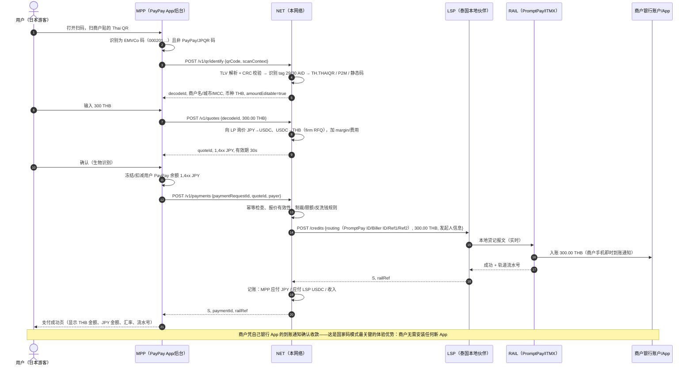
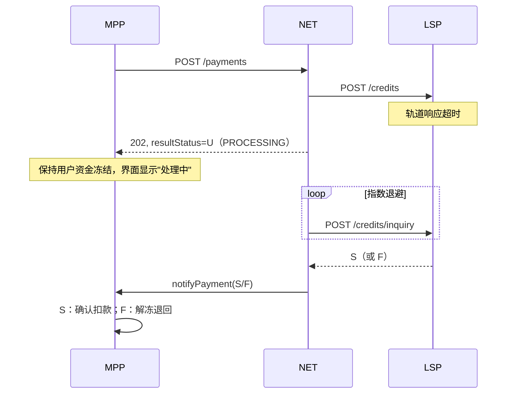
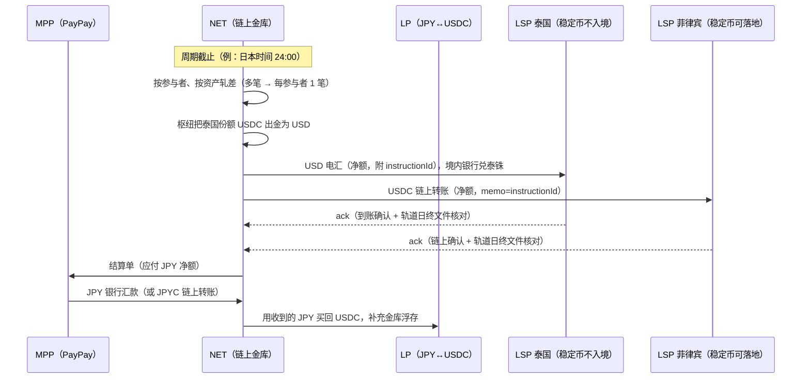

# 03 · 交易流程

本章用"PayPay 用户在曼谷路边店扫 Thai QR"为主线，说明一笔交易从扫码到商户入账、再到稳定币结算的完整时序，以及静态码/动态码、超时、退款、争议等分支。其他国家只有"本地轨道"那一段不同（见 [05 各国接入手册](05-country-playbooks.md)）。

参与方缩写：
* **MPP**：钱包（Mobile Payment Provider），例：PayPay
* **NET**：本网络（路由 + 汇率 + 清结算 + 规则）
* **LSP**：本地结算伙伴（Local Settlement Partner），目的国的本地持牌参与者（银行或持牌电子钱包），是国家快速支付系统的直连成员
* **RAIL**：目的国国家快速支付系统 / 交换机（例：泰国 ITMX 的 PromptPay）
* **LP**：持牌流动性提供方（稳定币 ↔ 法币做市/兑换）

## 3.1 主流程（静态码，最常见）

要点：
0. **能付哪些码取决于接入路径**：泰国既有的入境通道只接受参与银行发出的商户码（tag 30/31）；Phase 1 的 on-us 模式下只能付合作行自己的商户码，`identify` 对其他银行的码返回 `NO_ROUTE`，钱包提示"该店暂不支持"。
1. **商户零改造**：商户贴的是本国国家码，钱到的是自己原有的银行账户/钱包，到账通知来自自己的银行 App。网络不需要"签约商户"，覆盖面 = 该国国家码的全部商户。
2. **用户只看到日元**：用户余额里扣的是日元；稳定币只在机构之间（NET ↔ LSP、NET ↔ LP）流转，用户和商户都不接触加密资产——这是在多数东南亚国家合规可行的前提（见 [06 合规](06-compliance-risk.md)）。
3. **LSP 先垫付本币**：第 16 步 LSP 用自己在本地轨道的本币头寸给商户入账，之后在结算周期由 NET 以稳定币偿付（3.6）。LSP 的垫付额度由 NET 在链上托管的稳定币保证金覆盖。

## 3.2 动态码

动态码（`01`=`12`）由商户 POS/收银系统按单生成，含金额（`54`）和单据参考号（`62` 的 bill number / reference label / terminal label，或泰国 bill payment 的 Ref1/Ref2、QRIS 的 transaction ID 等）。

差异：
* `identify` 返回 `amountEditable=false`，钱包不可修改金额；
* LSP 发起贷记时**必须原样回传参考号**，商户 POS 才能通过其收单行/交换机的回执自动把订单标为已付；
* 有的国家动态码有有效期（码内时间戳或收单侧超时），过期码在 `identify` 阶段即拒绝；
* 有小费提示（`55`=`01`）时钱包显示小费输入框；固定服务费（`55`=`02`，`56`）自动加到金额里。

## 3.3 超时与"未知"状态（U）

跨境链路最大的工程风险是**状态不确定**：LSP 已向轨道发送贷记，但没在同步窗口内拿到结果。

规则：
* **U 状态下绝不自动解冻用户资金**，否则会出现"商户已到账、用户也拿回钱"的资金损失；
* NET 对 LSP 的查询 2s/4s/8s… 退避，超过 T+1 仍未知进入人工对账（与 LSP 用轨道日终文件核对）；
* 只有在"贷记尚未提交到轨道"时才允许 `cancel`；已提交的只能等终态。

## 3.4 退款

国家快速支付系统大多**没有"退款"报文**——它们只做贷记推送。因此退款路径是：

1. 商户在其收单行/LSP 渠道发起退款（若该商户就是 LSP 自己的商户），或通过网络提供的商户退款工具（需要商户在 LSP 处登记）；
2. 若商户不是 LSP 的客户（例如商户的银行是 A 行，LSP 是 B 行），退款只能由商户用自己银行 App 向 LSP 的专用回款账户做一笔反向贷记，附原 `paymentId`/`railRef`；LSP 匹配后调用 `POST /v1/lsp/refunds`；
3. NET 把本币退款折算回日元，`notifyRefund` 给 MPP，MPP 退回用户余额。

**退款汇率规则**（需要和 MPP 约定，参考实现采用 A）。现有做法可作参照：马来西亚 DuitNow 跨境退款按退款时的 PayNet 汇率，FX 风险由付款人承担；Alipay+ 结算时沿用原交易汇率。
* A. **按原交易汇率退本金**，费用不退；汇率波动由网络承担（用户体验最好，网络有小额 FX 风险）；
* B. 按退款时的汇率；
* C. 全额 ≤ X 天内按原汇率，之后按当时汇率（卡组织常见做法）。

## 3.5 争议（用户说"付了但商户说没收到"）

* 先查 `railRef`：轨道已成功即商户已入账，提供轨道流水号给商户核对（多数情况是商户看错账户或通知延迟）；
* 若轨道流水显示入账到与码不符的账户（码被篡改/贴码诈骗），按 [06 风控](06-compliance-risk.md) 的"贴码诈骗"流程处理：冻结收款账户的后续交易、通过 LSP 走本国轨道的争议/追索流程；
* 国家快速支付系统一般**没有卡组织式的 chargeback**，因此风控前置（商户名称显示、地理位置、商户账户黑名单、首次交易限额）比事后追索重要。

## 3.6 结算（每个结算周期）

* LSP 在周期内用本币垫付；NET 在周期末用稳定币偿付——LSP 的**垫付敞口 = 一个周期的交易额**。缩短周期（小时级甚至按笔）可以降低敞口，但增加链上交易次数和 LP 兑换次数；稳定币 7×24 的特性让"节假日不结算"不再成为问题。
* NET 金库需要的 USDC 浮存 ≈ 一个周期内所有 LSP 的应付净额 + 安全垫；MPP 付日元有 T+0/T+1 时滞，这段时间是 NET 的流动性占用（04 章有测算方法）。
* 双向业务（东南亚钱包到日本 PayPay 商户消费）上线后，同一参与者两个方向的头寸可以互相轧差，稳定币实际流量会显著小于毛交易额。

## 3.7 失败与补偿矩阵

| 场景 | 用户资金 | 商户 | 网络动作 |
|---|---|---|---|
| identify 失败（码坏/不支持） | 未动 | — | 返回错误码，钱包提示"该二维码暂不支持" |
| 报价过期 | 未动 | — | 重新报价 |
| 风控拒绝 | 未扣或已冻结 → MPP 解冻 | — | 返回 RISK_REJECTED |
| LSP/轨道明确失败（F） | 冻结 → 解冻 | 未入账 | 无账务 |
| 超时（U） | 保持冻结 | 可能已入账 | 查询直至终态 |
| 成功后用户要求退款 | 待商户退款 | 已入账 | 走 3.4 |
| 结算时金库稳定币不足 | 不影响 | 已入账（LSP 垫付） | 整批暂停付款并告警，动用备用额度/LP 授信，不做部分偿付 |
| 稳定币发行方冻结/脱锚 | 不影响 | 不影响 | 切换备用结算资产（USDT/本币稳定币/法币电汇），见 04 章 |
