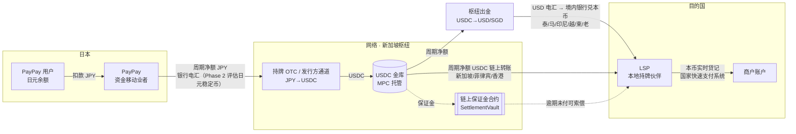

# 04 · 稳定币清结算层

> 一句话：**稳定币只在机构之间流动**——钱包用户付日元、商户收本币，中间的"跨境清结算资产"由银行电汇/预付资金换成稳定币。这样既拿到稳定币 7×24、T+0、可编程、可审计的好处，又避开多数东南亚国家"加密资产不得作为支付手段"的红线。

## 4.1 为什么在这一层用稳定币

Alipay+ 一类网络今天的跨境结算链路（简化）：

```
钱包(日本) ──JPY 银行汇款/预付──▶ 网络结算行(USD) ──SWIFT/代理行──▶ 收单方(当地) ──▶ 商户
           T+1~T+2，周末/节假日停摆；每个币种对都要开结算账户、预付头寸
```

痛点：
1. **预付资金沉淀**：网络要在每个国家的收单方/结算行放头寸，或者让收单方承担 T+1~T+3 的垫付；
2. **工作日依赖**：周五晚的交易要到周一才能结算，长假（春节、宋干节、开斋节）更长；
3. **代理行成本与不透明**：SWIFT 链路每层收费，到账时间与金额不可预测；
4. **对账三方各自记账**，差错处理靠文件往返。

稳定币作为机构间结算资产：

| 维度 | 银行电汇（现状） | 稳定币（本方案） |
|---|---|---|
| 结算时效 | T+1~T+2，工作日 | 分钟级，7×24（链上终局 + 出入金伙伴的本币到账时间） |
| 预付/垫付 | 每国、每伙伴单独放头寸 | 统一 USDC 金库 + 链上保证金，跨国共享流动性 |
| 透明度 | 各自账本 | 结算交易链上可验证；批次 manifest 哈希上链 |
| 可编程 | 无 | 保证金合约、到期自动兑付、按笔/按批原子结算 |
| 新增一个国家 | 开户、签代理行、外汇额度 | 新 LSP 接入稳定币钱包 + 本地出入金能力 |
| 主要新风险 | — | 发行方/脱锚、链与托管风险、出入金合规、各国对加密资产的监管边界 |

## 4.2 资金与资产流（推荐的 Phase 1 结构）



* **用户 ↔ 钱包**：日元，钱包自身的牌照下完成（PayPay 是日本的资金移动业者）；
* **钱包 ↔ 网络**：每个结算周期一次净额。Phase 1 由 PayPay 用日元银行电汇到网络**离岸枢纽**（新加坡）的结算账户，在枢纽经持牌 OTC / 发行方机构通道完成 JPY→USDC——这样避开日本境内外国稳定币每笔约 100 万日元的上限，也不需要日本法人收付日元；Phase 2 评估日元稳定币（信托型 JPYSC 公链流通后、或三大行共同稳定币）链上转账，实现日内结算（见 4.10 与 06 章）；
* **网络 ↔ LSP**：按目的国监管分两种——
  * 稳定币可以落地的司法辖区（新加坡、菲律宾、香港）：USDC 链上净额直接付给 LSP（或其持牌出金伙伴，如 StraitsX、Coins.ph）；
  * 稳定币不宜入境的国家（泰国、马来西亚、印尼、越南、柬埔寨、老挝）：枢纽把 USDC 换成 USD（或 SGD），电汇给 LSP 的结算账户（泰国可评估 NRQC 非居民泰铢账户），由**境内持牌银行**兑换本币。稳定币在这些国家只停留在离岸一侧，带来的仍是 7×24 的枢纽流动性和链上可审计的批次记录；保证金合约可由 LSP 的离岸关联主体（例如其新加坡分行）持有索偿权；
* **LSP ↔ 商户**：本币，走目的国国家快速支付系统，**与稳定币无关**。

## 4.3 结算模型比较

| 模型 | 做法 | 优点 | 缺点 | 适用 |
|---|---|---|---|---|
| A. 周期净额（推荐起步） | LSP 实时垫付本币；周期末网络按参与者轧差，一笔 USDC 偿付 | 链上笔数少、兑换次数少、易对账 | LSP 有一个周期的信用敞口 → 用保证金合约覆盖 | Phase 1 |
| B. 按笔链上结算 | 每笔交易成功即触发 USDC 转账 | 无信用敞口 | 链上费用、每笔兑换、隐私（商户流水上链）、链拥堵时影响支付成功率 | 大额 B2B，不适合零售 |
| C. LSP 预存本币头寸 | 网络在 LSP 处预存本币（传统预付） | LSP 无敞口 | 资金沉淀在每个国家、外汇管制下难以调回 | 外汇管制最严国家的过渡方案 |
| D. 本币稳定币 PvP | USDC↔本币稳定币链上原子交换后直接偿付 | 消除 FX 结算风险，可编程 | 本币稳定币稀缺、监管未完全落地 | Phase 3 |

模型 A 的关键是**缩短周期 + 保证金**：稳定币 7×24 可用，周期可以从"日"缩到"小时"，LSP 敞口同比例缩小。

## 4.4 链上保证金合约（SettlementVault）

源码：[`contracts/SettlementVault.sol`](../contracts/SettlementVault.sol)（设计草图，未审计；含 ganache 上的测试 `contracts/test/vault.test.cjs`）。

机制：
1. 网络为每个 LSP 在合约里存入 USDC **保证金**（≈ 该 LSP 一个结算周期的峰值交易额 × 安全系数）；
2. 每个周期网络用 EIP-712 签发**累计应付声明**：`Statement(partner, cumulativeOwed, asOf)`，LSP 保存最新一份——它是可以在链上强制执行的欠条；
3. 正常情况下网络调用 `settle(batchId, manifestHash, partners[], amounts[])` 原子付款，合约累计 `paid[partner]`，同一 `batchId` 不能重复结算；`manifestHash` 是逐笔明细文件的哈希，用于事后举证；
4. 若网络在 `asOf + claimDelay`（例如 24 小时）后仍未付清，LSP 自行调用 `claim()` 出示声明，合约从其保证金里支付 `cumulativeOwed − paid`（以保证金余额为上限）；
5. 网络撤回保证金要先 `requestRelease`，等待 `claimDelay` 才能 `executeRelease`，保证 LSP 有时间先行索偿。

这让 LSP 对网络的信用风险从"相信对方会付钱"变成"相信合约代码 + 稳定币发行方"，是 LSP 愿意先垫付本币的前提。注意事项：
* 所有对 LSP 的付款都必须经 `settle()`，否则 `paid` 不更新会造成重复索偿；
* 声明是累计值，旧声明重放无效；声明只能由合约登记的签名者签发，私钥放 HSM/MPC；
* 退款导致 LSP 反欠网络时（净额为负），本草图不处理，生产版本需要双向记账或用下一周期抵扣。

## 4.5 流动性测算方法

记号（以 USD 等值计）：
* `G_i`：LSP *i* 的日均出境交易额；`k`：峰值系数（p99 日 / 均值日，旅游旺季可达 2–3）；
* `c`：结算周期（天）；`L`：钱包付款时滞（天，银行 T+1 → 1；JPY 稳定币日内 → ≈0；钱包预付 → 负数）。

| 资金池 | 规模估算 | 谁出资 |
|---|---|---|
| LSP 本币垫付头寸 | `G_i × c × k` | LSP（由保证金覆盖其信用风险） |
| 链上保证金（每个 LSP） | `G_i × c × k` | 网络 |
| 网络 USDC 金库浮存 | `Σ G_i × (c + L) × k` | 网络（或 LP 授信） |

示例（演示数字，非预测）：出境日均 20 万美元、`k=1.5`：
* 日结 + 钱包 T+1 付款：保证金 30 万、金库浮存 60 万美元；
* 小时结 + 钱包 T+1：保证金 1.25 万、浮存 ≈31 万——**瓶颈变成钱包付款时滞**；
* 小时结 + 钱包用 JPY 稳定币在下一个小时内付款（`L≈1/24`）：浮存 = 20 万 × 2/24 × 1.5 ≈ 2.5 万美元。

结论：稳定币带来的流动性节约，一半来自"缩短周期"，另一半要靠"钱包侧也上链"。双向业务（东南亚钱包到日本商户消费）上线后，同一走廊两个方向的头寸可以互抵，进一步降低浮存。

## 4.6 汇率（FX）

* **报价**：两段 RFQ——`JPY→USDC`（日本侧 LP）和 `USDC→本币`（目的国 LP/LSP），取 firm quote（带有效期的可成交价），**不使用链上 AMM**（深度不足、价格可被操纵、对手方不可 KYC，不符合持牌机构的最佳执行与 AML 要求）；
* **锁价**：报价有效期 = min(网络 TTL, 两段 LP 的有效期)，用户确认时间超出需重报；网络在报价有效期内承担价格风险，在结算周期末统一与 LP 成交（批量成交降低价差）；
* **取整**：稳定币金额按 6 位小数**向上**取整，日元向上取整到 1 日元，保证商户足额收款（参考实现 `src/fx/quote.ts` 有对应测试）；
* **收入口径**：`fxMargin`（汇差）与 `networkFee`（网络费）分开入账，本金（商户货款）不是收入；
* **本币不可离岸的国家**（泰铢、印尼盾、马来西亚林吉特、越南盾等，有离岸交割限制）：`USDC→本币` 只能由**境内持牌机构**完成，网络拿到的是该机构的报价，不能自己在境外做本币头寸。

## 4.7 链与托管选择标准

| 标准 | 说明 |
|---|---|
| 原生发行 | 选稳定币发行方**原生发行**的链，避免跨链桥风险 |
| 终局性与费用 | 秒级终局、单笔费用可忽略；结算批次在链拥堵时可延后，但不能影响前台支付 |
| 合规能力 | 发行方冻结/黑名单功能（对机构是双刃剑：可配合执法，但也是冻结风险）；Travel Rule 生态支持 |
| 伙伴覆盖 | 各国 LSP、LP、托管商都支持 |
| 运维 | 节点/RPC 冗余、监控、MPC/HSM 托管、提现白名单、多签审批 |

建议：同一稳定币至少支持两条链（主 + 备），金库按链分仓；LSP 地址白名单 + 首次转账小额验证。

## 4.8 对账

三方 + 链上四方对账，每周期自动执行：
1. 网络账本（`reference-impl/src/ledger`）逐笔 `capture` 分录；
2. MPP 交易文件（`paymentRequestId` ↔ `paymentId`）；
3. LSP 本地轨道日终文件（`railRef`）；
4. 链上 `BatchSettled` 事件（`batchId`、`manifestHash`、金额）与托管钱包流水。

差异分类：长款/短款、状态不一致（U 未决）、汇率差、链上未确认；每类有处理时限与责任方。

## 4.9 风险与备援

| 风险 | 缓释 |
|---|---|
| 稳定币脱锚 | 金库只持有储备透明、受监管发行的稳定币；设定脱锚阈值（例如偏离 50 bps）自动暂停用该资产结算，切换备用资产/法币电汇 |
| 发行方冻结地址 | 机构地址 KYC 登记、制裁筛查前置；分仓；与发行方建立机构账户直接铸赎 |
| 链故障/拥堵 | 主备链；结算可延后，前台支付不受影响（LSP 垫付由保证金覆盖） |
| 私钥 | MPC/HSM、多签、提现白名单、额度分级审批 |
| LP 违约/无法兑出本币 | 每国至少两家出入金伙伴；LSP 本币头寸警戒线 |
| 监管变化 | 结算资产可替换（同一套净额/对账流程可以用法币电汇执行）——这是架构上必须保留的"降级模式" |

## 4.10 结算资产与出入金：2026-10 现状

### 可用的结算资产

| 资产 | 现状（2026-10） | 在方案中的角色 |
|---|---|---|
| **USDC** | 流动性最深；日本经 SBI VC Trade（電子決済手段等取引業者 关东财务局长第 00001 号，2025-03-04 登记）合法处理，2025-03-26 全面开始，但外国稳定币在日本境内**每笔约 100 万日元上限**；Circle 自有 L1 **Arc** 2026-09-16 主网上线（SBI、住友商事、Visa、Mastercard 等为验证者）；Visa、Mastercard 均已接受 USDC 结算 | **主结算资产**（在离岸枢纽使用） |
| **RLUSD** | 2026-06-24 经 SBI VC Trade 在日本上线（Ethereum）；Mastercard 接受 | 发行方冗余 / 备用 |
| **JPYC** | 资金移动业者发行的日元币，累计发行额 2026-09-18 超过 100 亿日元，链上流通约 28 亿日元（2026-08-18）；单笔额度受资金移动业类别限制（待核实） | 小额 PoC、开发者生态；不做大额净额 |
| **JPYSC**（SBI 新生信托，信托型） | 2026-06-24 发行，余额约 201 亿日元（2026-09-07），**目前只能在 SBI VC Trade 账户内使用，不能出库到外部钱包** | 中期评估：公链流通后作为钱包→网络的日元腿 |
| **三大行共同日元稳定币**（信托型） | 2026-06-10 宣布 2026 财年内开始实际交易，初期用于证券结算；受托信托银行与平台未定 | 远期 |
| **XSGD / XUSD**（StraitsX） | MAS MPI，发行 SCS 原则性批准；XSGD 约 1,300 万美元（2025-12）；Alipay+ × Grab 稳定币清算先例 | 新加坡最后一跳可选 |
| **PHPC**（Coins.ph） | 已从 BSP 沙盒毕业 | 菲律宾最后一跳可选 |
| **HKDAP**（Anchorpoint） | HKMA 2026-04-10 首批牌照（Anchorpoint、HSBC），第一阶段只面向机构 | 香港第二枢纽候选 |
| 泰铢 / 林吉特 / 印尼盾稳定币 | 泰国 BOT 2026 年内征求意见、第一阶段仅限金融机构结算；马来西亚仅 DAIH 批发试点；印尼稳定币不能作为支付工具 | 监管落地后再评估 |
| USDT | 日本无登记业者处理 | 不使用 |

### 出金能力

| 国家/地区 | 稳定币 → 本币 | 建议 |
|---|---|---|
| 新加坡 | StraitsX（XSGD/XUSD 铸赎）、CPN 新加坡出金（2026-02 上线）、dtcpay、OKX SG | **结算枢纽**：网络主体 + USDC 金库 + 稳定币出入金 |
| 菲律宾 | Coins.ph（CPN BFI，覆盖 120 多家银行与电子钱包，PHP 出金）、Munify（2026-06 接入 CPN） | 可直接用稳定币出金 |
| 香港 | CPN 香港通道、Anchorpoint | 第二枢纽候选 |
| 泰国、马来西亚、印尼、越南、柬埔寨、老挝 | **不建议稳定币直接入境**（泰国 SEC 支付禁令与 2026 Q4 稳定币资金流管控、马来西亚数字资产不是支付工具且林吉特不得离岸、印尼稳定币不能作支付工具、越南试点排除法币稳定币且截至 2026-03 无交易所获牌、老挝禁止金融机构从事加密业务） | 枢纽把 USDC 换成 USD（或 SGD），经结算银行付给当地 LSP，由境内持牌银行兑换本币入账；泰国可评估 NRQC 非居民泰铢账户 |
| 日本 | SBI VC Trade（USDC、RLUSD 每笔约 100 万日元） | 不在日本境内做大额 USDC 结算；JPY → USDC 在枢纽完成 |

### 先例给出的设计启示

* **卡组织已经这样做了**：Visa（美国 USDC 结算，年化运行率 35 亿美元以上）与 Mastercard（2026-06-03 起发卡方、收单方可选 USDC、PYUSD、USDG、USDP、RLUSD 等结算，**支持周末和节假日结算**）都只把稳定币用作机构间结算义务，持卡人和商户两端都是法币——与本方案同构，是向监管解释结构的最好范本；周末、节假日结算窗口正好对应东南亚长假期间预付资金占用最大的问题。
* **CPN 的规则手册模式**：网络运营方只提供技术与规则，不持有资金；参与者分付款方（OFI）、收款方（BFI）两种角色。本网络可以照搬"规则 + 持牌参与方"的定位，并在菲律宾、新加坡直接复用 CPN 的出金参与方。
* **Project Agorá（BIS 2026-05-27 报告）**：每种货币的法律债权留在本国账本，跨账本靠编排做原子结算——本方案把本币腿留在 LSP 的账本，只把跨境净额放在稳定币上，是同一思路的私营版本。
* **Project Pax**：前端兼容 SWIFT / ISO 20022 报文、后端用稳定币结算，参与方几乎不用改流程——本网络对 LSP 的接口采用 ISO 20022 风格字段。
* **只用发行方原生的跨链方案**（如 CCTP），不用第三方流动性池桥。

### Travel Rule 门槛（机构间稳定币转账）

| 法域 | 门槛 | 置信度 |
|---|---|---|
| 日本 | 未查到门槛（框架：犯収法，2023-06-01 起） | 框架高 / 门槛低 |
| 新加坡 | S$1,500（MAS Notice PSN02） | 中 |
| 菲律宾 | PHP 50,000（BSP Circular 1108） | 中 |
| 泰国 | 0（所有 VASP 转账） | 低 |

结论：每一笔机构间结算转账都按 Travel Rule 交换信息；底层零售交易的付款人、收款人信息走支付报文（FATF R.16 已于 2025-06-18 修订为 "Payment transparency"，各国 2030 年底前落实；钱包扫码支付是否适用卡类豁免尚无定论，按"每笔都带结构化付款人和商户信息"设计）。
