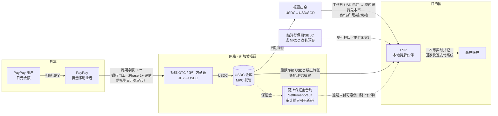

# 04 · 稳定币清结算层

> 一句话：**稳定币只在机构之间流动**——钱包用户付日元、商户收本币，中间的"跨境清结算资产"由银行电汇/预付资金换成稳定币，避开多数东南亚国家"加密资产不得作为支付手段"的红线。**价值因国而异**：新加坡、菲律宾的伙伴链上收 USDC，拿到 7×24、日内多次结算；泰国、马来西亚、印尼、越南、柬埔寨、老挝（含 Phase 1 泰国）的伙伴仍收工作日 USD 电汇加境内换汇（T+0–T+1 工作日），稳定币只带来枢纽侧多国共享流动性和链上批次存证，还多出 JPY→USDC→USD 两次兑换（10 章假设约 15 bps）。这些国家是否经 USDC 中转，由 10 章 10.6 法币基准对照的实测报价决定。

## 4.1 为什么在这一层用稳定币

Alipay+ 一类网络今天的跨境结算链路（简化）：

```
钱包(日本) ──JPY 银行汇款/预付──▶ 网络结算行(USD) ──SWIFT/代理行──▶ 收单方(当地) ──▶ 商户
           T+1~T+2，周末/节假日停摆；每个币种对都要开结算账户、预付头寸
```

Alipay+ 的标准结算是合同约定的银行法币（钱包 T+1、收单方 T+2），但已有稳定币清算的个案先例：2024-11 起新加坡 StraitsX × Alipay+ × Grab 在 Avalanche 上用 XSGD + PBM 清结算、商户收 SGD（个案试点；未见 Alipay+ 对外部钱包/收单方的商业结算改用稳定币）；Ant International 还参与 MAS BLOOM，旗下 Alipay (Europe) 2025-09 获 MiCA EMT 授权（欧元代币 BREUR，仅限关联方批发使用）。所以"机构间稳定币结算"本身不是差异化；差异化在于日本钱包可付泰、越、印尼国家码，加上锁定报价（以及对链上伙伴的日内结算），见 [01 章 1.1](01-architecture.md)。

痛点：
1. **预付资金沉淀**：网络要在每个国家的收单方/结算行放头寸，或者让收单方承担 T+1~T+3 的垫付；
2. **工作日依赖**：周五晚的交易要到周一才能结算，长假（春节、宋干节、开斋节）更长——稳定币只为链上收款的伙伴解决这一点，电汇伙伴照旧；
3. **代理行成本与不透明**：SWIFT 链路每层收费，到账时间与金额不可预测——电汇国家的最后一段仍走这条链路；
4. **对账三方各自记账**，差错处理靠文件往返。

稳定币作为机构间结算资产：

| 维度 | 银行电汇（现状） | 稳定币（本方案） |
|---|---|---|
| 结算时效 | T+1~T+2，工作日 | 链上伙伴（新/菲）：分钟级、7×24（链上终局 + 出金伙伴的本币到账时间）；电汇伙伴（泰/马/印尼/越/柬/老）：仍是工作日 USD 电汇 + 境内兑换（T+0–T+1 工作日） |
| 预付/垫付 | 每国、每伙伴单独放头寸 | 统一 USDC 金库，跨国共享流动性；垫付担保：链上伙伴用链上保证金合约，电汇伙伴用结算行保函/SBLC（泰国也可用 NRQC 泰铢预存）（4.4） |
| 透明度 | 各自账本 | 结算交易链上可验证；批次 manifest 哈希上链 |
| 可编程 | 无 | 保证金合约、到期自动兑付、按笔/按批原子结算（只对链上伙伴生效） |
| 新增一个国家 | 开户、签代理行、外汇额度 | 链上国家：新 LSP 接入稳定币钱包 + 本地出金能力；电汇国家：仍要结算行、电汇路径与外汇安排，与现状相同 |
| 主要新风险 | — | 发行方/脱锚、链与托管风险、出入金合规、各国对加密资产的监管边界；电汇国家多两次兑换（约 15 bps，假设） |

## 4.2 资金与资产流（推荐的 Phase 1 结构）



* **用户 ↔ 钱包**：日元，钱包自身的牌照下完成（PayPay 是日本的资金移动业者）；
* **钱包 ↔ 网络**：每个结算周期一次净额。Phase 1 由 PayPay 用日元银行电汇到网络**离岸枢纽**（新加坡）的结算账户，在枢纽经持牌 OTC / 发行方机构通道完成 JPY→USDC。JPY→USDC 放在离岸完成的理由：日本境内外国稳定币只能由登记的電子決済手段等取引業者经手（目前只查到 SBI VC Trade，2025-03-04 登记），其说明书规定外国電子決済手段总预托额超过上限时可限制新的预托与购买；另有报道称境内转移每笔约 100 万日元上限，但府令原文未核实，可能与"国外電子決済手段移転等調書"的 100 万日元报告门槛混淆（须日本律师确认）；同时也避免网络的日本实体代收日元而落入 2026-06-01 起的"跨境收纳代行"规制。日元腿维持银行电汇：JPYC 只用于小额 PoC；Phase 2+ 再评估信托型日元稳定币（JPYSC 上公链流通后、三大行共同币开放支付/跨境场景后，最早 2027），见 4.10 与 06 章；
* **网络 ↔ LSP**：按目的国监管分两种——
  * 稳定币可以落地的司法辖区（新加坡、菲律宾）：USDC 链上净额直接付给 LSP（或其持牌出金伙伴，如 StraitsX、Coins.ph），可 7×24、日内多次结算。香港是第二枢纽候选，不是目的国；
  * 稳定币不宜入境的国家（泰国、马来西亚、印尼、越南、柬埔寨、老挝）：枢纽把 USDC 换成 USD（或 SGD），在工作日电汇给 LSP 的结算账户，由**境内持牌银行**兑换本币（T+0–T+1 工作日）。泰国的周末/节假日缺口：网络离岸主体可申请加入 BOT 的 NRQC 计划，在其泰国非居民泰铢账户（NRBA）中持有不受日终上限约束的泰铢预存池（相当于 4.3 模型 C；NRQC 是 BOT 对非居民的资格，不是账户类型）。稳定币在这些国家只停留在离岸一侧，带来的是枢纽侧多国共享流动性和链上批次记录，**不是伙伴侧 7×24**；垫付担保用结算行保函/SBLC（泰国也可用 NRQC 泰铢预存），不用链上保证金合约（4.4）；伙伴的负净额（退款多于付款）也经出金方以电汇收回，不收稳定币；
* **LSP ↔ 商户**：本币，走目的国国家快速支付系统，**与稳定币无关**；
* **枢纽牌照**：枢纽向日本 PayPay 收日元、持有并转出 USDC、向境外 LSP 付款，客户全在新加坡境外；不持 PS Act 牌照即落入 DTSP 制度（FSMA 第 9 部分，2025-06-30 生效、无过渡期）。所以要么申请 MPI（跨境汇款 + DPT 服务），要么由持牌的 StraitsX / dtcpay 做稳定币兑换与托管、网络只做规则与技术。新加坡法律意见是 Phase 0 阻断项（06 章 6.3）。

## 4.3 结算模型比较

| 模型 | 做法 | 优点 | 缺点 | 适用 |
|---|---|---|---|---|
| A. 周期净额（推荐起步） | LSP 实时垫付本币；周期末网络按参与者轧差，每个伙伴一笔偿付（链上 USDC 或枢纽出金后 USD 电汇） | 链上笔数少、兑换次数少、易对账 | LSP 有约 `(c + d)` 的信用敞口（4.5）→ 链上伙伴用保证金合约、电汇伙伴用结算行保函/SBLC 覆盖 | Phase 1 |
| B. 按笔链上结算 | 每笔交易成功即触发 USDC 转账 | 无信用敞口 | 链上费用、每笔兑换、隐私（商户流水上链）、链拥堵时影响支付成功率；只适用于链上伙伴 | 大额 B2B，不适合零售 |
| C. 预存本币头寸 | 网络在 LSP 处预存本币（传统预付）；泰国可由网络离岸主体经 NRQC 在 NRBA 持泰铢预存池 | LSP 无敞口；可覆盖电汇停摆的周末/节假日 | 资金沉淀在每个国家、外汇管制下难以调回 | 外汇管制最严国家的过渡方案；泰国周末/节假日补充 |
| D. 本币稳定币 PvP | USDC↔本币稳定币链上原子交换后直接偿付 | 消除 FX 结算风险，可编程 | 本币稳定币稀缺、监管未完全落地 | Phase 3 |

模型 A 的关键是**缩短周期 + 担保**，但缩短周期**只适用于链上收款的伙伴**（新加坡、菲律宾）：稳定币 7×24 可用，周期可以从"日"缩到"小时"，担保规模随之缩小。电汇伙伴（Phase 1 泰国）按泰国工作日日结，截止时间与节假日日历对齐结算行，不做小时结——经 USD 电汇做不到小时结，而且 10 章电汇费按批分摊，批次越多每笔越贵。

## 4.4 链上保证金合约（SettlementVault）

源码：[`contracts/SettlementVault.sol`](../contracts/SettlementVault.sol)（设计草图，**未审计**）；测试 `contracts/test/vault.test.cjs` 用 solc-js + ganache + ethers 在进程内跑 9 个用例，运行 `cd contracts && npm install && npm test`（安装依赖需联网）。

**使用规则**：审计前只用于链上收款的伙伴（新加坡、菲律宾）。电汇伙伴（Phase 1 泰国等）的垫付风险改用结算行的银行保函/SBLC 覆盖（泰国也可用 NRQC 泰铢预存）。合约已有 `recordReceipt`，电汇付款经伙伴签名回执后可计入"已付"，不会被重复索偿；但 `claim()` 支付的是 USDC，与"稳定币不入境"矛盾，除非索偿权由 LSP 的离岸关联主体持有。

机制（按合约现状）：
1. **保证金**：网络用 `fundGuarantee(partner, amount)` 为每个已登记（`addPartner`）的 LSP 存入 USDC 保证金，规模 ≈ `G_i × (c + d) × k`（4.5）；
2. **累计应付声明**：每个周期网络用 EIP-712 签发 `Statement(partner, cumulativeOwed, asOf)`，LSP 保存最新一份——它是可以在链上强制执行的欠条。签名者为合约登记的 `statementSigner`，私钥放 HSM/MPC；
3. **结算**：`settle(batchId, manifestHash, to[], cumulativeTargets[])` 按**累计目标**付款，每个伙伴只付 `target − paid`，所以先有索偿、后到的 settle 不会重复付款；同一 `batchId` 不能重复结算；`manifestHash` 是逐笔明细文件的哈希，随 `BatchSettled` 事件上链，用于事后举证；
4. **库外付款回执**：`recordReceipt(partner, cumulativeReceived, 签名)` 接收伙伴签名的 EIP-712 `Receipt(partner, cumulativeReceived)`，把库外付款（例如法币电汇）计入 `paid`；任何人都可提交，只会抬高 `paid`；
5. **索偿**：`claim(cumulativeOwed, asOf, 签名)` 在 `asOf + claimDelay` 之后可用；网络发起撤回保证金期间可立即索偿。合约支付 `cumulativeOwed − paid`，以剩余保证金为上限，USDC 付到伙伴地址；
6. **撤回保证金**：先 `requestRelease`，等 `claimDelay` 后才能 `executeRelease`，保证 LSP 有时间先行索偿；
7. **签名者轮换**：`proposeSigner` 后等 `claimDelay` 才能 `activateSigner`；旧签名者只对 `asOf < rotatedAt` 的声明继续有效；
8. **参数与防护**：`claimDelay` 部署时设定，限定在 1 小时–30 天；链 ID 变化时重新计算 EIP-712 domain separator（分叉保护）。

这让 LSP 对网络的信用风险从"相信对方会付钱"变成"相信合约代码 + 稳定币发行方"，是链上伙伴愿意先垫付本币的前提。注意事项：
* 对 LSP 的每笔付款都必须经 `settle()` 或 `recordReceipt()` 计入 `paid`，否则会被重复索偿；
* 声明是累计值，旧声明重放无效（`cumulativeOwed ≤ paid` 时无可索偿）；
* **LSP 规则**：最新签名声明或 settle 逾期超过一个周期，LSP 即停止为本网络垫付。没被签名声明覆盖的入账不受保证金保护；
* 若要对电汇伙伴也用合约担保（推断，须审计与法律确认）：LSP 须按合同及时签收款回执，否则电汇无法计入 `paid`；`claimDelay` 不得短于最长电汇在途时间加节假日，否则电汇还在路上就能合法索偿；`claimDelay` 是整个合约部署时定下的单一参数，电汇伙伴如需更长的 `claimDelay`，须单独部署一份合约；
* **负净额**（退款多于付款）：合约草图不处理。参考实现的结算引擎为该伙伴出具回收指令：链上伙伴以 USDC 回款；电汇伙伴经离岸出金方以 USD 电汇回款，不向其收取稳定币。生产版本需要双向记账或在下一周期抵扣；
* **生产前还缺**：`pause()` 与多签守护者、伙伴停用（`deactivatePartner`）、审计；`operator` 地址部署后不可更换。签名私钥与运营私钥分离，都放 HSM/MPC，定期演练轮换。

## 4.5 流动性测算方法

记号（以 USD 等值计）：
* `G_i`：LSP *i* 的日均出境交易额；`k`：峰值系数（p99 日 / 均值日，旅游旺季可达 2–3）；
* `c`：结算周期（天）；`L`：钱包付款时滞（天，银行 T+1 → 1；JPY 稳定币日内 → ≈0；钱包预付 → 负数）；
* `d`：LSP 发现声明/结算逾期并停止垫付所需时间（天）。链上伙伴取 1 个周期；电汇伙伴至少 1 个工作日 + 最长连休。

| 资金池 | 规模估算 | 谁出资 |
|---|---|---|
| LSP 本币垫付头寸 | `G_i × c × k`（电汇伙伴另加电汇在途与节假日天数） | LSP（由担保覆盖其信用风险） |
| 垫付担保（每个 LSP）：链上保证金，或结算行保函/SBLC、NRQC 泰铢预存 | `G_i × (c + d) × k` | 网络 |
| 网络 USDC 金库浮存 | `Σ G_i × (c + L) × k` | 网络（或 LP 授信） |

示例（演示数字，非预测）：出境日均 20 万美元、`k=1.5`：
* 链上伙伴，日结 + 钱包 T+1（`c=1`，`d=1`，`L=1`）：保证金 20 万 × 2 × 1.5 = 60 万、金库浮存 60 万美元；
* 电汇伙伴（Phase 1 泰国），工作日日结 + 钱包 T+1，假设 `d=4`（1 个工作日 + 3 天连休，实际按结算行节假日日历取最长连休）：保函/SBLC 或预存 20 万 × 5 × 1.5 = 150 万、金库浮存 60 万美元；
* 链上伙伴，小时结 + 钱包 T+1（`c=d=1/24`）：保证金 20 万 × 2/24 × 1.5 = 2.5 万、浮存 = 20 万 × 25/24 × 1.5 ≈ 31 万——**瓶颈变成钱包付款时滞**；小时结只适用于链上伙伴；
* 链上伙伴，小时结 + 钱包用 JPY 稳定币在下一个小时内付款（`L≈1/24`）：浮存 = 20 万 × 2/24 × 1.5 ≈ 2.5 万美元。**这一情景依赖最早 2027 年才可能可用的银行系日元稳定币，当前没有可用资产**（JPYC 每次发行 ≤ 100 万日元，不承载 PayPay 日净额，见 4.10）。

结论：流动性节约来自"缩短周期"和"钱包侧也上链"，但前者只对链上伙伴可行，后者 2027 年前没有可用工具。对按工作日电汇日结的泰国，担保与浮存规模与纯法币路径大致相当（推断），稳定币的增益主要是多国共用一个 USDC 池；是否值得多两次兑换，由 10 章 10.6 法币基准对照决定。双向业务（东南亚钱包到日本商户消费）上线后，同一走廊两个方向的头寸可以互抵，进一步降低浮存。

## 4.6 汇率（FX）

* **报价**：两段 RFQ——`JPY→USDC`（枢纽侧持牌 OTC / 发行方通道）和 `USDC→本币`（链上国家为出金方；电汇国家为 USDC→USD 出金加境内结算行 USD→本币），取 firm quote（带有效期的可成交价），**不使用链上 AMM**（深度不足、价格可被操纵、对手方不可 KYC，不符合持牌机构的最佳执行与 AML 要求）；
* **锁价**：报价有效期 = min(网络 TTL, 两段 LP 的有效期, 码自身有效期)，用户确认超时需重报（参考实现：LP 报价有效 30 秒、网络 TTL 60 秒）。LP 的 firm quote 只在 30–60 秒内有效。若在周期末批量成交，网络从报价到成交之间持有敞口（日结 + PayPay T+1 + 周末或长假，最长可达 3–4 天；按原汇率退款（03 章 3.4 方案 A）会再延长）。二选一：(a) 按笔或按分钟与 LP 背靠背成交，报价即成交，点差较高；(b) 批量成交，同时设敞口限额并对冲。泰铢、林吉特、印尼盾不能在离岸对冲，只能与在岸银行做。电汇国家的本币腿，须由境内结算行书面承诺"交易日锁价、T+n 交割"，否则不能向用户承诺锁定汇率。对冲成本列入 10 章 10.2 的"FX 敞口/对冲成本"（假设）。参考实现的再平衡只生成指令（周期报告中的 `rebalance`），不执行兑换；
* **取整**：稳定币金额按 6 位小数**向上**取整，日元向上取整到 1 日元，保证商户足额收款（参考实现 `src/fx/quote.ts` 有对应测试）；
* **收入口径**：`fxMargin`（汇差）与 `networkFee`（网络费）分开入账，本金（商户货款）不是收入；
* **本币不可离岸的国家**（泰铢、印尼盾、马来西亚林吉特、越南盾等，有离岸交割限制）：`USDC→本币` 只能由**境内持牌机构**完成，网络拿到的是该机构的报价，不能自己在境外做本币头寸或对冲。

## 4.7 链与托管选择标准

| 标准 | 说明 |
|---|---|
| 原生发行 | 选稳定币发行方**原生发行**的链，避免跨链桥风险 |
| 终局性与费用 | 秒级终局、单笔费用可忽略；结算批次在链拥堵时可延后，但不能影响前台支付 |
| 合规能力 | 发行方冻结/黑名单功能（对机构是双刃剑：可配合执法，但也是冻结风险）；Travel Rule 生态支持 |
| 伙伴覆盖 | 各国 LSP、LP、托管商都支持 |
| 运维 | 节点/RPC 冗余、监控、MPC/HSM 托管、提现白名单、多签审批 |

建议：同一稳定币至少支持两条链（主 + 备），金库按链分仓；LSP 地址白名单 + 首次转账小额验证。

## 4.8 对账

三方 + 链上四方对账，每周期自动执行：
1. 网络账本（`reference-impl/src/ledger`）逐笔 `capture` 分录；
2. MPP 交易文件（`paymentRequestId` ↔ `paymentId`）；
3. LSP 本地轨道日终文件（`railRef`）；
4. 链上记录：枢纽钱包与托管流水（参考实现每笔链上转账 memo = `instructionId`）；使用保证金合约的伙伴另核 `BatchSettled` 事件（`batchId`、`manifestHash`、金额）；电汇伙伴另核出金方电汇流水（`wireRef`）与伙伴到账确认。

差异分类：长款/短款、状态不一致（U 未决）、汇率差、链上未确认、电汇在途；每类有处理时限与责任方（建议对账差异 T+1 内分派、T+3 内关闭，假设，见 08 章）。

## 4.9 风险与备援

| 风险 | 缓释 |
|---|---|
| 稳定币脱锚 | 金库只持有储备透明、受监管发行的稳定币；设定脱锚阈值（例如偏离 50 bps）自动暂停用该资产结算，切换备用资产/法币电汇 |
| 发行方冻结地址 | 机构地址 KYC 登记、制裁筛查前置；分仓；与发行方建立机构账户直接铸赎 |
| 链故障/拥堵 | 主备链；结算可延后，前台支付不受影响（LSP 垫付由担保覆盖：链上伙伴为保证金合约，电汇伙伴为保函/SBLC（泰国也可用 NRQC 泰铢预存）） |
| 私钥 | MPC/HSM、多签、提现白名单、额度分级审批；声明签名者可经 `claimDelay` 时间锁轮换，暂停/守护者多签与伙伴停用尚未实现（4.4） |
| FX 敞口 | 背靠背成交，或批量成交 + 敞口限额 + 在岸对冲（4.6） |
| 电汇延误/节假日（电汇伙伴） | 截止时间与结算行节假日日历对齐，顺延规则写入合同；NRQC 泰铢预存覆盖周末/长假；LSP 在逾期超过一个周期时停止垫付 |
| LP 违约/无法兑出本币 | 每国至少两家出入金伙伴；LSP 本币头寸警戒线 |
| 监管变化 | 结算资产可替换（同一套净额/对账流程可以用法币电汇执行）——这是架构上必须保留的"降级模式" |

## 4.10 结算资产与出入金：2026-10 现状

### 可用的结算资产

| 资产 | 现状（2026-10） | 在方案中的角色 |
|---|---|---|
| **USDC** | 流动性最深；日本经 SBI VC Trade（電子決済手段等取引業者 关东财务局长第 00001 号，2025-03-04 登记）合法处理，2025-03-26 全面开始；SBI VC Trade 说明书（2026-06 修订）规定外国電子決済手段总预托额超过上限时可限制新的预托与购买；另有报道称日本境内转移每笔约 100 万日元上限，但府令原文未核实，可能与"国外電子決済手段移転等調書"混淆——后者是取引業者向国外转移超过 100 万日元时提交的税务报告，不是上限；Circle 自有 L1 **Arc** 2026-09-16 主网上线（SBI、住友商事、Visa、Mastercard 等为验证者）；Visa、Mastercard 均已接受 USDC 结算 | **主结算资产**（在离岸枢纽使用） |
| **RLUSD** | 2026-06-24 经 SBI VC Trade 在日本上线（Ethereum）；Mastercard 接受 | 发行方冗余 / 备用 |
| **JPYC** | 资金移动业者（2025-08-18 登録）发行的日元币，2025-10-27 正式发行；**每次发行 ≤ 100 万日元且禁止短时连续申请**（2026-05 起），链上转移不限额；累计发行额 2026-09-18 超过 100 亿日元，链上流通约 28 亿日元（2026-08-18）；Ethereum、Avalanche、Kaia | 只用于小额 PoC、开发者生态；不承载 PayPay 日净额 |
| **JPYSC**（SBI 新生信托，信托型） | 2026-06-24 发行，余额约 201 亿日元（2026-09-07），**目前只能在 SBI VC Trade 账户内使用，不能出库到外部钱包** | 中期评估：公链流通后作为钱包→网络的日元腿 |
| **三大行共同日元稳定币**（信托型） | 2026-06 宣布 2026 财年内（2027-03 前）开始法人交易；不同报道称初期用于证券结算或 B2B/跨境结算、平台为 Progmat 或尚未选定 | 远期：银行系日元结算资产候选（信托型是否有单笔/跨境转账上限未核实；初期用途报道不一，支付/跨境开放时间未定） |
| **XSGD / XUSD**（StraitsX） | MAS MPI，发行 SCS 原则性批准（正式 SCS 牌照尚待立法）；XSGD 约 1,300 万美元（2025-12）；StraitsX × Alipay+ × Grab 稳定币清算先例（2024-11，XSGD on Avalanche + PBM，商户收 SGD） | 新加坡最后一跳可选；也是枢纽稳定币兑换与托管的持牌候选方（4.2） |
| **PHPC**（Coins.ph） | 已从 BSP 沙盒毕业 | 菲律宾最后一跳可选 |
| **HKDAP**（Anchorpoint） | HKMA 2026-04-10 首批牌照（Anchorpoint、HSBC），第一阶段只面向机构 | 香港第二枢纽候选 |
| 泰铢 / 林吉特 / 印尼盾稳定币 | 泰国 BOT 2026 年内征求意见、第一阶段仅限金融机构结算；马来西亚：BNM DAIH 批发试点，另有私营 RMJDT（2025-12，监管身份未确认），均不能用于零售支付（RMJDT 一项为推断）；印尼稳定币不能作为支付工具 | 监管落地后再评估 |
| USDT | 未查到日本登记业者处理 | 不使用 |

### 出金能力

| 国家/地区 | 稳定币 → 本币 | 建议 |
|---|---|---|
| 新加坡 | StraitsX（XSGD/XUSD 铸赎）、CPN 新加坡出金（2026-02 上线）、dtcpay、OKX SG | **结算枢纽**：网络主体 + USDC 金库 + 稳定币出入金；须申请 MPI（跨境汇款 + DPT），或由持牌 StraitsX / dtcpay 做兑换与托管（DTSP 制度，见 4.2、06 章 6.3） |
| 菲律宾 | Coins.ph（CPN BFI，覆盖 120 多家银行与电子钱包，PHP 出金）、Munify（2026-06 接入 CPN） | 可直接用稳定币出金 |
| 香港 | CPN 香港通道、Anchorpoint | 第二枢纽候选（不是目的国） |
| 泰国、马来西亚、印尼、越南、老挝 | **不建议稳定币直接入境**（泰国 SEC 支付禁令与 2026 Q4 稳定币资金流管控、马来西亚数字资产不是支付工具且林吉特不得离岸、印尼稳定币不能作支付工具、越南试点排除法币稳定币且截至 2026-03 无交易所获牌、老挝禁止金融机构从事加密业务） | 枢纽把 USDC 换成 USD（或 SGD），在工作日经结算银行付给当地 LSP，由境内持牌银行兑换本币入账；泰国周末/节假日可由网络离岸主体申请加入 NRQC，在其 NRBA 中持泰铢预存池（模型 C）。SCB 与 Lightnet 2024-10 推出稳定币跨境转账服务（所用代币、泰铢出金能力、牌照范围未查到），可在 Phase 0 向 SCB 确认。印尼推荐路径经 Netstars/JPQR Global，在 LCS 框架下由 ACCD 银行按本币直接报价，结算安排随之不同（05 章 5.5） |
| 柬埔寨 | NBC 2024-12 Prakas：持牌银行经 NBC 事前批准可持有锚定传统资产的稳定币（Group 1b，≤ 3% CET1；NBC 原文未核） | 可与 ACLEDA / Sathapana 探讨 NBC 批准下以 USDC 做跨境头寸结算；否则同上走 USD。推荐路径经 Netstars/JPQR Global（JPQR–KHQR 二期，计划中），结算安排随之不同（05 章 5.7） |
| 日本 | SBI VC Trade（USDC、RLUSD；总预托额超上限时可限制新预托与购买；每笔约 100 万日元上限为报道，府令原文未核实）；JPYC EX（每次发行 ≤ 100 万日元） | 不在日本境内做大额 USDC 结算；JPY → USDC 在枢纽完成 |

### 先例给出的设计启示

* **卡组织已经这样做了**：Visa（美国 USDC 结算，年化运行率 35 亿美元以上）与 Mastercard（2026-06-03 起发卡方、收单方可选 USDC、PYUSD、USDG、USDP、RLUSD 等结算，**支持周末和节假日结算**）都只把稳定币用作机构间结算义务，持卡人和商户两端都是法币——与本方案同构，是向监管解释结构的最好范本。周末、节假日结算的思路正好对应东南亚长假期间预付资金占用最大的问题；但截至 2026-10，Mastercard 首批只有美国、拉美参与方，Visa 未见新加坡、日本或东南亚的收单方/发卡方参与，本网络不能依赖卡组织窗口补充流动性。
* **CPN 的规则手册模式**：网络运营方只提供技术与规则，不持有资金；参与者分付款方（OFI）、收款方（BFI）两种角色。本网络可以照搬"规则 + 持牌参与方"的定位，并在菲律宾、新加坡直接复用 CPN 的出金参与方。
* **Project Agorá（BIS 2026-05-27 报告）**：每种货币的法律债权留在本国账本，跨账本靠编排做原子结算——本方案把本币腿留在 LSP 的账本，只把跨境净额放在稳定币上，是同一思路的私营版本。
* **Project Pax**：前端兼容 SWIFT / ISO 20022 报文、后端用稳定币结算，参与方几乎不用改流程——本网络对 LSP 的接口采用 ISO 20022 风格字段。
* **只用发行方原生的跨链方案**（如 CCTP），不用第三方流动性池桥。

### Travel Rule 门槛（机构间稳定币转账）

| 法域 | 门槛 | 置信度 |
|---|---|---|
| 日本 | 未查到门槛（框架：犯収法，2023-06-01 起） | 框架高 / 门槛低 |
| 新加坡 | S$1,500（MAS Notice PSN02） | 中 |
| 菲律宾 | PHP 50,000（BSP Circular 1108） | 中 |
| 泰国 | 0（所有 VASP 转账） | 低 |

结论：每一笔机构间结算转账都按 Travel Rule 交换信息；底层零售交易的付款人、收款人信息走支付报文（FATF R.16 已于 2025-06-18 修订为 "Payment transparency"，各国 2030 年底前落实；钱包扫码支付是否适用卡类豁免尚无定论，按"每笔都带结构化付款人和商户信息"设计）。
