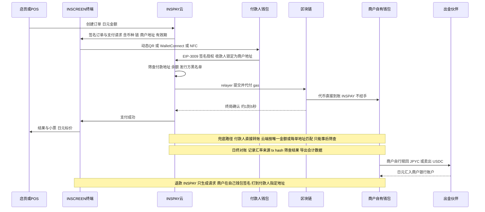

# 11 · INSCREEN 终端受理稳定币：做法与商业模式

> **这是决策文档，不是法律意见或财务预测。** 截至 2026-10-18。本章讨论日本国内商户经 INSCREEN 终端受理稳定币，与 01–10 章的东南亚跨境网络是两个问题（日本侧法规另见 [06 章](06-compliance-risk.md) 6.2）。
> 标注：**事实**（一手或可靠来源，括号内为置信度 高/中/低）、**公司说法**、**推论**、**假设**。"未查到"不等于不存在。来源编号见文末。
> 环境限制：fsa.go.jp、nta.go.jp、coinpost.jp、paymentnavi.com 等 WebFetch 均失败（DNS 或 403），一手资料多数只依据搜索结果摘要，用于对外材料或法律判断前须回原文核对。
> INSCREEN 的硬件规格、现有功能、BOM 和售价本文都没有掌握，凡涉及处均为假设；"0% 手续费 + 月费 ¥2,000" 是创始人的暂定方案，按假设评估。

## 结论先行

* **怎么做：非托管直收（设计 a）。** 终端生成支付请求，付款人在钱包里签 EIP-3009 授权，收款人锁定为商户自有地址；INSPAY 只代付 gas、监听到账，不持私钥、不报价、不兑换、不经手资金。按資金決済法的定义，这是牌照负担最低的做法：INSPAY 原则上不需要電子決済手段等取引業或資金移動業登録，商户收稳定币作为自己商品的对价原则上也不需要登録（推论，低；金融庁没有明文。INSPAY 作为 relayer 保留"提交或不提交"的控制力，这一点怎么定性也没有先例。上线前须律师意见和 FinTech サポートデスク事前相談）。商户侧的上线步骤见 2.3 节。
* **币种：首发 JPYC + USDC。** JPYC 走 Kaia、Polygon、Avalanche（日元计价、无汇率风险；发行方自称不收加盟店手续费）；USDC 先上 Polygon，再按出金伙伴 SBI VC Trade 支持的链增加（链清单未查到）。USDT、PYUSD 不原生受理，因为未查到日本登记业者以電子決済手段身份处理它们，境内没有已确认的合法出金通道。这是设计(a) 下的选择，不是市场上的硬约束：Netstars 已对日本商户受理 USDT（架构未公开）。所以这对 INSCREEN 是功能缺口，可以经接入 QR 网关通道补上。JPYSC 目前不能出库，链上终端收不到。
* **商业模式：只收稳定币、"0% + ¥2,000/月"的专用终端，今天在日本不是合理的独立生意。**
  * 需求：推算单店稳定币销售只有 ¥0.3万–7.8万/月（推论，低）。这个推算假设 INSCREEN 有 1,000 家商户、拿下全国两成，而且把 USDT 付款人也算在内；不收 USDT 时会更低。
  * 商户侧：只看月费，稳定币月销售也要 ≥ ¥10.1万才比 PayPay 1.98% 便宜，≥ ¥20.4万才比 Netstars 0.98% 便宜。
  * INSPAY 侧：柜台终端按租赁计（终端 ¥2.5万、安装 ¥8千、获客 ¥3万，均为假设），4% 月流失下按留存加权 60 个月不回本。月费要 ≥ ¥3,670，60 个月期望现金才能打平；而商户要在 ¥3,670 下不亏，稳定币月销售约需 ¥16–23万。
  * 两边同时有缺口。
* **竞争已经到位。**
  * Netstars Stablecoin Pay：2026-07-13 商用，0.98% 非課税，USDC/USDT/JPYC，媒体称可沿用现有终端，日元记账结算 [21]。
  * PayPay×HIVEX×Binance Pay：2026-09-30 起，海外 Binance 用户可在 PayPay 线下店付款，商户零接入 [27][28]。"用 USDT 付"是 Binance 方和媒体的说法，PayPay 日文公告没写币种；费率按 HIVEX 与 PayPay 同率推定为 1.60%/1.98%。
  * USDC 实证：SBI VC×アプラス、JCB×デジタルガレージ×ローソン [17][31]。
  * JPYC 场景下"0%"也不独有：JPYC 自称不收加盟店手续费。
* **创始人的通道判断：**
  * 卡 2–3% 基本对：中小优惠价 1.98%–2.5%，标准价 2.70%–3.25%。
  * "QR 约 1%"与日本商户挂牌价不符：PayPay、经 PayPay 的 Alipay+ 和 HIVEX 是 1.60%–1.98%（税別），d払い、au PAY、メルペイ 约 2.6%。本轮查到唯一接近 1% 的商户价是 Netstars 的稳定币产品 0.98%；"约 1%"也可能指未公开的批发层费率。
  * "Netstars 不如 HIVEX、海外没进展"**部分同意**。入境外国钱包的商户覆盖，HIVEX（借 PayPay 线下加盟店）确实远大于 JPQR Global。但 Netstars 是上市、已扭亏的国内收单聚合商，在面向商户的稳定币受理上领先；海外（柬埔寨、印尼入境）有进展，只是规模小，2026 年未见新增（1.2 节）。
* **建议定位：多通道受理层，稳定币只是其中一种支付方式，不是收费理由。**
  * 单台能算通的结构有三种：①纯软件，装在商户已有设备上，按留存加权约 11 个月回本；②多通道终端，由持牌 PSP 的卡和 QR 分润承担毛利（10 bps 分润是假设，比例未查到）；③机台无现金模块卖断给运营商，约 36 个月回本。
  * 但这只是单台层面。按 ¥200–300万/月 的业务线固定成本（假设），①②仍要每月新增约 120 台和 56 台才能覆盖，36 个月内都不转正。①还有一个前提：商户愿意为手续费以外的理由（新客、记账、多通道）付 ¥2,000。
  * 差异点放在 Netstars 和 PayPay 没覆盖的地方：自托管钱包和 JPYC 用户、付款人离线签名、无人机台、想直接持币的商户。
* **什么会推翻这个结论（3.5 节、第 4 节）：**
  * 典型商户稳定币月销售实测 ≥ ¥12–13万；
  * 每台前期现金降到 ≤ ¥1.5–2万；
  * 商户为新客或营销愿付 ≥ ¥3,670/月（流失 4% 时；流失 2% 时为 ≥ ¥2,680）；
  * 外部条件变化，例如 JPYSC 上公链、Unifi/Kaia 的 JPYC 用户放量。
  * 反方向：如果设计(a) 被认定需要登録，做法改为设计(c)，商户成本须重算。
* **第一步（都便宜，硬件采购放在后面）：** ①金融庁事前相談 + 律师意见（设计 a、relayer 定性）；②向 Netstars、SBI×アプラス、JPYC 要单店月笔数；③秋叶原、难波 10–20 家店的 4 周纯软件试点（约 ¥30–100万）；④30–50 家商户的三方案定价测试；⑤确认 SBI VC Trade 的 USDC 链和限额、JPYC EX 法人赎回规则、Unifi 钱包兼容性。②③④有结果前不采购硬件。

## 1 三类通道对比

| | 信用卡网关 | QR 网关：PayPay（含经 PayPay 的 Alipay+、HIVEX） | Netstars：StarPay / JPQR Global / Stablecoin Pay | INSCREEN 直收稳定币（设计 a） |
|---|---|---|---|---|
| 付款人 | 日本居民与游客的卡；稳定币卡（Slash Card、RedotPay 等）也走这条 | PayPay 用户 7,400 万（2026-05）；入境：Alipay+ 17 国/地区 35 项服务（中），HIVEX 接台湾钱包、WeChat Pay（2025-09-16）、UnionPay App（2026-09-03）、海外 Binance Pay 用户（2026-09-30；USDT 为 Binance 方说法）（事实，高）[27][29] | 国内 25+ QR 品牌（另一来源称国内外 40+）；WeChat Pay（2015 起收单）、Alipay；JPQR Global 入境的印尼、柬埔寨用户；Stablecoin Pay 上线时只支持 MetaMask，Bitget Wallet、imToken 计划中，2026-10 是否已加入未查到（中）[21] | 自托管钱包用户（经 WalletConnect）、JPYC 持有人（Unifi 兼容待确认）；交易所 App 用户大多无法直接扫链上码（推论） |
| 商户手续费 | 中小优惠价 1.98%（stera；STORES Visa/MC 须加入月费 ¥3,300 的中小方案）–2.5%（Square，有条件），标准 2.70%–3.25%（事实，中–高）[30][43]；債権譲渡型一般非課税，经決済代行时可能课税（中）[41] | 1.98% 税別（课税）；全部门店加入ライトプラン（每店 ¥1,980/月）为 1.60%；Alipay+ 固定 1.98%；HIVEX 与 PayPay 同率（事实，高）[28]；d払い、au PAY、メルペイ 约 2.6% 税別 | Stablecoin Pay 0.98% 非課税（事实，高）[21]，是否含兑换点差未查到；StarPay 其他品牌、JPQR Global 的费率未查到 | 0% + 月费 ¥2,000 税別（实付 ¥2,200）（假设） |
| 其他成本 | 终端：stera pack light 月费 0、初期 ¥39,600/台，Square ターミナル ¥39,980，Airペイ 读卡器审查后免费贷与 | 早期振込 0.38% + 振込费（可选） | 媒体称沿用现有终端；入金周期、振込费、月费未查到 | USDC 兑换点差（SBI 販売所买入侧实测约 0.35%，卖出侧未查到）[42]、出金或赎回费、gas、USDC 汇率风险、记账、终端（价格未知） |
| 结算 | 日元，按收单方周期 | 日元，月末締め，可选早期振込 | 外币稳定币也按日元记账结算；周期未查到 | 链上数秒到商户钱包；换日元靠商户自己经 JPYC EX 赎回或在 SBI VC Trade 卖出 |
| 覆盖 / 需求 | 2025 年无现金金额的 82.7%（事实，中）[33] | PayPay 称约 80% 访日游客可用本国支付服务（中）；经 PayPay 受理 Alipay+ 的商户 2024-11 称 300 万以上（公司新闻稿，中）；PayPay 加盟店总数未查到 | StarPay 约 70 万账户（低）；JPQR Global 首批 35 家，后续未披露；Stablecoin Pay 商户数未公开 | 推算全国游客原生稳定币柜台 GMV ¥1.6億–47億/年，占入境消费的 0.002%–0.05%（推论，低；含 USDT 付款人） |
| 监管负担 | 与商户签约的 PSP 须按割賦販売法登録并做加盟店調査，另有 PCI DSS（记忆，低） | PayPayマネー 以資金移動業为法律基础（记忆，未核实）；HIVEX 不与日本商户签约 | Netstars 如何合规收 USDT 并换日元未公开（日本登记业者未见处理 USDT） | INSPAY 与商户原则上无需登録（推论）；换汇由商户自己在持牌业者开户 |
| 退款 / 拒付 | 有 chargeback，拒付风险在商户 | 平台内退款 | 媒体称不正交易风险由 Netstars 承担 | 没有 chargeback；退款是商户签名的一笔新交易 |
| 提供方赚什么 | MDR 减 interchange（约占加盟店手数料 7 成）[32] | MDR；Alipay+、HIVEX 批发层费用未公开 | 0.98% 等 MDR | 月费；可选硬件毛利、收单分润 |

读法：
* 无现金金额 82.7% 走卡、10.2% 走码（2025）[33]，商户的手续费负担主要在卡；INSCREEN 只替代"顾客恰好用稳定币付款"的那一小部分销售，卡和 QR 仍要保留。
* 小商户的市场基准已是"月费 0、约 2%"（stera pack light 2026-09-28 起，但每台初期 ¥39,600）[30]。在稳定币上，基准是 Netstars 的 0.98%，以及 PayPay 上零接入的 Binance 用户付款。0.98% 是非課税；PayPay 1.98% 是税別，约合税込 2.18%。这个税差只对免税事業者、簡易課税的商户有实际意义，一般课税商户可以抵扣进项税。
* 创始人设想的 ¥2,000 月费与 PayPay ライトプラン ¥1,980 同档，但 PayPay 的月费只对单店 PayPay 月流水约 ¥52万以上的商户划算（推论），多数小店实际不付月费。

### 1.1 付款人实际怎么持有稳定币

* **外国游客**
  * 规模：2025 年访日 4,268 万人次、消费 9兆4,549億円（事实，高）[34]；2026 年 1–8 月 −2.7%，中国客月度约 −60%（事实，中–高）。
  * 加密采用度较高的客源：Chainalysis 2025 前 10 名中的越南、菲律宾、印尼，加上本文自定计入的泰国，四国合计约 344 万人次，占 8%。人次是事实（高）；这个分组是推论；回头客会重复计算，不等于人数。
  * 持币者主要在交易所（推论）：海外 Binance 用户已能在 PayPay 付款；稳定币卡全球月消费约 11.7 亿美元（2026-09，Paymentscan 数据经二手引用，中；只算链上约 7.9 亿美元）[35]，在任何刷卡终端都能花。
  * 原生终端真正能服务的是自托管钱包用户（推论），而这批人 Netstars、JCB×DG、SBI×アプラス 也在争。
  * 需求证据：没有找到"游客想用稳定币付款"的调查。Visa 2026 年亚太调查称 16% 受访者过去 12 个月用过稳定币，但不针对访日游客，且为自报（低）。
* **日本居民**
  * JPYC：EX 直接开户约 1.9 万（2026-06），持有地址 13.7 万以上（2026-04-15），链上流通约 28.3 億円（2026-08-18），累计发行超过 100 億円（2026-09-18）（公司说法，中）[15]。
  * Kaia：KAIA DLT Foundation 称 Kaia 上的 JPYC 流通额超过 3.3 億円，超过 Polygon、Ethereum、Avalanche，居各链之首（公司说法，中）[40]。发布月份未见，同期报道提到约 1.9 万账户，推测在 2026-06 前后。若与 8 月总流通 28.3 億円口径相同，四条链中最大的一条至少有约 7.1 億円，所以 3.3 億円只能是更早的数（或口径不同），现状须用链上数据核对。
  * USDC：截至 2026-08 的报道，境内能买 USDC 的仍只有 SBI VC Trade（中）[42]。Coincheck 已于 2025-08-27 登记为第00002号（媒体，中）[20]，未查到它已开始取扱 USDC。持有动机多为 5–10% 的借贷收益，拿来消费有机会成本（推论）。
  * JPYSC：余额约 201 億円（2026-09-07），但只能在 SBI VC Trade 账户内使用（事实，高）[16]。
  * 已有替代：居民的 USDC 已能经 Slash Card（2026-04-20 发卡，媒体，中）在 Visa 终端消费。

### 1.2 Netstars / JPQR 进展与判断

| 方面 | 进展（日期） | 置信度 |
|---|---|---|
| 公司 | 东证 Growth 5590；FY2025 营收 47.88 億円（+22.7%），营业利润 2.93 億円（上期亏损 0.84 億）；2026 中期营收 24.67 億円（+14.3%），营业利润 1.54 億円 [23] | 高 |
| 国内收单 | 2015 年起 WeChat Pay 收单，2018 年起 Alipay；StarPay 聚合 25+ 国内品牌；2023-06 末约 1.5 万社、40 万以上账户（含自販機）；2025-12 末约 70 万账户（第三方摘要，低）；2025-09-16 起「メルペイ・d払い共通QRコード」加盟店可收 WeChat Pay | 中 |
| JPQR（国内标准） | JPQR 是キャッシュレス推進協議会的统一规格，不是 Netstars 的产品。统一规格 2019-03-29 制定、Ver.3.0 2022-11-08；総務省普及事业导入约 1.5 万店（2023 年度末），据総務省资料该事业令和3年度已结束（中）；地方税 eL-QR 采用 JPQR 规格；2025-10-17 的一览显示经 JPQR 窗口申请 PayPay、メルペイ 已暂停 | 中–高 |
| JPQR Global 入境 | Netstars 是交换系统运营方（中）。柬埔寨 KHQR 一期 2025-07-04（大阪）[25]；印尼 QRIS 2025-08-17，首批 35 家商户 [24]；GoPay 2025-09；2025-10-20 起受理加盟申请；2026 年再检索，未见新增国家或商户数（未查到≠不存在） | 高 |
| 出境 / 其他海外 | 日本游客在印尼扫 QRIS：BI 2026-04-22 称已获 FSA 许可、"即将"实施，截至 2026-10 未见上线；KHQR 二期、DuitNow、泰、老、越未见上线；另有卡塔尔 QNB/UPI（2025-09）、柬埔寨 ACLEDA 的 WeChat Pay 网关等 B2B 业务；国際通貨研究所 2026-09 评价日本与东盟联通"进展有限" [26] | 中 |
| 稳定币 | 羽田 USDC 实证（2026-01～02）；Circle Gateway 开发（2026-04-13）；与 Startale 签 MOU 研究 JPYSC（2026-06）；Stablecoin Pay 正式提供（2026-07-13）；ローソン 大崎 POS 联动实证（2026-08-17，ローソン 称视需求再定）[22]；imToken MOU（2026-09） | 高（商用、实证）/ 中（MOU） |

| 创始人的看法 | 判断 | 理由 |
|---|---|---|
| "Netstars 在日本不如 HIVEX" | **部分同意** | 入境外国钱包的商户覆盖这一点成立：HIVEX 借 PayPay 全部线下加盟店（默认开启；量级可参照经 PayPay 受理 Alipay+ 的 300 万以上商户），JPQR Global 只有首批 35 家。不过 Netstars 自己也是 WeChat Pay、Alipay 的收单方，不只有 JPQR Global。HIVEX 在日本不签约商户、不做收单；在国内收单聚合和面向商户的稳定币受理产品上，Netstars 更强。按可用商户数算的游客 USDT 覆盖，则是 HIVEX×Binance Pay 更大 |
| "Netstars 海外更没有进展" | **不同意（措辞），同意（规模）** | 柬埔寨、印尼入境已上线，另有中东、柬埔寨的网关业务；但规模小、依赖 METI 政府间框架，日本人出境方向尚无上线案例。HIVEX 的海外钱包网络更宽、商业化更深 |
| 对 INSPAY 的含义 | — | Netstars 不是弱竞品，而是"商户主动接稳定币"这一价格带的占位者（0.98%、媒体称无需新终端），也可能是合作对象（INSCREEN 作为其受理终端之一）。须查清它收 USDT 的牌照架构 |

**截至 2026-10-18，Netstars/JPQR 走到哪一步：**

| 方面 | 状态 |
|---|---|
| 国内收单聚合 | 成熟：上市，FY2025 扭亏 |
| JPQR 国内统一窗口 | 停滞、在收缩：导入约 1.5 万店；普及事业已结束；部分品牌经该窗口暂停受理。"收缩"是推论 |
| JPQR Global 入境 | 停在"2 国、首批规模"：2025-07、2025-08 上线后，未见 2026 年新增 |
| 日本游客出境 | 未上线：印尼方向已获许可但未见上线 |
| 稳定币受理 | 已商用（2026-07-13），商户数未公开 |

## 2 怎么做

### 2.1 监管设计：谁控制收款地址、谁做兑换

| 设计 | 资金和币怎么走 | INSPAY 需要的牌照 | 建议 |
|---|---|---|---|
| **(a) 非托管直收** | 付款人钱包 → 商户自有地址；INSPAY 只生成请求、监听、代付 gas | 原则上不需要（推论，低；未找到金融庁明文）。待确认：relayer 能选择提交、延迟或拒绝提交付款人签好的授权，这是否构成媒介或代为移转，没有明文。红线：持有可单独签名的商户密钥份额（"管理"）；在终端引导顾客到特定交易所、替交易所招揽商户（"媒介"）[5]；作为对手方报日元兑 USDC 的价（"売買"）；在结算链路中从取引業者处接收币，金融庁 2026-05-22 对仲介業パブコメ的回答称可能该当取引業 [3]；代收日元再分给商户（資金移動業或收纳代行） | **首发** |
| **(b) INSPAY 托管或兑换** | 付款人 → INSPAY 地址 → INSPAY 换日元 → 付商户 | 電子決済手段等取引業登録，并承担犯収法特定事業者义务、Travel Rule 和 unhosted wallet 措施 [7]、外為法确认义务 [11]、分别管理；处理外国币还须满足第62条の12 和府令第30条1項6号（每次转移不超过 100 万日元的措施等）[8]，2026-06-01 起按"与日本制度的同等性"判断 [4]。由境外实体收币、向日本商户付日元，可能落入クロスボーダー収納代行（第2条の2第2号，作为為替取引规制，2026-06-01 施行）[6]；收的是电子决济手段而不是金钱时是否适用，未见权威解释（须律师意见） | 不做。登记业者至今只查到 2 家 |
| **(c) 持牌伙伴兑换托管** | 商户以自己名义在 SBI VC Trade 等开法人账户，伙伴控制收款地址或商户归集过去；JPYC 走 JPYC EX 赎回 | 只提供系统：原则上不需要（推论）。替伙伴招揽商户、推荐并协助缔约：「電子決済手段・暗号資産サービス仲介業」登録（2026-06-01 起受理）。该制度是所属制，须受所属取引業者委托并接受其管理，禁止接受利用者财产预托（事实，高）[2]。JPYC 社是資金移動業者而非取引業者，替 JPYC 招揽能否纳入仲介業框架未核实；本轮未查到已登録的仲介業者，审查期没有先例 | 第二阶段，以 SBI×アプラス 实证为模板 [17] |

* **商户侧**：一般零售商户不是犯収法特定事業者，不负 Travel Rule 或取引時確認义务（推论，低；特定事業者名单凭记忆；宝石・貴金属等取扱事業者收稳定币是否视同现金未查到）；但外為法的资产冻结支付规制适用于所有居民，商户也可能收到被发行方冻结的币，所以链上地址筛查要做成终端功能，而不是当作法定义务。
* **税务（均须税理士确认）**：电子决济手段的譲渡自 2023-10-01 起消费税非课税，也不计入课税销售比例（事实，高）[9]；商品销售照常课税，外币对价按交易日 TTM 换算（规则为事实，套用到 USDC 是推论）[10]，以 USDC 收日元标价商品时课税标准取日元标价还是 USDC 时价换算额，未确认；USDC 在法人税上是否按外国通貨处理（期末是否须按汇率重估）未找到国税庁明文；JPYC 按面额收、按面额赎回，没有汇兑差额（推论）；インボイス 按日元标价开具，与支付手段无关。
* **收费形式不决定牌照**，决定因素是是否经手资金或币、是否媒介。但从伙伴处拿与兑换量挂钩的返佣，更容易被认定为媒介（推论）。

### 2.2 币种与链

| 币 | 首发 | 链 | 理由与约束 |
|---|---|---|---|
| JPYC（資金移動業型，関東財務局長第00099号）[12] | 是 | Kaia、Polygon、Avalanche；Ethereum 只收不代付 gas | 日元计价，无汇率风险，不用报价。官方合约 0xE7C3…3c29 四链同址，与前払式旧 JPYC 不同，终端须按（chainId，合约地址）白名单识别 [14]。第三方实测支持 EIP-3009（中）[38]，EIP-712 domain 的 version 为第三方假设值；官方开发者文档未能读取，冻结函数未核实。发行每次 ≤ 100 万円（与第二種資金移動業每笔上限一致，"第二種"为二手说法）、マイナンバー KYC [13]。赎回：二手称手续费当面免费（银行费和 gas 另计）、最低 ¥3,000、每日 ≤ 100 万円，大口须开法人账户（2025-08 前后报道，低）[44]；法人账户条件和现行赎回规则未确认 |
| USDC | 是 | Polygon 起步（与 JPYC、Netstars 共有）；再加 SBI VC Trade 支持的链（再检索仍未查到；官方 FAQ 有"入出庫ネットワーク"项目但正文未能读取） | 境内出金只有 SBI VC Trade（第00001号）[1]：截至 2026-08 报道仍只有 SBI 在卖 USDC [42]，Coincheck 已登记（第00002号）但未见开始取扱 [20]；SBI App 称入出庫不收手续费（中）[45]；外部入库 100 万円以上反映较慢，SBI 说明书保留限制外国电子决济手段新规預託的权利 [18]；经取引業者的外国币转移每次 ≤ 100 万円的措施（第62条の12、府令第30条1項6号，二手，中）[8]，约束商户把汇集的 USDC 存入 SBI，不约束游客自托管钱包直接付给商户（推论）；顾客从日本交易所转到商户自托管地址属 unhosted wallet，可能被延迟或拦截；商户承担汇率风险 |
| RLUSD | 观察 | Ethereum（报道） | SBI VC Trade 2026-06-24 起处理 [19]；访日游客持有量未知 |
| USDT | 不原生收 | — | 未查到日本登记业者处理 USDT，境内无已确认出金通道。但 Netstars 已受理（架构未公开），Binance 用户可走 PayPay；对 INSCREEN 是功能缺口，可经接入 QR 网关通道补；2026-06 新同等性框架下须重查 [4] |
| PYUSD | 不支持 | — | 未查到日本出入金通道 |
| JPYSC / 三大行共同币 | 不能 / 观察 | — | JPYSC 只能在 SBI 账户内使用，只能做需 SBI 配合的"账户型"对接 [16]；三大行共同币：三行 2026-06-10 称 2026 财年内（即 2027-03 前）开始实际交易（高），共同社报道初期用于证券结算（中），零售和公链开放时间未定 [46] |

### 2.3 商户怎么上线（设计 a，推论/设计建议）

1. **收款钱包**：商户以自己名义建自托管钱包，最好是 passkey 加社交恢复的智能账户。INSPAY 不持有能单独签名的份额。终端上只登记收款地址。
2. **出金账户**：
   * JPYC：在 JPYC EX 开账户，取引時確認用マイナンバーカード。法人账户条件未查到。
   * USDC：在 SBI VC Trade 开法人账户（法人入库规则未查到）。
   * 小店每月收到的 JPYC 可能不到赎回最低额 ¥3,000（二手），要按月或按额度合并赎回。
3. **终端设置**：
   * 选币和链（JPYC：Kaia、Polygon、Avalanche；USDC：Polygon）；
   * 设 USDC 参考汇率来源、报价有效期和少付、超付的容差；
   * 设退款规则：退原数额还是日元等值，退到付款人指定的地址；
   * 设筛查命中后的处理（先暂停，再问律师）。
4. **店头**：日元标价不变，小票注明支付手段。员工培训的重点是选错链、等待终局和退款。可以考虑"稳定币付款立减"（推论：省下的手续费让给顾客，比"商户 0%"更能吸引付款人）。
5. **日终**：导出每笔的汇率来源、tx hash 和筛查结果；按 TTM 入账（须税理士确认）；按规则赎回 JPYC 或卖出 USDC。
6. **保留卡和 QR 通道**：稳定币只替代其中一小部分销售。

### 2.4 参考架构

| 环节 | 做法 | 要点 |
|---|---|---|
| 支付请求 | 同时提供 WalletConnect、EIP-681、Solana Pay（带 reference）、EIP-3009 签名请求 | EIP-681 没有发票号字段，EVM 上靠 EIP-3009 nonce = hash(invoiceId)、唯一金额或每单地址匹配；订单由云端签名，防贴假码 |
| 钱包 | MetaMask 等经 WalletConnect | Unifi（JPYC 最大份额，公司说法）能否扫码、签名、接入未查到，是首要 BD 事项；交易所 App 要走提现流程，柜台上难以完成 |
| 确认 | 首发只用确定性终局 ≤ 5 秒的链（Polygon、Kaia、Avalanche） | Polygon 约 5 秒（Heimdall v2，2025-07；2025-09 出过终局延迟）[39]，Avalanche、Kaia 约 1–2 秒（记忆）；不接受只在 mempool 的交易；超时提示换链或换支付方式；Ethereum L1 不用于柜台；日后加 Solana 时按 confirmed/finalized 分金额分层（阈值为假设） |
| gas | 付款人只签名，INSPAY relayer 代付（EIP-3009 [36]） | Polygon 约 ≤ 1 円/笔、Kaia 约 0.06 円/笔（开发者实测，中）[38]；付款人不必持有原生币，这是相对直接转账最大的体验改善 |
| 筛查 | 提交前查 from 地址和发行方黑名单 | 只在 relayer 路径有效：签名谁都能提交，任何人也能直接往商户地址转币，所以挡不住全部问题资金；付费 KYT 无公开价，第三方估算 Chainalysis 合同中位约 $1.85万/年（低）[47] |
| 小票与会计 | 每笔记订单号、日元价、币、链、合约、数额、汇率来源与时间、tx hash、from、筛查结果 | 按 TTM 入账；インボイス 用日元；freee、マネーフォワード 导出；電子帳簿保存法要件须税理士确认 |
| 换汇 | 商户自己赎回或卖出 | 自动赎回规则须由商户自己的智能账户执行，INSPAY 不能代管 |
| 退款 | 商户签名的新交易 | 退到付款人指定地址，不默认退回 from（可能是交易所热钱包）；USDC 按原数额还是日元等值退，须事先定规则 |

### 2.5 离线与无人值守

* **离线只有一种可行**：付款人离线、终端在线。付款人钱包离线签 EIP-3009 授权，经付款人出示的码、NFC 或 BLE 交给终端，终端在线提交，几秒终局。这没有跨钱包标准，要靠 INSPAY 自有钱包或 SDK，或与合作钱包共定格式（推论）。
* **双方都离线不保证结算**：预签授权可能因余额先被花掉、cancelAuthorization、地址被冻结或过期而落空；只能小额、限注册用户、由商户事先接受风险。由 INSPAY 控制放行的托管合约或预存额度，可能构成管理、為替取引或前払式支払手段（推论）。首发不做。
* **无人机台**：只用确定性终局链，等待 ≤ 5 秒、超时取消；终局后再出货；出货失败由商户的受限退款密钥或不受 INSPAY 控制的托管合约自动退款；gas 必须在 1 円以下量级。机台接口（MDB、脉冲、厂商私有协议）的日本规格未查到；预存点数涉前払式（自家型余额超过 1,000 万円须届出，记忆）；游戏机涉風営法（未检索）。没有找到无人机台稳定币需求的证据，交通 IC 和 PayPay 是强替代。
* **终端密钥**：终端不持有能动用货款的私钥，只存收款地址或 xpub 与终端身份密钥；relayer 的 gas 钱包放云端 KMS/HSM、只放少量原生币。

### 2.6 自建与采购

| 自建（差异化与合规边界所在） | 采购 |
|---|---|
| 终端支付 App；订单签名与匹配引擎；确认策略引擎；EIP-3009 relayer 与 gas 资金管理；付款人离线签名协议与钱包 SDK；商户后台、对账、会计导出；POS 云 API 与 webhook、机台接口；伙伴适配层（JPYC EX、SBI VC Trade、QR 网关） | 多家 RPC 与索引（冗余）；制裁与 KYT 筛查；WalletConnect；云 KMS/HSM（只管 gas 钱包）；日元兑换与出金（SBI VC Trade、JPYC EX）；QR 网关通道（PayPay、HIVEX、Alipay+ 或 Netstars）。只有设计(b) 才需要 MPC 托管和 Travel Rule 方案 |

技术本身不构成护城河：Ingenico 与 WalletConnect 宣布在 Android POS 上用纯软件受理稳定币（2026-01-13 宣布，首批商户预计 2026 年上半年在欧洲启用，实际上线规模未查到，公司说法）[37]；日本的 OpenPay 已在 Polygon、Kaia 上用同一套 EIP-3009 + 代付 gas 收 JPYC，收 1.0%（开发者自述，中）[38]。

## 3 商业模式是否合理

以下数字出自本轮测算（口径：税別；稳定币是商户货款，不是 INSPAY 收入；贡献只扣变动成本；份额、终端、CAC、流失均为假设）。

### 3.1 商户侧：月度全成本与盈亏平衡

| 商户（假设） | 稳定币月销售 S（基准份额） | 走卡 2.5% | 走 PayPay 1.98% | 走 Netstars 0.98% | INSCREEN 硬成本 / 含软成本 | INSCREEN 有效费率 |
|---|---|---|---|---|---|---|
| 小餐馆（月 GMV ¥150万） | ¥4,500（0.3%） | ¥113 | ¥89 | ¥44 | ¥2,193 / ¥3,723 | 44% |
| 景区店（¥500万） | ¥50,000（1%） | ¥1,250 | ¥990 | ¥490 | ¥2,335 / ¥4,990 | 4.0% |
| 无人机台（¥30万） | ¥600（0.2%） | ¥15 | ¥12 | ¥6 | ¥2,011 / ¥2,311 | 333% |

硬成本 = 月费 + 点差 + 出金费 + gas；软成本另加记账（¥300–2,500/月）、收银多花时间（¥18.75/笔）、退款处理（均为假设）。USDC 汇率风险只列 1σ（景区店 ±¥811），不计入期望成本。各列只算稳定币份额 S 那部分销售，其余销售照旧走卡和 QR；作为参照，小餐馆每月全部收单费约 ¥3.5万（假设 70% 卡、30% QR）。小餐馆基准下每月只收约 ¥2,250 的 JPYC，不到 JPYC EX 赎回最低额 ¥3,000（二手），实际要隔月合并赎回。

| 对标费率 | 只看月费 | 硬成本口径（三类商户） | 含软成本口径 |
|---|---|---|---|
| 1%（Netstars 0.98% → ¥20.4万） | ¥20万 | ¥24–30万 | ¥29万–¥246万（小餐馆 ¥246万，超过其全部 GMV ¥150万，即不可能） |
| 2%（PayPay 1.98% → ¥10.1万） | ¥10万 | ¥11–13万 | ¥13–33万 |
| 3% | ¥6.7万 | ¥7–8万 | ¥8–19万 |

* 证据推算的单店量是 ¥0.3万–7.8万/月，上沿只略高于对 3% 的纯月费盈亏点。
* 份额在 0.1%–5% 之间，INSCREEN 对 Netstars 全部为负；对卡 2.5%，只有景区店份额 ≥ 2% 时硬成本转正，含软成本要到约 5%。
* 免税事業者、簡易課税商户实付月费 ¥2,200（税込），对非課税的卡 2.5% 纯月费盈亏点升到 ¥8.8万，对 Netstars 升到 ¥22.4万。
* 如果稳定币付款人中三成原本不会来，算上这部分毛利（毛利率餐馆 65%、景区店 35%、机台 40%，假设），对卡口径只有景区店转正（+¥1,510/月）。新增比例没有数据。要卖，应卖"新客和营销"，不是"省手续费"。

### 3.2 INSPAY 侧：单台经济（柜台月流失 4%、机台 2%）

| 方案 | 月贡献 | 前期现金 | 存活终端回本 | 按留存加权回本 | 60 个月期望现金 |
|---|---|---|---|---|---|
| A 柜台租赁（终端 ¥2.5万、安装 ¥8千、CAC ¥3万） | ¥1,163 | ¥64,500 | 56 个月 | 不回本 | −¥37,940 |
| B 柜台卖断（售价 ¥29,800） | ¥1,163 | ¥34,700 | 30 个月 | 不回本 | −¥8,140 |
| C 机台租赁 | ¥853 | ¥61,500 | 约 73 个月 | 不回本 | −¥31,541 |
| D 机台卖断给运营商（¥39,800） | ¥853 | ¥21,700 | 26 个月 | 36 个月 | +¥8,259 |
| E 纯软件层（商户已有设备，CAC ¥1万） | ¥1,417 | ¥12,000 | 9 个月 | 11 个月 | +¥20,366 |

* A 的变动成本 ¥837/月：收费 80、客服 400、设备管理 150、链上基础设施 100、gas 3、维修准备 104（假设）。
* INSPAY 需要的月费：60 个月期望现金打平，流失 2% / 4% / 6% 时分别 ≥ ¥2,680 / ¥3,670 / ¥4,810；24 个月回本 ≥ ¥4,200 / ¥4,970 / ¥5,850。商户要在 ¥3,670 下不亏，稳定币月销售约需 ¥16–17万（对卡 2.5%）或 ¥20–23万（对 PayPay 1.98%），硬成本口径。两边对不上。
* 改按交易额收 0.5–0.98%，每月稳定币 GMV ¥4,500–50,000 的终端只得 ¥22–490，覆盖不了 ¥837 的变动成本。
* 付费 KYT：Chainalysis 合同中位约 $1.85万/年（第三方估算，低）[47]，按 ¥150/USD 约 ¥23万/月。200 台时每台分摊约 ¥1,150，足以吃掉全部贡献（A 只剩 ¥13）。

### 3.3 "0% + ¥2,000/月"在哪里成立

| 场景 | 判断 | 条件 |
|---|---|---|
| 普通小店、小餐馆 | 不成立 | 有效费率约 44%；省下的手续费每月约百円 |
| 加密人流热点（秋叶原、难波电器店、奢侈品店、加密活动、面向东南亚或加密社群的酒店） | 有条件成立 | 稳定币月销售 ≥ ¥12–13万（对约 2% 的费率，硬成本口径；对卡 2.5% 约 ¥9.4–9.9万），或新客毛利能覆盖月费；仍比不过 Netstars 0.98% 的商户，只能靠差异化（自托管钱包体验、付款立减活动、商户直接持币） |
| JPYC 居民场景 | "0%"不构成卖点 | JPYC 自称不收加盟店手续费（公司说法）；能收费的是多店管理、记账导出、自动赎回 |
| 无人机台 | 只收稳定币不成立 | 作为运营商的"无现金模块"卖断加 SaaS 才可能成立（方案 D） |
| 装在商户已有设备上的软件 | 单台对 INSPAY 成立 | 约 11 个月回本，但每月要新增约 120 家以上才能覆盖业务线固定成本；前提是商户愿为手续费以外的理由付 ¥2,000（只按省手续费算，3.1 节显示商户不值得） |

### 3.4 替代收入线

| 收入线 | 谁付 | 量级（假设） | 约束 | 定位 |
|---|---|---|---|---|
| 多通道卡/QR 收单分润 | 商户经 MDR，由持牌 PSP 分给 INSPAY | 5–20 bps：餐馆 ¥750–3,000/月，景区店 ¥2,500–10,000/月；比例未查到 | 割賦販売法、PCI；卡受理须认证终端或装在已认证终端上 | 唯一有量级的一条；与 stera、Square 正面竞争 |
| 机台运营商 SaaS | 运营商 | 每台 ¥500–2,000/月（无基准） | 前払式、風営法、景品表示法 | 探索，按"无现金模块"卖 |
| 增值档位（多店、记账导出、自动赎回） | 商户 | ¥3,000–5,000/月 | 自动赎回须由商户自己的账户执行 | 可以测试 |
| 兑换点差分成（设计 c） | 商户经点差 | 每台 ¥15–30/月 | 须仲介業登録（所属制） | 当前量下可忽略 |
| 发行方或钱包的受理激励 | JPYC、Circle、Kaia/Unifi 等 | 未查到金额 | 与用户购买挂钩有媒介风险 | 只作探索，不计入情景 |
| 自己兑换、托管或浮存收益 | — | — | 等于设计(b) | 排除 |

### 3.5 情景（36 个月，不计补贴）

| 指标 | 下行 | 基准 | 上行（仅稳定币） | 纯软件层 | 多通道（10 bps 分润，假设） |
|---|---|---|---|---|---|
| 每月新增 / 月流失 | 10 / 6% | 30 / 4% | 80 / 2% | 60 / 5% | 50 / 2% |
| 第 36 个月活跃台数 | 149 | 577 | 2,067 | 1,011 | 1,292 |
| 第 36 个月 INSPAY 月收入 | ¥28.7万 | ¥112.5万 | ¥405.4万 | ¥196.1万 | ¥443.4万（订阅 ¥253万 + 分润 ¥190万） |
| 第 36 个月稳定币 GMV（商户货款，不是 INSPAY 收入） | ¥44.6万 | ¥866万 | ¥1.24億 | ¥1,516万 | ¥1,938万；另有经 PSP 的卡/QR GMV 约 ¥19.4億（每台 ¥150万，假设），也是商户货款 |
| 36 个月累计现金（未计固定成本） | −¥2,463万 | −¥5,501万 | −¥7,930万 | +¥655万 | −¥5,515万 |
| 36 个月累计现金（含固定成本与法务 ¥500万） | −¥8,363万 | −¥1.32億 | −¥1.74億 | −¥7,045万 | −¥1.68億 |
| 每台生命周期剩余（月贡献 ÷ 流失 − 前期现金，不折现） | −¥60,466 | −¥35,425 | +¥14,700 | +¥16,340 | +¥53,650 |
| 覆盖固定成本所需的每月新增 | 不可能 | 不可能 | 170 台 | 122 台 | 56 台 |

* **固定成本**：业务线固定成本按 ¥150–300万/月（各情景依次为 150/200/250/200/300 万，假设）。
* **基准**："新增越多亏越多"，因为每台生命周期剩余为负。
* **上行**：累计现金最差，因为租赁终端和获客的现金压在前期。它的 2% 流失要靠商户看重新客才成立：每台 ¥6万 稳定币 GMV 时，商户对卡的硬成本净额仍约 −¥800–900/月。
* **什么会让它成立**：
  * 典型商户稳定币月销售 ≥ ¥12–13万；
  * 每台前期现金 ≤ ¥1.5–2万（软件化或渠道获客）；
  * 商户为新客或营销愿付的月费达到 INSPAY 的门槛：流失 4% 时 ≥ ¥3,670，流失 2% 时 ≥ ¥2,680；
  * 或者外部条件变化：JPYSC 上公链、三大行共同币开放零售、Unifi/Kaia 的 JPYC 用户放量、PayPay 以外的钱包开放类似 Binance Pay 的通道。

## 4 风险与待验证

| 风险 | 影响 | 缓解 |
|---|---|---|
| 设计(a) 的法律定性被否（relayer、匹配合约、MPC 份额被视为管理或媒介） | 须走(b) 或(c)，牌照和成本结构全变 | 上线前取律师意见、金融庁事前相談；不持有可单独签名的份额，不做招揽 |
| 出金通道单点依赖（SBI VC Trade；每次 100 万円措施；可能限制外国币新规預託） | 商户收得到 USDC 换不了日元 | 首发以 JPYC 为主；同时谈 Coincheck（已登记第00002号，截至 2026-08 未见开始卖 USDC）；确认法人入库规则 |
| 需求不足 | 单店笔数远低于盈亏点 | 软件试点先测量，不先采购硬件 |
| 竞品挤压（Netstars 0.98%、PayPay×HIVEX、JCB×Circle 关联公司 2026-07 基本合意（中）、Ingenico×WalletConnect、OpenPay 1.0%） | 价格带和人群被占 | 不正面比价；做多通道或成为 Netstars/伙伴的受理终端 |
| 钱包兼容（Unifi 未知、交易所 App 难以直扫） | 最大 JPYC 用户群够不到 | 先做 Unifi BD 和实测 |
| 收到被冻结或涉制裁的币 | 商户资金损失、外為法问题 | 筛查做成默认功能；命中后的退回方式先问律师 |
| 商户丢失私钥 | 货款丢失 | passkey 加社交恢复的智能账户，INSPAY 不持单独签名份额 |
| 链终局延迟 | 柜台卡单、机台误出货 | 超时取消、降级换链 |
| USDC 税务分类不明 | 会计与申报成本 | 税理士意见；首发以 JPYC 为主 |
| 无人机台的前払式、風営法问题 | 预存额度或游戏机场景受限 | 不做预存；游戏机另做法律检索 |

**最可能推翻建议的三项假设**（任一越过阈值，结论会转向"可以做"）：

1. 单台稳定币 GMV（基准 ¥1.5万/月）达到 ¥12–13万以上（月费 ¥3,670 时约 ¥16–23万）；
2. 每台前期现金（基准 ¥6.45万）降到 ¥1.5–2万以下；
3. 商户愿付的月费达到 INSPAY 的打平门槛：流失 4% 时 ≥ ¥3,670，流失 2% 时 ≥ ¥2,680。

前置条件：设计(a) 不需登録；SBI VC Trade 的链、限额和法人入库，以及 JPYC EX 法人赎回规则可用。任一不成立，商户成本就要重算。

**最便宜的下一步验证**（成本与时间为估计）：

1. 金融庁 FinTech サポートデスク事前相談（免费），再取一份律师意见：设计(a)、relayer 只代付 gas 的定性，INSPAY 能否作为 Netstars 或 SBI 的受理终端而不构成媒介。
2. 向 Netstars（Stablecoin Pay）、SBI VC×アプラス（大阪实证结果）、JPYC（150 家导入店）要单店月笔数、客单价、付款人国籍和钱包；顺带问 Netstars 的 USDT 架构、入金周期和合作意向（¥0，2–4 周）。
3. 4 周纯软件试点：秋叶原、难波电器店、加密活动选 10–20 家，平板 App 生成动态 QR，记录笔数、币种、链、钱包、放弃率（约 ¥30–100万）。
4. 定价测试：对 30–50 家商户同时给出按笔 0.98%、¥980/月、¥2,000/月含终端、多通道 ¥3,000/月四个方案，收可退订金，问清付费理由是省手续费还是新客（不到 ¥10万，约 2 周）。
5. 伙伴与产品核对：SBI VC Trade 的 USDC 链清单、法人入库和 API；JPYC EX 法人账户、赎回上限与到账时间；Unifi 的扫码和签名能力；PSP 的代理分润比例；2 家 ODM 终端报价；stera、Square 等已认证终端是否允许装第三方 App（人力 1–2 周）。

## 资料来源

置信度：高 = 一手来源出现在检索结果中（多数只看到摘要）；中 = 可靠二手或部分核实；低 = 未核实或推论。

1. 金融庁「電子決済手段等取引業者登録一覧」（SBI VC Trade 第00001号，USDC），https://www.fsa.go.jp/menkyo/menkyoj/denshikessaisyudan.pdf ，2025-03-04，高
2. 金融庁「暗号資産・電子決済手段関係」（仲介業：所属制、禁止预托、2026-06-01 起），https://www.fsa.go.jp/policy/virtual_currency02/index.html ，2026，高
3. 金融庁 仲介業府令パブコメ回答（从取引業者处接受预托可能该当取引業），https://www.fsa.go.jp/news/r7/sonota/20260522/03.pdf ，2026-05-22，中
4. 金融庁 電子決済手段等取引業者府令等改正（外国信托受益权、同等性判断），https://www.fsa.go.jp/news/r7/sonota/20260519/20260519.html ，2026-05-19 公布、06-01 施行，中
5. 金融庁 事務ガイドライン（媒介的认定），https://www.fsa.go.jp/news/r6/sonota/20240830-2/03.pdf ，2024-08-30，高
6. 金融庁 2025 年改正资金决济法政令・府令公布，https://www.fsa.go.jp/news/r7/sonota/20260522/20260522.html ，2026-05-22，高；クロスボーダー収納代行解说（AMT），https://amt-law.com/asset/pdf/bulletins2_pdf/260316.pdf ，2026-03，中
7. 金融庁 Travel Rule 与 unhosted wallet 措施，https://www.fsa.go.jp/news/r4/sonota/20230526-2/20230526-2.html ，2023-05-26，高
8. 西村あさひ 解说（第62条の12、府令第30条1項6号），https://www.nishimura.com/sites/default/files/newsletters/file/finance_law_230807_ja.pdf ，2023-08-07，中
9. 財務省 令和5年度税制改正 政令要綱（消費税：电子决济手段譲渡非课税），https://www.mof.go.jp/tax_policy/tax_reform/outline/fy2023/seirei/youkou/4shouhi.pdf ，2023，高
10. 国税庁 質疑応答「外貨建取引の課税標準」，https://www.nta.go.jp/law/shitsugi/shohi/14/06.htm ，日期未见，高（规则）
11. 財務省 外為法：电子决济手段纳入资本交易规制与确认义务，https://www.mof.go.jp/policy/international_policy/gaitame_kawase/press_release/20230526.html ，2023-05-26，高
12. JPYC 契約締結前交付書面（資金移動業，関東財務局長第00099号），https://jpyc.co.jp/legal/pre-contract-disclosure.pdf ，2025–2026，高
13. JPYC EX 大更新（发行每次 ≤ 100 万円、新增 Kaia），https://prtimes.jp/main/html/rd/p/000000315.000054018.html ，2026-05-15，高
14. JPYC 官方 GitHub（合约地址与四链），https://github.com/jpycoin ，2026-08-14，高
15. JPYC 累计发行超 100 億円，https://paymentnavi.com/?p=182688 ，2026-09-18，中；流通约 28.3 億円，https://jp.bloomingbit.io/feed/news/118550 ，2026-08-18，中
16. SBI新生銀行 JPYSC 发行（先行阶段不能出库），https://corp.sbishinseibank.co.jp/ja/news/news/20260624b/main/01/link/20260624_JPYSC.pdf ，2026-06-24，高；余额约 201 億円，https://www.sbigroup.co.jp/news/pdf/group/2026/0907_a.pdf ，2026-09-07，高
17. SBI VC Trade×アプラス USDC 店铺支付实证，https://corp.sbishinseibank.co.jp/ja/news/news/20260430a/main/01/link/260430_AP_VC_USDC.pdf ，2026-04-30（实施 05-25～29），高
18. SBI VC Trade 电子决济手段说明书（可限制外国币新规預託），https://www.sbivc.co.jp/assets/docs/comparison20260624_manual-ex_electric-payment-instrument.pdf ，2026-06-24，中
19. Ripple×SBI：RLUSD 在日本上线，https://ripple.com/ripple-press/ripple-and-sbi-group-partner-to-launch-ripple-usd-in-japan/ ，2026-06-24，高
20. Coincheck 登记为電子決済手段等取引業者第00002号，https://coinpost.jp/?p=733783 ，2025-08-27，中
21. Netstars「Stablecoin Pay」正式提供（0.98%），https://prtimes.jp/main/html/rd/p/000000185.000019526.html ，2026-07-13，高；非課税与 MetaMask，https://www.netstars.co.jp/news/9450/ ，2026-07，高（摘要）
22. Netstars ローソン 店头实证，https://prtimes.jp/main/html/rd/p/000000187.000019526.html ，2026-08-17，高
23. Netstars 决算短信，https://www2.jpx.co.jp/disc/55900/081220260212556119_tse-acedjpsm-55900-20260212355900-ixbrl.htm ，2026-02-12，高；中間決算短信，https://www2.jpx.co.jp/disc/55900/081220260812518634_tse-scedjpsy-55900-20260813355900-ixbrl.htm ，2026-08-13，高
24. Bank Indonesia：QRIS 在日本经 JPQR Global 受理，https://www.bi.go.id/en/publikasi/ruang-media/news-release/Pages/sp_2719325.aspx ，2025-08-17，高
25. 柬埔寨–日本 QR 一期，https://fintechnews.sg/113469/cambodia/cambodia-japan-qr/ ，2025-07，高
26. 国際通貨研究所コラム（日本与东盟 QR 联通进展有限），https://www.iima.or.jp/docs/column/2026/ei2026.9.pdf ，2026-09，中
27. PayPay 加盟店公告：HIVEX 新增 Binance Pay，https://paypay.ne.jp/notice-merchant/20260930/n-01/ ，2026-09-30，高
28. PayPay 加盟店帮助页：HIVEX 与 PayPay 同率 https://paypay.ne.jp/help-merchant/b0761/ ；1.98%/1.60% https://paypay.ne.jp/help-merchant/b0544/ ；ライトプラン https://paypay.ne.jp/help-merchant/B0515/ ；Alipay+ 1.98% https://paypay.ne.jp/help-merchant/b0076/ ，2026-10 检索，高
29. PayPay：Alipay+ 17 国/地区 35 项服务，https://about.paypay.ne.jp/en/pr/20260629/01/ ，2026-06-29，中；注册用户 7,400 万，https://paypay.ne.jp/store/merit/ ，2026-05，高
30. 三井住友カード stera pack / stera pack light，https://www.smbc-card.com/kamei/start/plan.jsp ，2026-09-28 起，高；Square 2.5% 条件，https://www.watch.impress.co.jp/docs/news/1645193.html ，2024-12，中
31. JCB×デジタルガレージ×ローソン USDC 实证，https://www.garage.co.jp/documents/pr/ja/20260819_JP.pdf ，2026-08-19，高
32. 公正取引委員会・経済産業省 インターチェンジフィー公开，https://www.jftc.go.jp/houdou/pressrelease/2022/sep/220914creditcard.html ，2022-09-14，高
33. 2025 年キャッシュレス決済比率（58.0% 新指标、46.3% 旧指标；卡 82.7%、码 10.2%），https://www.watch.impress.co.jp/docs/news/2099068.html ，2026-03-31，中
34. 観光庁 2025 年访日外国人消费额，https://www.mlit.go.jp/kankocho/content/002003329.pdf ，2026，高；JNTO 2026 年 7 月推计，https://asset.japan.travel/image/upload/v1787134368/pdf/Number_of_visitor_arrivals_to_Japan_in_July_2026.pdf ，2026-08，高
35. Paymentscan 稳定币卡月消费 11.7 亿美元，https://cryptoslate.com/stablecoin-cards-enter-hyper-growth-mode-as-monthly-spending-hits-record-1-17-billion/ ，2026-10，中
36. EIP-3009，https://eips.ethereum.org/EIPS/eip-3009 ，2020，高
37. Ingenico×WalletConnect 店头稳定币受理，https://www.pymnts.com/cryptocurrency/2026/ingenico-walletconnect-launch-stablecoin-payments-partnership/ ，2026-01-13，高（公司说法）
38. OpenPay（cipherwebllc/openpay，JPYC EIP-3009 实测、gas 估算、1.0% 收费），https://github.com/cipherwebllc/openpay ，2026-05，中（开发者自述）
39. Polygon 5 秒终局升级，https://www.polygon.technology/blog/polygon-5-second-fast-finality-upgrade ，2025-07，高
40. KAIA DLT Foundation：Kaia 上 JPYC 流通额突破 3.3 億円、居各链之首（公司说法），https://prtimes.jp/main/html/rd/p/000000023.000154579.html ，发布月份未见（推测 2026-06 前后），中；转载 https://voix.jp/biz/news/171793/
41. Square「決済手数料と消費税」（債権譲渡型非課税、经決済代行可能课税），https://squareup.com/jp/ja/townsquare/payment-processing-fees-consumption-tax ，日期未见，中（国税庁原文未见）
42. CoinPost：SBI VC Trade 販売所 USDC 点差实测约 0.352%（买入侧），https://coinpost.jp/crypto/exchange/sbivc/ ，日期未见，中；国内 USDC 只有 SBI VC Trade 在卖（2026-08 时点），https://coinpost.jp/crypto/stablecoin/usdc/ ，中（单一媒体）
43. STORES 決済「中小支援プラン」（月额 ¥3,300，Visa/MC 1.98%），https://www.watch.impress.co.jp/docs/news/1644124.html ，推定 2024-12，中
44. JPYC EX 发行、赎回规则解说（手续费当面免费、每日上限、大口须法人账户），https://www.issoh.co.jp/tech/details/11180/ ；https://myforex.com/ja/news/myf25082601.html ，2025-08–2026，低
45. SBI VC Trade App 说明（入出庫手数料无料），https://apps.apple.com/jp/app/taotao-%E3%82%BF%E3%82%AA%E3%82%BF%E3%82%AA-%E5%AE%89%E5%BF%83-%E5%AE%89%E5%85%A8%E3%81%AA%E4%BB%AE%E6%83%B3%E9%80%9A%E8%B2%A8%E5%8F%96%E5%BC%95%E6%89%80/id1461654946 ，2026-10 检索，中；官方 FAQ（入出庫ネットワーク，正文未能读取）https://www.sbivc.co.jp/faqs/category/o2s71dam5m
46. 三菱UFJ銀行等 三行共同稳定币（2026 财年内开始实际交易），https://www.bk.mufg.jp/news/news2026/pdf/news0610.pdf ，2026-06-10，高
47. Chainalysis 合同价第三方估算（中位约 $18,500/年），https://www.costbench.com/software/crypto-compliance/chainalysis/ ，日期未见，低

完整事实清单与核实结论见 [`docs/research/INSCREEN-*`](research/README.md)（law、demand、fees、competitors、tech、economics），测算脚本见 [`docs/research/inscreen-econ/`](research/inscreen-econ/)（`python3 unit.py` 等可直接重算）；已核实的前期事实见 [docs/research](research/README.md) 与 [09 章](09-sources.md)。
