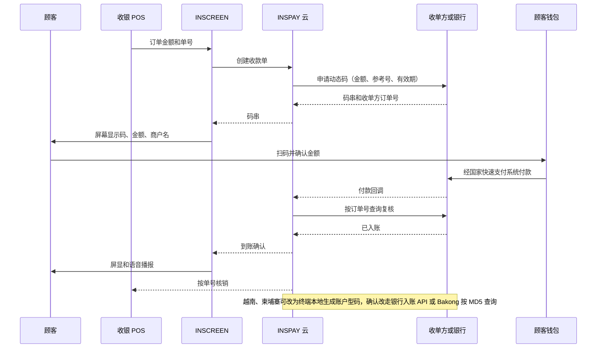

# 12 · 东南亚静态码升级动态码：需求有多强、INSCREEN 能做什么

> 本章检验一个假设：**"INSCREEN 能出动态码，东南亚商户把支付码从静态升级为动态的需求很强。"** 动态码指 EMVCo `01=12`、码内带 tag 54 金额和参考号、通常一次性的码；静态码 `01=11` 由付款人自己输入金额（[02 章 2.1](02-qr-interoperability.md)）。覆盖泰、越、印尼、马、菲、新、柬、老八国，印度、中国只作参照。
>
> * **证据标注**：（已核实）一手或多源一致；（公司说法）厂商或银行自述；（媒体）媒体报道；（推断）由证据推出；（假设）测算用的设定值；（未查到）本轮没找到，**不等于不存在**；（凭记忆，未核实）不得作为决策依据。
> * **调研条件**：2026-10-18 一轮专项调研，分痛点、设备、商户经济、接入、市场规模五个主题，每个主题都经过核实轮修正；本章只采信修正后的口径。多数官方域名 WebFetch 打不开（DNS 失败或代理 403），新事实大多依据 WebSearch 摘要；已核实的国别事实沿用 [`docs/research/`](research/README.md)。
> * **INSCREEN 已知事实只有一条**：能显示动态码（创始人说法）。"0% 手续费 + ¥2,000/月"是创始人的暂定数字，本章按假设处理；硬件、成本、联网方式、是否要店员逐笔输入金额、能否接 POS 或电子发票，**全部未知**。
> * **汇率假设**：1 USD ≈ ¥154 ≈ ฿32.5 ≈ ₫26,000 ≈ Rp16,400 ≈ RM4.3 ≈ ₱57 ≈ S$1.29 ≈ ₹87，只用于量级比较；¥2,000 ≈ USD 13。

## 结论先行

**直接回答：按本轮证据，"东南亚商户强烈需要把静态码升级为动态码"不成立，整体需求是弱的。** 要把两件事分开：

* **商户感到的痛：真实、普遍，但不是动态码问题。** 痛点是"钱到底到没到"（假截图、假 slip、假转账单）。静态码加上付款人改不了的到账确认就能解决，市场已经免费或低价解决了，而且继续用静态码。
* **为动态码付费的意愿：弱，没有直接证据。** 查过的国家都没有强制，没有公开的静态/动态码占比，也没找到商户主动要求动态码的报道或调研。银行、钱包和交换机构推的几乎都是"静态码 + 播报"。动态码只在三个窄细分里有中等需求：POS 收银台对账、越南开票户、日本客商圈。这些需求多数已经由收单方或 POS 软件低价、免费满足。
* **证据的局限**：判断主要来自供给侧（谁在卖什么）和监管文本，没有商户访谈或支付意愿数据。12.5 给出最便宜的验证办法。

1. **痛点的证据。** 假截图、假 slip、假转账单在泰、越、印尼、马、菲、新都有报道，多为媒体或厂商说法，没有官方统计。柬埔寨查到的是"核对付款难"，没查到假截图报道（只查了英文来源）。老挝未检索。现有解法是免费的银行 App 语音推送、银行赠送或一次性约 USD 12–65 的音箱，以及 slip 验证 API。
2. **把动态码当作商户付费的产品，需求弱。** 查过的七国（老挝未检索）都没找到要求商户改用动态码的规定，也没找到静态/动态码的占比数据。泰、越、马、菲的监管没有逐国检索一手来源。据 BI QRIS 页面摘要，BI 把静态码定位给微型和小型商户，把动态码定位给中型、大型和高交易量商户；这是定位，不是强制。印尼 MDR 按商户规模分档，不区分静态和动态。据多家银行通知和媒体（BI 原文未读），2026-10-01 起所有类别单笔 ≤Rp100,000 为 0%。能出动态码的带屏音箱已有现成产品：马来西亚有交换机构 PayNet 与 RHB 联合推出的，也有 BSN、Qashier 的；印尼有 Telkomsel 和白牌。查到的价格点约 USD 30–56，样本少。即使有交换机构背书，RHB 的音箱据其 2024-08 自述也只铺到约 5,000 个受理点（未拆分静态、动态款）。
3. **真实需求只在几个窄的细分里**（规模都是假设推导）：
   * 有 POS、多收银台、要按单自动对账的中型商户和连锁：七国约 240–400 万家，只占 QR 商户的约 4–8%。其中已由收单方的 EDC/API（如 BRI）或 POS 软件（如 Sapo、KiotViet）出码的比例没有数据；
   * 越南需开电子发票的个体户：2025-06 起被强制用收银机发票的约 3.7 万户（当时的统计口径）。2026 年新规把适用面扩大到所有年营业额 ≥₫10 亿的个体户，户数未查到；同时允许改用税务机关赋码发票，不一定要设备。银行和 VNPAY 的一体方案免费或补贴；
   * 日本客极多的游客区商户：前提是 PayPay 接入本网络，目前这个前提不存在；
   * 无人值守点：贴纸覆盖的案例集中在这里，但单案损失小，本轮没有专门调研。
4. **国家排序（推断）**：越南（税务拉力，账户型码可本地出码，到账 API 成熟，但免费竞品多）> 印尼中型商户（数量最多，但必须接 PJSP 的 API，并与 BRI 等竞争）> 泰国（日本游客最多，走 tag 30 Biller 码 + 银行回调）> 马、菲、新、柬（需求弱）；老挝未调研。
5. **INSCREEN 不应以"能出动态码"为卖点。** 可以卖的是：付款人改不了的到账确认 + 金额显示 + 按单对账或开票 + POS 联动 + 一机多种受理（卡、外国钱包、稳定币，按各国合规）。买方是收单方、银行、POS 厂商和连锁总部（B2B2M），不是小微店主。按 ¥2,000/月（假设）算，它是印度音箱月费的约 9–21 倍。小微段更现实的做法是以带屏音箱的形式卖给银行，价格对标 USD 12–65。"外国钱包受理"也不是硬件差异点：Alipay+ 已经能扫菲律宾、柬埔寨、马来西亚商户现有的码，新加坡则是经 NETS 扫 SGQR；泰、越、印尼的国家码只开了中国 Alipay 线。
6. **对 INSPAY 跨境网络的含义**：动态码让境外钱包按商户给出的金额锁价，但这是"更好"，不是"必需"。静态码由付款人输入金额后同样能锁价（02 章 2.5 已这样实现）。另外，本网络只承接商户（P2M）码。INSCREEN 若在柬埔寨用个人账户生成 KHQR（tag 29），会被本网络按 `P2P_NOT_SUPPORTED` 拒绝。越南 VietQR 没有 P2M 标志，参考实现按"有商户名且 MCC ≠ 0000"判定，个人账户码只要填了商户名就会被当作 P2M。所以越南的约束来自合规（个人账户收经营款、跨境个人汇款定性）和 NAPAS 受理网络登记，不是码格式（12.4.4）。
7. **第一步（4–6 周）**：① 向 INSPAY 拿 INSCREEN 的成本、交互方式和接口事实；② 在胡志明市访谈约 30 家商户，同时与一家收单方（或 SePay）谈 API 和 B2B 采购意愿；③ 访谈过了门槛，再做 20 家 POS 商户、为期 4 周的试点（见 12.5）。同时向 BI/ASPI、NITMX 索取静态/动态码占比。

## 12.1 商户的真实痛点

### 12.1.1 痛点和解法不是一一对应的

| 痛点 | 证据 | 动态码能否单独解决 | 已有的更便宜解法 |
|---|---|---|---|
| 假截图、假 slip、假转账单（"到没到"） | 泰、越、印尼、马、菲、新有报道（下表；多为媒体或厂商说法，无官方统计）；柬埔寨只查到"核对付款难" | **不能**：付款人照样可以伪造截图，关键在于商户能不能看到可信的到账确认 | 银行 App 推送、音箱、slip 验证 API |
| 贴纸被覆盖 | 印尼 2023 年清真寺等 38 处（多为捐款箱），约 Rp1,306 万（约 USD 800）（多源一致）[5]；新加坡只有二手博客（低） | **能**：屏幕上每笔现生成的码无法被覆盖 | KYM（了解你的商户）、播报商户名后核对 |
| 冒名商户、quishing | GCash 2026-04 称封禁 4,900 多个 quishing 商户（媒体）[37] | **部分**：只能防住贴在真实柜台上的覆盖；解决不了商户准入漏洞和远程钓鱼 | 收单方 KYM |
| 付款人输错金额、少付 | **未查到任何数据** | 能 | 音箱报金额，店员当场核对 |
| 按单自动对账 | 中型商户和连锁的需求（推断） | 能（Ref1/Ref2、`62-05`、VietQR `62-08` 附言） | 收单方 EDC/API 出码；越南用虚拟账户归因（SePay） |
| 店员换上自己的码 | 未查到数据 | 部分 | 店主、店员同时收通知（K SHOP、แม่มณี） |

动态码能单独解决的是贴纸覆盖、输错金额、按单对账三件事：贴纸覆盖的证据集中在无人值守场景，单案损失小；输错金额没有数据；按单对账是有收银系统的商户才有的需求。**静态码 + 音箱也会播报金额**，所以对小微户来说，"输错金额"和"到账确认"都能在不换码的情况下解决。

### 12.1.2 分国

| 国家 | 码与静/动态现状 | 最有感的痛点（数据） | 监管、税务推力 | 动态码需求（推断） |
|---|---|---|---|---|
| 泰国 | 很多小微户用 tag 29 个人 PromptPay 码（推断）；K SHOP 商户码是带 Ref 的 tag 30 静态码（只有一个 GitHub 样本）；动态码靠银行 API（SCB 等） | 假 slip：DES 警告网上有人卖假 slip 生成程序 [14]；PRD 发布识别方法 [15]，另有报道称已有人用 AI 生成假 slip；SlipOK、Slip2GO、RDCW 等验证服务已商业化 [21]。"多发生在线上和远程收款"只是推断，没有线上/柜台的占比数据 | 没查到 BOT/NITMX 要求动态码，也没查到静态/动态码占比；BBL 对法人商户的 Thai QR 每笔收 0.35% 或 ฿5，个人商户"另行通知前"免费 [19] | 小微弱；有 POS 的餐厅和连锁中等 |
| 越南 | VietQR 是账户型码，没有 P2M 标志；带金额和附言的码很容易生成（Sapo、KiotViet 按单出码）| 假转账单很普遍：有网站按金额生成各家银行的假凭证，造假服务在社交网络公开售卖，没有官方统计（媒体，多源）[22]；有一条单一来源报道称有人伪造到账音箱的播报（低）[23] | **税务是唯一的制度拉力**：2025-06 起年营业额 ≥₫10 亿、直接面向消费者的个体户须用收银机电子发票，当时约 3.7 万户、占个体户 1% 多（税务局数据，媒体转述）[24]；2026 年起，年营业额 ≥₫10 亿的个体户可在税务机关赋码发票和收银机发票之间二选一，生效日有 2026-01-01 和 2026-07-01 两说 [25][61]。依据各来源说法不一：第 68/2026 号议定第 8 条第 5 款（经第 141/2026 号修订），或税务期刊引 Cục Thuế 所说的第 254/2026 号议定第 6 条，原文都未读。另据报道，营业额达标不自动适用，税务机关还看是否直接面向消费者。2026-01-01 起取消定额税 [26]。没查到要求收款码和发票绑定的条款 | 小摊贩弱；需开票的个体户要"开票 + 收款 + 对账"一体，中等，但免费竞品多：VietinBank × VNPAY 2026-07 签约做个体户支付与数字报税，VNPAY 称其报税方案免费到 2028 年底（公司说法）[27] |
| 印尼 | QRIS 静态（贴纸）、动态（EDC 或 App 输入金额后生成）都是 MPM；商户 4,486 万，96.68% 是 UMKM（含中型 UME，不等于微型）[4] | 修图伪造的付款截图：Batu 市地方报道称是商户投诉之首（2026-05，单篇地方报道，不能推广到全国）[7]；2023 年清真寺贴纸覆盖案 [5] | BI 定位静态码给微小商户、动态码给中大型 [1]；没查到要求动态码的 PADG 条款；MDR 不分静态/动态，2026-10-01 起所有类别单笔 ≤Rp100,000 为 0%，适用于静态、动态和 API [2][3]；BI 的创新方向是 QRIS Tap（NFC，2025-03 上线）和 CPM（推断） | 小微弱；中型商户中等，但 BRI 已通过 EDC、API 和 BRI Merchant App 提供动态 QRIS（App 用户约 27 万，2024-12）[8] |
| 马来西亚 | DuitNow 规范支持动态码（据社区资料，动态码里的账户号约 60 秒有效，低）| 假付款收据：RHB 推音箱时点名的就是这个风险 [31] | 没查到要求动态码；2023 年 BNM 称约 75% 的商户所在机构对小微商户免 MDR，由 PayNet 出资，现状未核实 [35] | 弱。供给已经在：PayNet×RHB 的动态码音箱（2024-08，带键盘）、BSN 动态码音箱（两者价格未查到）、Qashier（RM179 起）。采用规模有限：RHB 自述其 DuitNow QR 音箱（未拆分静态、动态款）约 4,000 家商户、5,000 个受理点 [32][59]，而全国 DuitNow QR 受理点在 300 万以上 |
| 菲律宾 | QR Ph 分 P2M（tag 28）和 P2P（tag 27）；`62-05` 是一次性参考号；大量 sari-sari 小店用个人 GCash 码（推断） | 2024 年有人在 Facebook 卖仿 GCash 收据的 Canva 模板 [36]；quishing 和冒名商户（GCash 封禁 4,900 多个）[37] | 没查到要求动态码；商户 MDR 1–2%（厂商口径），未找到 BSP 上限 | 弱；问题出在 KYM |
| 新加坡 | 国家路线是 SGQR+ 统一静态标签：受理点 24,000 个，扩展到熟食中心后超过 35,000 个（2024-11）[41] | 本轮只查到一桩有媒体报道的案例：如切一家餐馆两年收到 35 张伪造的 PayNow 截图，损失 S$4,619.90，属于远程订单（2023-09）[40] | 熟食摊 0.5% MDR 补贴已于 2026-06-30 结束，只覆盖 2025-12-31 前加入的摊主，没找到再延期 [42] | 弱 |
| 柬埔寨 | KHQR 动态码须带 tag 99 过期时间（NBC 官方 SDK）；约 450 万"受理商户"（口径含个人码，推断）| 繁忙餐饮摊主"核对付款难"：ABA 2026-06 推出 App 内到账播报 PaySound 时的定位 [44] | 没查到推动商户改用动态码 | 弱：KB PRASAC 免费送 KHQR 音箱 [43]，ABA 用 App 播报 |
| 老挝 | LAO QR，成员接口不公开 | 本轮未检索 | 未检索 | 未知 |

**监管小结**：
* 只有印尼查到了央行自己的说法（BI QRIS 页面，据搜索摘要），结论是"有定位、无强制"。泰、越、马、菲只能说"没查到强制规定"。越南 SBV、泰国 BOT 的付款人认证措施凭记忆，未核实，不写入结论。
* 中国的两条先例值得注意。
  * 人民银行确实强制商户换过码，但换的仍是静态码：259 号文要求使用码牌的经营商户自 2022-03-01 起改用经营收款码（媒体转述，中）[48]。凭记忆（未核实），央行后来澄清个人码并未被禁止用于小额经营。
  * 《条码支付业务规范（试行）》（银发〔2017〕296 号，2018-04-01 施行）规定，付款人用静态条码付款的单日累计上限为 500 元，超过时由收款方扫付款人的动态码（媒体多源，人民银行原文未读，此后是否修订未查到）[60]。中国收银台走向"被扫"（CPM），推动力至少有一部分来自这条监管限额，不只是商户需求（推断）。
* **如果东南亚某国出台类似的静态码限额，本章结论要重算**（12.5）。本轮没查到东南亚有这类限额；QRIS 境内单笔上限 Rp10 juta 对静态码、动态码相同。

## 12.2 现有方案与竞争

| 类型 | 例子 | 价格 | 谁出钱 | 能否出动态码 |
|---|---|---|---|---|
| 银行/钱包 App 内播报 | K SHOP（免费，2022 年自称受理点超过 200 万）[16]；SCB แม่มณี；ABA PaySound [44]；Paylabs "Soundbox on App"（FEKDI 2026-09）[56] | 免费 | 银行、钱包 | 否（只确认到账） |
| 音箱（静态码 + 播报） | 越南 VietinBank、MB、VPBank、Woori 绑定开户或套餐免费送 [28]，SePay ₫599,000（约 USD 23）[29]；印尼 DANA（自称"静态 QRIS + 语音"）[11]、BSI、BCA/BRI/Mandiri/OVO [6]，GoPay Spiker 月租 Rp49,000（约 USD 3）+ 开通费 Rp100,000，或年付 Rp499,000（推广性质来源）[10]；泰国 SCB "มณี รับทรัพย์" [17]；柬埔寨 KB PRASAC 免费 [43]；马来西亚 Maybank RM199.90 / 含一年 SIM RM279.90（屏幕显示到账金额；2025 促销 RM50，2026 年向首批 4,000 家非城市商户免费，未复核）[34]；菲律宾 HitPay ₱2,500 [38]；新加坡 HitPay SGD 30（据摘要） | 免费，或一次性约 USD 12–65，印尼多为月租 | 银行为开户和活期存款，钱包、收单方为 MDR 和锁定商户 | 否（RHB 2023 年的 Plug & Play 款据摘要静态、动态码都支持） |
| **带屏、能出动态码的音箱** | 马来西亚：PayNet×RHB Dynamic DuitNow QR Soundbox（2024-08-06，带键盘和计算器，在设备上输金额出码）[32][59]、BSN 动态码音箱（2024-03）[33]、Qashier RM179 / 含 SIM RM239，可作 POS 第二屏显示 POS 生成的码，泰国 ฿1,790 已上线 [18]；印尼：Telkomsel QRIS Soundbox（2025-08，B2B，带动态 QR）[9]，Tokopedia 白牌带屏音箱挂牌约 Rp499,000（约 USD 30，市场挂牌价，低）；RHB Sound Box Plus（加 NFC，可刷 Mastercard、Visa、MyDebit，单笔 ≤RM250；是否出动态码未核实）[59] | 查到的价格点约 USD 30–56（PayNet×RHB、BSN 未查到；新加坡 Qashier 据摘要 S$199/239，约 USD 154–185，是例外） | 收单方、交换机构、银行 | **能，码仍由收单方签发** |
| POS / EDC | BRI 经 EDC、API 出动态 QRIS [8]；Sapo、KiotViet 按单出动态 VietQR，VietQR.vn 有把带金额码推到终端的 MQTT 接口 [30]；StoreHub USD 39/79/149 每月 [55]；印尼 Moka Rp249,000/月起（约 USD 15，页面可靠性低）；Maybank Indonesia EDC 月租 Rp100,000–200,000，BCA 免租 [62]；BBL EDC 押金 ฿1,000/3,000、安装费 ฿500 [19] | 软件约 USD 15–149/月 | 商户（软件）、收单方（终端常免租） | 能 |
| slip 验证 API | SlipOK、Slip2GO、RDCW（读 e-slip 内嵌 QR）[21] | AIS 套餐客户 500 张/月 ฿210 起（不是标准价） | 网店卖家 | 不相关 |

**装机量**：东南亚各国全国的音箱装机量**本轮都没查到**。唯一的单家数字是 RHB 在 2024-08 新闻稿里的自述：其 DuitNow QR 音箱约 4,000 家商户、5,000 个受理点（未拆分静态、动态款；据搜索摘要，PayNet PDF 未打开）[32][59]。参照系：
* **印度**：Paytm 截至 2023-06 为"支付设备"付订阅的商户 790 万，含音箱和 POS 刷卡机，不是纯音箱（BSE 申报，已核实）[46]；FY26 Q4 订阅商户 1,500 万（含全部设备，低）；PhonePe 截至 2025-09-30 净部署 919 万台设备（含 EDC，招股文件）；PhonePe 音箱月租方案 ₹125/月，零租金方案 ₹999 一次性 + ₹25/月 [47]；另有报道称 NPCI 拟建统一的互通音箱基础设施（低）[49]。印度音箱配的是静态 UPI 码。动态码音箱也已出现：Razorpay Dynamic Soundbox（只知文档存在）；Paytm 卡音箱支持 ≤₹5,000 的 tap and pay（媒体摘要）。
* **中国**：小微层是"收款码牌 + 云音箱"；云码自称 2018 年以来出货超过 1,700 万台（公司说法，低）[50]；有收银系统的商户用扫码盒子扫顾客付款码（CPM），而不是商户出示动态码（凭记忆，未核实）。静态码有单日 500 元的付款人限额（12.1.2 监管小结）。

**读数（推断）**：
1. 小微层的主流形态是"静态码 + 可信播报"，东南亚、印度、中国都一样。
2. "带屏 + 动态码 + 刷卡"的路线**已经有人在做**，背后是交换机构和银行，查到的价格点约 USD 30–56。INSCREEN 若走这条路，进入的是价格战品类。PayNet 把动态码音箱当防诈产品推，说明动态码有一定需求；但这份需求由收单方用低价设备满足，不是商户愿意为 INSCREEN 付溢价的需求。RHB 的采用规模（约 5,000 个受理点）也说明，即使有交换机构背书，单家银行的音箱铺设仍然有限。
3. 补贴能力在变弱：新加坡熟食摊补贴已结束；印尼 2026-10 扩大 0% MDR，压缩了收单方的小额 MDR 收入，也就压缩了它们补贴设备的余地；PayNet 的 MDR 豁免现状未核实。

## 12.3 INSCREEN 怎么接

### 12.3.1 两种出码模式

终端"能显示动态码"，不等于"有权签发可对账的动态码"。按签发权分（推断，依据各国码结构）：

* **模式 a，收单方签发**：QRIS（NMID 须经 PJSP 登记）、DuitNow（收单方分配 QR ID 或临时账户）、QR Ph P2M（商户账户开在 InstaPay 参与机构）、SGQR 里带签名的 NETS 载荷。INSCREEN 只能调收单方 API 取码串、收回调。泰国 tag 30 是变体（a′）：Bill Payment 格式公开，商户或平台在银行登记 Biller ID 后可以本地按单生成，银行负责入账回调（凭记忆，须向 SCB 确认）。
* **模式 b，账户型转账码本地生成**：VietQR、PromptPay tag 29、KHQR、PayNow UEN 或手机号的格式公开，终端技术上可以在本地生成"账户 + 金额 + 单号"的码，难点在**到账确认**。技术上可行不等于合规：用个人账户收经营款、第三方读取入账数据是否需要许可，各国不同，本轮没有法律意见（12.3.3）。
* **不可用：伪动态码**。在静态 QRIS 里把 `010211` 改成 `010212`、插入 tag 54 再重算 CRC，开源库就能做，付款也能成功，但这种码**不能作为对账依据**（05 章印尼技术要点）。这也说明"能出动态码"本身没有门槛。

### 12.3.2 到账确认的方法

| 方法 | 可信度 | 适用 | 局限 |
|---|---|---|---|
| 收单方/银行回调 + 按单查询复核 | 高 | 模式 a 全部国家 | 要收单方合同；有第三方称 SCB 回调不签名（低），所以收到回调后应再查询复核 |
| 银行入账通知 API（SePay、Casso/payOS，虚拟账户归因） | 中高 | 越南 | SePay 称与 12 家银行正式连接，ACB 官网挂有双方协议；其他银行是否同样正式未逐一核实；第三方的合规定位须确认 |
| Bakong `check_transaction_by_md5` | 中高 | 柬埔寨 | NBC 有正式文档（v1.0.2，2021）[45]；token 申请资格和商用条款未查到；需要轮询 |
| slip 验证 API | 中 | 泰国远程订单 | 要付款人出示 slip、要防同一张真 slip 重复使用、外国钱包付款人没有泰国 e-slip |
| 音箱或 App 播报 | 取决于上游 | 全部 | 越南有伪造播报的单一来源报道（低） |
| 看付款人手机截图 | 不可信 | — | 本章痛点的来源 |

下图是模式 a 下 INSCREEN 收一笔动态码付款的流程（推断的参考设计；INSCREEN 的实际交互未知）：

没有 POS 时，假设金额由店员在 INSCREEN 上输入（INSCREEN 的实际交互未知）。这样一来，静态码"顾客输金额、店员核对"变成"店员输金额、省掉核对"，净效果**没有测量过**（12.5 试点要测）。

### 12.3.3 分国可行性

| 国家 | INSCREEN 模式 | 出码与到账确认 | 商户费率参考 | 牌照与合同 | 判断（推断） |
|---|---|---|---|---|---|
| 印尼 | a | BRI《QRIS MPM Dinamis v1.1》API [8]；Midtrans charge API 返回码串，再收支付通知 [57] | 2026-10-01 起所有类别单笔 ≤Rp100,000 为 0%；UMI 单笔 ≤Rp500,000 为 0%，单笔 >Rp500,000 为 0.3%；UKE/UME/UBE 单笔 >Rp100,000 为 0.7%（银行通知与媒体，BI 原文未读）[2][3] | QRIS 收单须 BI 持牌 PJP（非银外资上限 85%）；INSCREEN 只能做 PJSP 的设备/技术伙伴，是否要登记为辅助服务商未核实 | 可行，靠伙伴 |
| 马来西亚 | a | HitPay：按金额建 payment request，webhook 或轮询确认，码交易窗口后失效 [38] | Qashier 0.8%；Omise 每笔 RM1.50（日期不明，可能只限线上，未核实） | 收单须按 FSA 2013 注册；PayNet 的数字注册商户合作方须是马来西亚注册、BNM 持牌的第三方收单方或获批电子货币发行人，且有 3 年以上经验，INSPAY 目前不具备（推断） | 可行，靠伙伴；PayNet 自己已有动态码音箱 |
| 菲律宾 | a | PayMongo Payment Intent（qrph）：一次性码，默认 30 分钟过期，事件 `payment.paid`、`qrph.expired` [39] | PayMongo 1.34%；厂商称市场 1.0–2.0%；未找到 BSP 上限 | 据厂商博客，BSP 第 1198 号通函（2024）要求非银收单方取得 Merchant Acquisition License（BSP 原文未读）；2026-09 征求意见稿拟暂停新 OPS 注册 12 个月，是否定稿未知 | 可行，靠伙伴；费率最高，收单方补贴空间也最大 |
| 泰国 | a′（tag 30） | 向 SCB 等登记 Biller ID，按单生成带 Ref1/Ref2 的码；SCB 推送 payment confirmation，另有交易查询 API 和 slip 验证 API（重试细节只见摘要）[20] | BBL 法人商户每笔 0.35% 或 ฿5 [19] | Biller ID 前 13 位是税号；SCB Business QR 允许一个账户挂多个 Biller ID，平台能否给多个商户分后缀须确认 | **推荐路线** |
| 泰国 | b（tag 29） | 离线生成容易；没找到银行向第三方开放个人 PromptPay 入账的官方 API，只能 slip 验证 | 个人收款免费 | BOT 冻结约 5,000 个用于人民币 P2P 地下收款的账户（用途特殊，不能直接套到一般商户）；e-Payment 申报门槛凭记忆 | 不宜作主路线 |
| 越南 | b | 本地生成"账户 + 金额 + 单号附言"；SePay webhook（HMAC/API Key/OAuth，失败最多重试 7 次、共约 33 分钟）或 Casso/payOS 确认 | 收款方转账通常免费（厂商口径） | Decree 52/2024（境外机构经 SBV 认可的银行进入）；只读入账通知、不碰资金是否属"支付中介"须越南律师确认 | 技术最成熟；赛道已有 SePay、Sapo、KiotViet 和银行免费音箱 |
| 柬埔寨 | b | NBC SDK 本地生成（动态码带 tag 99 过期）+ Bakong Open API 查询 | 付款方普遍免费；商户 MDR 未查到 | NBC 商用条款未查到；ABA 指南称商户须按 ABA/NBC 要求调整，否则可能被暂停服务 | 技术可行，合规未知 |
| 新加坡 | b（企业 UEN）或 a（HitPay、NETS） | PayNow 码可带金额、参考号、`04` 过期；确认要靠企业账户所在银行的入账通知 API（DBS/OCBC 凭记忆，未核实）；NETS 载荷只能由 NETS 签发 | HitPay 一页写 0.65% + S$0.30，另一页写 <S$100 为 0.9%（最低 S$0.20）；一笔 S$5 按前者约 6.65%，按后者 4%（触及最低 S$0.20） | 凭记忆（未核实），《支付服务法》对"商户收单服务"的定义不以经手资金为条件，INSCREEN 走模式 a 也可能被纳入 | 先拿 MAS 法律意见 |
| 老挝 | a（经 BCEL 等银行） | LAPNet 成员接口不公开；BCEL OnePay 接口凭记忆 | 未查到 | 未检索 | 未知 |

**两种模式各自拿到什么（推断）**：
* **模式 a**：动态码和回调都是收单方的能力，费率和商户关系归收单方，INSCREEN 只是终端。INSPAY 的收入要靠设备费、SaaS 费或向收单方分润。"0% 手续费"在三种情况下不成立：新加坡经 HitPay、NETS 等收款，菲律宾，马来西亚的非豁免商户。在印尼单笔 ≤Rp100,000 的交易上，模式 a 本来就是 0%。
* **模式 b**：INSPAY 掌握出码和确认链路，可以叠加开票和对账。模式 b 独有的是**绕开收单方**，0% 并非它独有。代价有两类合规问题和一类跨境限制。
  * 合规问题一：用个人账户收经营款。越南取消定额税后更受税务关注（推断）；泰国有 e-Payment 申报门槛（凭记忆）。
  * 合规问题二：只读入账通知、不碰资金，是否构成需许可的支付中介或收单服务。越南、新加坡都须律师意见。
  * 跨境限制：个人 KHQR、PromptPay tag 29 会被本网络拒绝（`P2P_NOT_SUPPORTED`）；即使技术上能通过（如越南个人 VietQR），也可能被定性为跨境个人汇款。
* **两种模式都可能有的义务**：把付款人姓名、账号传回日本，按仓库已核实的法律摘要（中），属于越南 Law 91/2025 规定的个人数据跨境传输，须做影响评估并在 60 天内报公安部。实施细则是否调整未查到，须越南律师确认。读取入账只走银行正式 API，不转发短信、不托管网银密码。这是设计约束，本轮没找到明令禁止的条文。

### 12.3.4 自建与合作

| 自建（INSPAY 掌握） | 合作 | 不做 |
|---|---|---|
| 云端收款单与出码编排；多收单方适配层；确认引擎（回调 + 查询复核 + 去重 + 过期）；POS API 与 webhook；屏显与语音；商户后台对账导出 | 各国收单方或银行（出码、回调，费率归对方：BRI/Midtrans、HitPay、PayMongo、SCB）；越南入账通知（银行 API 或 SePay/Casso）；越南电子发票服务商（合作条件未查到）；设备制造（INSCREEN 硬件现状未知） | 自持收单牌照（PJP、BNM 注册、BSP MAL）；读短信或托管网银密码；把 slip 验证当柜台主确认；插 tag 54 冒充动态码 |

## 12.4 商业模式

### 12.4.1 谁付钱、付多少

* **小微层的设备多由银行、钱包、收单方承担**：越南银行绑开户或套餐送音箱，Maybank 促销 RM50 或免费，BCA 免 EDC 月租，PayNet 出资让收单方豁免 MDR（2023 口径）。也有商户一次性买断（Maybank RM199.90、Qashier RM179、SePay ₫599,000），印尼则多为月租（GoPay Spiker 约 USD 3/月）。这是推断，不是全量统计。
* **银行能为一家微型商户出的设备钱**：按活期余额 USD 300–1,000、利差 2–4% 估算，约 USD 0.5–3/月（假设，未计交叉销售）。小微户的 QR MDR 在印尼（小额）、马来西亚（豁免）、泰国（个人商户）、越南（转账）基本为零，没有 MDR 可分。
* **INSCREEN 自身成本未知**：[11 章](11-inscreen-stablecoin-acceptance.md) 对日本柜台终端的假设是 ¥2.5 万/台（约 USD 162；假设值，11 章仍在撰写）。如果 INSCREEN 接近这个成本，它就是东南亚音箱价格锚（一次性约 USD 12–65）的约 2.5–13.5 倍，小微段只有银行全额补贴才进得去（推断）。
* **中型商户的 MDR 毛收入**（假设流水；还要在发卡方、收单方、交换机之间分配，分配比例未查到）：印尼约 USD 32/月（月流水 Rp1.5 亿，一半是 >Rp100,000 的交易；客单价低的门店接近 0）、泰国约 USD 32、马来西亚约 USD 35、菲律宾约 USD 132（月流水分别假设为 ฿30 万、RM6 万、₱50 万；马来西亚按 0.25%，小微商户多被豁免）。所以只有中型以上商户，收单方才有余量补贴屏幕终端。

| 对照（二手数据或假设） | 数值 | ¥2,000/月（≈ USD 13）相当于 |
|---|---|---|
| 泰国日最低工资（2026） | ฿337–400 | 1.06–1.25 天 |
| 菲律宾 NCR 日最低工资（2025-07 工资令，2026 是否调整未查到） | ₱695 | 1.07 天 |
| 越南 I 区月最低工资（2026-01） | ₫5,310,000 | 6.4% |
| 雅加达省最低工资（2026） | Rp5,729,876 | 3.7% |
| 马来西亚月最低工资（凭记忆） | RM1,700 | 3.3% |
| 印度音箱月费 | 约 USD 0.6–1.4（₹999 + ₹25/月按 36 个月摊销约 ₹53/月；或 ₹125/月） | 9–21 倍 |
| 印尼音箱月租 | 约 USD 3 | 约 4 倍 |
| 银行每户设备预算（假设） | USD 0.5–3/月 | 4–26 倍 |

### 12.4.2 分层：哪里值得为一块屏付费

| 层 | 现状 | 动态码/屏幕的增量价值 | 最高可承受（假设） | 买方 | ¥2,000/月 是否成立 |
|---|---|---|---|---|---|
| S1 微型、店主自营（摊贩、warung、熟食摊；按印尼推断占 QR 商户大多数） | 贴纸码 + 免费 App 通知或音箱 | 假截图已被播报解决；贴纸覆盖少见；输错金额无数据 → 约 0 | USD 0–1.5/月 | 银行、收单方 | 否 |
| S2 小型、有 1–3 名店员 | 静态码 + 音箱或多用户通知 | 店员侧可信确认；有简易 POS 时省去顾客输金额；越南开票 | USD 2–5/月；越南需开票户捆绑发票或 USD 5–10 | 商户或银行 | 否 |
| S3 POS 收银台（餐饮连锁、现代零售） | POS 软件 USD 15–149/月；EDC 常免租，且常已能出动态码 | 按单核销、省人工对账（假设每店每天 0.5–1 小时）、减少漏收 | USD 5–15/收银台/月（约 ¥770–2,300） | POS 厂商、收单方、连锁总部 | **勉强**：USD 13 在区间上沿，前提是接 POS 和收单方 API；对手是已出码的 EDC/POS，不是贴纸 |
| S4 游客区、日本客多 | Alipay+ 钱包已能扫菲、柬、马、新的现有码；PayPay 在东南亚未上线 | 境外钱包按已知金额锁价、按单核销 | USD 3–10/月；只有日本客极多的商户更高 | INSPAY 网络补贴 | 只在极少数商户成立（12.4.3） |
| S5 无人值守（捐款箱、自助机、停车、洗衣等） | 贴纸码 | 屏幕码防覆盖、机器知道金额 | 未调研 | 设备运营商 | 未知：需与机器控制器集成，本轮没有数据 |

### 12.4.3 自下而上测算（全部为假设推导的数量级，不是预测）

**S3 收银台外设，3 年**（低 / 基准 / 高）：

| 步骤 | 低 | 基准 | 高 | 依据 |
|---|---|---|---|---|
| 七国独立 QR 商户（去重后） | 4,700 万 | 5,300 万 | 6,000 万 | 公开受理数相加约 6,040 万，但商户、受理点、码口径混杂（假设去重系数） |
| 有收银台的商户 | 238 万 | 318 万 | 398 万 | 按 GlobalData POS 密度推算 [58]；印尼 POS 中大量是 BRILink 代理用 EDC（代理 120 万个，2025-03）[13]，印尼可能偏高；只用平板 POS 的商户又被漏掉 |
| 尚未由 EDC/POS 出动态码的比例 | 40% | 50% | 60% | 无数据 |
| SAM（商户） | 95.2 万 | 159 万 | 239 万 | |
| 3 年触达 × 采用 | 5% × 10% | 10% × 15% | 15% × 25% | 经 1–2 家收单方或 POS 伙伴、2–3 国 |
| SOM 商户 | 4,760 | 23,850 | 89,550 | |
| 设备（每户 1.2 / 1.5 / 2.0 台） | 5,712 | 35,775 | 179,100 | |
| 每台每月 | USD 5 | USD 8 | USD 13（≈ ¥2,000） | |
| 年经常性收入 | USD 34 万 | USD 343 万 | USD 2,794 万 | POS/EDC 厂商可以用软件更新做同样的事，竞争会压价 |

**S4 游客区（日本客）**：PayPay 等日本钱包接入本网络之前，这一层的流水为 0。下面算的是接入后的上限：

日本游客 338 / 370 / 408 万人次 × 在商户的人均消费 USD 300 / 450 / 600（假设）× 日本钱包经本网络的份额 5% / 10% / 20%（假设）= 年流水 USD 5,070 万 / 1.67 亿 / 4.90 亿。游客数的口径：泰国 2025 年 1–5 月 444,274 人次 [51]，全年约 105–108 万为推算；越南 2025 年约 81.4 万 [52]；其余五国凭记忆合计约 150–220 万。按 [10 章](10-economics.md) 的假设：
* 网络毛收入约 82 bps，即 USD 42 万 / 137 万 / 401 万。其中约 73 bps 是变动成本，不能拿来付设备费；
* 分润前贡献约 9 bps（10.2 取整口径），即 USD 4.6 万 / 15 万 / 44 万；
* 一家商户每月的日本钱包流水要达到约 **USD 14,400**（每年约 USD 17.3 万），贡献才够付 ¥2,000/月。按 30% / 50% / 60% 的流水集中在达标商户计，各国合计最多约 **90 / 480 / 1,700 家**，每户按 1 台计。按 10.3 的未取整口径，贡献约 7 bps，门槛升到约 USD 18,600/月，家数再少约 22%；
* 向 PayPay 分润超过约 7.5 bps 后贡献转负（10.7），那时流水再大也付不起设备费；
* 现有数据也提示通道的作用：巴厘约 100 万家 QRIS 商户，2025 年跨境 QRIS 只有 148,717 笔、约 Rp360 亿（约 USD 220 万）[12]。但 2025 年能用跨境 QRIS 的只有已联通国家的游客：中国线 2025-08-17 起才进入沙盒，2026-04-30 才软启动，日本入境未上线。这衡量的是"已联通通道的流量小"，不能说明游客对 QR 的需求弱。

**对照：作为带屏音箱卖给银行（满足的是到账确认需求）**：QR 商户 4,700 / 5,300 / 6,000 万 × 5 年带屏或音箱设备渗透率 5% / 10% / 20% × INSCREEN 份额 0.5% / 1% / 3%，每户按 1 台计，得 1.2 万 / 5.3 万 / 36 万台；按 B2B 单价 USD 25 / 30 / 40 计，5 年累计一次性收入 USD 29 万 / 159 万 / 1,440 万。台数更大，但毛利薄，对手是中国 ODM，也证明不了"动态码需求强"。

### 12.4.4 与 INSPAY 跨境网络、稳定币受理的关系

* **跨境锁价**：动态码让 PayPay 等境外钱包按商户给出的金额报价并锁定，还能用码内参考号自动核销，这是本网络偏好动态码的原因（02 章 2.5）。但静态码由付款人输入金额后同样能锁价。有一个已核实的先例：Alipay+ 钱包在韩国 ZeroPay 店铺扫的是 MPM 码，由用户自己输金额，而 PayPay 海外模式在 ZeroPay 店铺也只支持 MPM（高；PayPay 用户同样自输金额是按同一机制推断）。菲、柬商户现有的码多为静态码，Alipay+ 直接扫（推断）。所以动态码是**设计偏好，不是必要条件**。锁汇有效期必须短于码有效期（PayMongo 默认 30 分钟、DuitNow 约 60 秒、KHQR `99-01`）。
* **码的类型决定能不能跨境**：境外钱包一般只付商户（P2M）码。泰国中国线开通时只受理六家参与银行的商户码，2026-06 "Pay Like a Local" 列出 8 家银行，现状须向 NITMX 确认。本网络默认拒绝个人码。但这不是所有通道的限制：TouristDigiPay 允许向个人码付款（每月 ≤฿5 万），RedotPay、Bitget 能扫 VietQR，PayNow–PromptPay 有按手机号的 P2P 联通。INSCREEN 走模式 b 时，越南和柬埔寨的情况不同：
  * 柬埔寨：个人 KHQR（tag 29）会被本网络拒绝，商户要用开在收单行的商户 KHQR（tag 30）；
  * 越南：VietQR 没有 P2M 标志，参考实现按商户名和 MCC 判定（02 章 2.3），技术上拦不住填了商户名的个人账户码。把关只能靠两条规则：商户账户须在 NAPAS 受理网络登记（外国钱包"只在 NAPAS 受理网络内可付"）；合规上不把跨境付款打进个人账户。

  结论是："0% 直连个人账户"和"本网络跨境锁价"在同一台设备上互相冲突，除非商户另有收单方签发或已登记的商户码。
* **外国钱包受理不是硬件差异点**：Alipay+ 接入 DuitNow（2023-10，8 个以上钱包）、经 NETS 接入 SGQR（2023-04）、接入 KHQR（2024-10，12 个钱包）和 QR Ph（2026-09-01）[53] 后，境外钱包直接扫商户现有的码，商户不用换码、不用换硬件；印尼 2026-04-30 软启动的是中国线（支付宝、云闪付用户，经 Alipay+ 和银联）[54]。PayPay 是否在这些线路内未核实；它的海外支付模式截至 2026-10 只覆盖韩国、台湾（01 章 1.1）。
* **稳定币受理不改变本章的数量级**。[11 章](11-inscreen-stablecoin-acceptance.md) 讨论的是日本国内商户；在东南亚，泰国（SEC 2022 禁止数字资产业者为加密支付提供便利）、印尼（BI 禁止 PJP 处理虚拟货币，置信度低）、越南（加密资产不是合法支付手段）的本地商户受理稳定币付款受限或被禁止；新加坡（dtcpay 在 NETS 受理点：付款人用稳定币、商户收新元）、菲律宾是例外，泰国 TouristDigiPay 沙盒允许游客用加密资产换泰铢付款（有月度上限）。加密钱包 Bitget、RedotPay 已经能扫 VietQR、QR Ph 的现有码（05 章），说明稳定币付款人也不需要新硬件。所以在东南亚，稳定币是一机多受理里的一个选项，不是商户升级的理由。

## 12.5 风险与下一步验证

**什么会推翻本章结论**：

| 信号 | 结论怎么变 | 去哪里查 |
|---|---|---|
| 某国出台静态码限额或强制动态码（类似中国 296 号文：静态码付款人单日累计 ≤500 元） | 该国小微层需求转强，要重算 | BI PADG、BOT/NITMX、SBV、BNM/PayNet、BSP 公告 |
| 公布的动态码占比高，或增长主要来自动态码 | "增长发生在静态码体系"要撤回（目前两个方向都没有证据） | BI 支付系统统计（SPIP）、ASPI、NITMX |
| 量化数据显示，有音箱的商户仍有大额假截图或贴纸覆盖损失 | 音箱方案不够可信，屏幕码的价值上升 | 收单方风控数据、警方统计、越南伪造播报的原文 |
| POS 商户按收银台付 ≥USD 8/月的比例高，且收单方动态码覆盖率低 | S3 SOM 向高情景靠 | 试点和访谈（下文） |
| PayPay 在东南亚接入本网络，日本客流水集中在少数商圈 | S4 从 0 变为可投放（仍只有百到千家量级） | 08 章 Phase 0 PayPay BD |
| INSCREEN 成本 ≤USD 30，能从 POS 自动取金额 | S1/S2 的人工收益由未知变正，带屏音箱路线可行 | INSPAY 内部 |

**最便宜的验证（按顺序）**：
1. **INSCREEN 自身事实（1 周）**：BOM 成本、是否需要店员逐笔输入金额、能否接 POS、电子发票、4G/Wi-Fi、语音、NFC/刷卡。没有这些，12.4 的任何定价都只是假设。
2. **案头确认（1–2 周）**：向 BI/ASPI、NITMX、PayNet 要静态/动态码占比；读 BI 2026-08-17 新闻稿 No. 28/159/Dkom 原文；向 NBC 确认 Bakong Open API 能否用于商用终端；读越南第 68/2026 号议定（含第 141/2026 号修订）和第 254/2026 号议定原文，确认法律依据、生效日和 2026 年适用户数。
3. **一个城市的访谈（2 周）**：建议胡志明市（日本游客约一半集中在这里，按 2024 年比例；有开票拉力；模式 b 技术成熟）。访谈约 30 家：10 家需开票的个体户、10 家有 POS 的餐饮零售、10 家游客区商户。问三件事："只要可信播报"和"自动对账/开票"各愿付多少；当前每天人工对账花多少时间；过去一年假截图、少付的次数和金额。
4. **一次伙伴对话（并行）**：越南找 SePay/Casso 或一家银行，印尼找 BRI 或 Midtrans，泰国找 SCB（tag 30 Biller ID 分后缀）。问 API 条件、费率、回调签名，以及是否愿意按 USD 30–55 一台 B2B 采购带屏终端；马来西亚可顺带向 RHB/PayNet 问动态码音箱的实际使用率。
5. **4 周试点（访谈过门槛后）**：20 家有 POS 的商户，一半用 INSCREEN 动态码，一半维持"静态码 + 音箱"作对照。测量：每笔耗时、对账工时、金额不符率、欺诈事件、试点后按 USD 5 / 8 / 13 每台每月的续用意愿。**继续的门槛（建议）**：至少 30% 的试点商户愿付 ≥USD 8/收银台/月，或有一家收单方/POS 厂商愿意按单价采购。达不到就转向"卖给银行的带屏音箱"，或只作为本网络在日本客商圈的补贴投放。

## 资料来源

置信度口径同 [09 章](09-sources.md)：高 = 官方一手且在线核实；中 = 二手权威或官方页面摘要；低 = 单一来源、推广性质或未核实。多数链接只读到 WebSearch 摘要。国别码结构、跨境联通与监管沿用 [`docs/research/`](research/README.md)（ID、TH-LA、VN-KH、SG-MY、PH-MM、ALIPAY-VERIFY）。

| # | 来源 | 日期 | 置信度 |
|---|---|---|---|
| 1 | BI QRIS 官方页（静态码给微小商户、动态码给中大型）：https://www.bi.go.id/id/fungsi-utama/sistem-pembayaran/ritel/kanal-layanan/qris/default.aspx | 2026 | 中 |
| 2 | BCA 商户通知：2026-10-01 起 QRIS MDR 调整，适用静态、动态、API，引 BI 新闻稿 No. 28/159/Dkom：https://www.bca.co.id/id/informasi/news-and-features/2026/09/01/18/50/informasi-penyesuaian-merchant-discount-rate-mdr-transaksi-qris | 2026-09-01 | 中-高（BI 原文未读） |
| 3 | Kontan，BTN 按新 MDR 调整费率：https://keuangan.kontan.co.id/news/kebijakan-mdr-qris-0-berlaku-mulai-1-oktober-2026-btn-sesuaikan-tarif-merchant | 2026 | 中 |
| 4 | Fortune IDN，QRIS 商户 4,486 万、UMKM 96.68%：https://www.fortuneidn.com/finance/transaksi-digital-melesat-qris-tumbuh-82-4-persen-d7w02-00-lflgw-8hs5kx | 2026 年中 | 中 |
| 5 | Katadata，清真寺 QRIS 贴纸覆盖案：https://katadata.co.id/amp/berita/nasional/643554ef0bf48/tersangka-penipuan-qris-ditangkap-berikut-38-titik-yang-jadi-sasaran | 2023-04 | 高（多源一致） |
| 6 | detikInet，QRIS Soundbox 防假截图、多为月租：https://inet.detik.com/business/d-8207135/cara-kerja-qris-soundbox-lindungi-pedagang-dari-bukti-transfer-palsu/amp | 约 2025 | 中 |
| 7 | JatimTIMES，Batu 市商户投诉修图截图：https://jatimtimes.com/baca/3331344260/20260525/145200/privacy | 2026-05-25 | 中（单篇地方报道） |
| 8 | BRI 动态 QRIS API 文档：https://developers.bri.co.id/en/docs/qris-merchant-presented-mode-mpm-dinamis-v11 ；BRI Merchant App：https://www.idxchannel.com/banking/mudah-dan-cepat-begini-cara-buat-qris-lewat-aplikasi-brimerchant | 2024-12 | 中 |
| 9 | Telkomsel QRIS Soundbox：https://bcasekuritas.co.id/latest-news/news/telkomsel-luncurkan-solusi-pembayaran-aman-qris-soundbox | 2025-08 | 中（摘要） |
| 10 | GoPay Spiker 租金：https://mojok.co/kilas/keunggulan-qris-soundbox-gopay-spiker-buat-keamanan/ | 2025–2026 | 低（推广性质） |
| 11 | Kontan，DANA QRIS soundbox：https://keuangan.kontan.co.id/news/tingakatkan-kepercayaan-pelaku-usaha-dana-luncurkan-soundbox-qris | 约 2024–2025 | 中 |
| 12 | Antara Bali，巴厘 QRIS 商户与跨境交易：https://bali.antaranews.com/berita/411140/qris-beri-nilai-tambah-pariwisata-di-bali-karena-mudahkan-turis-bertransaksi | 2025 | 中（单一来源） |
| 13 | Kontan，BRILink 代理 120 万：https://keuangan.kontan.co.id/news/hingga-akhir-maret-2025-jumlah-agen-brilink-tembus-12-juta | 2025-03 | 中 |
| 14 | InfoQuest，DES 警告假 slip 生成程序：https://www.infoquest.co.th/?p=221031 | 约 2022 | 中 |
| 15 | 泰国 PRD，识别假 slip 的方法：https://www.prd.go.th/th/content/category/detail/id/9/iid/237135 | 2023–2025 | 中 |
| 16 | KBank K SHOP：https://www.kasikornbank.com/th/business/sme/digital-banking/kshop/help/Pages/qualification.aspx | 2022 | 中（公司说法） |
| 17 | SCB มณี รับทรัพย์ 音箱：https://www.scb.co.th/th/personal-banking/payment/for-merchant/manee-rubsub.html | 2025–2026 | 中 |
| 18 | Qashier 音箱（泰国 ฿1,790、马来西亚 RM179、第二屏）：https://qashier.com/th/en/qashier-soundbox/ ；https://qashier.com/my/qashier-soundbox ；https://support.qashier.com/en/articles/9989837-soundbox-as-second-screen-sass | 2026 | 中 |
| 19 | Bangkok Bank 商户费率表：https://www.bangkokbank.com/en/Business-Banking/Manage-My-Business/Merchant-Services/Payments-on-EDC | 2025-07-01 | 中（单一银行） |
| 20 | SCB 开发者文档 payment confirmation：https://developer.scb.co.th/assets/documents/documentation/qr-payment/payment-confirmation.html | 2026 | 低-中（摘要） |
| 21 | RDCW Slip Verify：https://slip.rdcw.co.th/docs ；AIS SlipOK 套餐：https://www.ais.th/consumers/package/postpaid/rsme/slip-ok | 2024–2026 | 中 |
| 22 | 越南假转账单：https://tapchicongthuong.vn/nhan-dien-lua-dao-gia-mao-bien-lai-chuyen-tien-thanh-cong-116612.htm ；https://viettimes.vn/xuat-hien-trang-web-gia-mao-bill-chuyen-khoan-cua-nhieu-ngan-hang-viet-nam-post169054.html | 2023–2026 | 中（多源） |
| 23 | vnreview，伪造到账播报警告：https://vnreview.vn/threads/canh-bao-ve-thu-doan-lua-dao-qua-loa-thong-bao-giao-dich-doi-voi-ho-kinh-doanh.86916/ | 约 2025–2026 | 低 |
| 24 | SGGP，强制收银机发票约 3.7 万户：https://www.sggp.org.vn/hoa-don-dien-tu-gop-phan-tao-he-sinh-thai-kinh-doanh-minh-bach-hon-post792218.html | 2025 | 中（税务局数据，媒体转述） |
| 25 | 第 68/2026 号议定（经第 141/2026 号修订）的发票二选一：https://www.misaeshop.vn/?p=37775 ；https://ihoadon.vn/hddt/ho-kinh-doanh-co-doanh-thu-tu-1-ty-dong-tro-len-phai-su-dung-hoa-don-dien-tu.html | 2026 | 中（议定原文未读） |
| 26 | 取消定额税（Resolution 198/2025/QH15）：https://thuvienphapluat.vn/ma-so-thue/phap-luat-thue/bo-thue-khoan-2026-ho-kinh-doanh-phai-chuan-bi-nhung-gi-433724-212436.html | 2026 | 中 |
| 27 | VietinBank × VNPAY 个体户支付与报税方案：https://vnba.org.vn/vi/vietinbank-va-vnpay-hop-tac-cung-cap-giai-phap-thanh-toan-va-nop-thue-so-cho-ho-kinh-doanh-22922.htm | 2026-07-27 | 中 |
| 28 | 越南银行免费送音箱：https://vneconomy.vn/mb-tang-mien-phi-thiet-bi-loa-thanh-toan-cho-ho-kinh-doanh-nho.htm ；https://daibieunhandan.vn/mua-cao-diem-ban-hang-loa-thong-bao-chuyen-khoan-tro-thanh-tro-thu-dac-luc-cua-tieu-thuong-10410575.html | 2025–2026-03 | 中 |
| 29 | SePay webhook 文档：https://developer.sepay.vn/en/sepay-webhooks ；音箱零售价：https://didongviet.vn/thiet-bi-am-thanh/loa-thong-bao-chuyen-khoan-sepay.html | 2026 | 中 |
| 30 | VietQR.vn Host-to-Device MQTT 接口：https://api.vietqr.vn/vi/cac-dich-vu-api-khac/api-host-to-device-mqtts/mqtt-tao-ma-thanh-toan-vietqr | 2026 | 中 |
| 31 | RHB × PayNet DuitNow QR Sound Box 新闻稿：https://rhbfoundation.rhbgroup.com/-/media/Assets/Corporate-Website/Document/Highlights/Media-Release/20231130.pdf | 2023-11-30 | 中 |
| 32 | PayNet，Dynamic DuitNow QR Soundbox：https://paynet.my/press-release/2024/RHB-Bank-And-PayNet-Launch-Dynamic-DuitNowQR-Soundbox-to-Combat-Payment-Fraud.pdf | 2024-08-06 | 中（只有标题和摘要） |
| 33 | Malay Mail，BSN 动态 DuitNow 音箱：https://www.malaymail.com/news/money/2024/03/23/bank-simpanan-nasional-payhunter-facilitate-24-ramadan-bazaar-spots-in-kl-to-go-cashless/125168 | 2024-03 | 中 |
| 34 | Maybank QRPay Soundbox：https://maybank2u.com.my/maybank2u/malaysia/en/personal/services/digital_banking/qrpay-soundbox.page | 2025–2026 | 中 |
| 35 | BNM，DuitNow QR 小微商户 MDR 豁免：https://www.bnm.gov.my/-/duitnow-qr-payments | 2023-09 | 中（现状未核实） |
| 36 | Unbox，仿 GCash 收据模板：https://unbox.ph/news/fake-gcash-receipts/ | 2024 | 中 |
| 37 | Tribune，GCash 封禁 quishing 商户：https://tribune.net.ph/2026/04/22/gcash-blocks-4900-quishing-scam-merchants | 2026-04 | 中 |
| 38 | HitPay：马来西亚 DuitNow API https://hitpayapp.com/my/blog/duitnow-api-integration-malaysia ；菲律宾音箱 https://hitpayapp.com/ph/payment-soundbox-philippines | 2026 | 中（公司说法） |
| 39 | PayMongo QR Ph API 与定价：https://developers.paymongo.com/docs/qr-ph-api ；https://developers.paymongo.com/docs/pricing | 2026 | 中（摘要） |
| 40 | Mothership，如切餐馆假 PayNow 截图：https://mothership.sg/2023/09/customer-scam-joo-chiat-restaurant-fake-paynow-screenshots//amp | 2023-09 | 中 |
| 41 | NETS SGQR+ 全岛推广：https://www.nets.com.sg/newsroom/nets-announces-sgqr-islandwide-rollout-following-the-success-of-sgqr-proof-of-concept | 2024-11-07 | 中 |
| 42 | IMDA，Hawkers Go Digital 补贴"最后 6 个月"：https://www.imda.gov.sg/resources/press-releases-factsheets-and-speeches/press-releases/2025/government-subsidy-under-hgd-programme-extended-for-another-year | 2025 | 中 |
| 43 | KB PRASAC KHQR Soundbox：https://www.kbprasacbank.com.kh/?p=31056 | 2026 | 中（摘要） |
| 44 | Cambodia Investment Review，ABA PaySound：https://cambodiainvestmentreview.com/2026/06/29/aba-bank-targets-payment-verification-challenges-for-cambodias-busy-fb-vendors-with-new-paysound-feature/ | 2026-06-29 | 中 |
| 45 | NBC《Bakong Open API Documentation》v1.0.2（Scribd 副本）：https://www.scribd.com/document/897084225/Bakong-Open-API-Document | 2021 | 中 |
| 46 | Paytm Q1 FY24 经营更新（BSE）：https://bseindia.com/xml-data/corpfiling/AttachHis/08cf74b4-dc6a-4b66-a5bc-010a042b73a2.pdf | 2023-07 | 高 |
| 47 | PhonePe SmartSpeaker 收费：https://cms.phonepe.com/en/mx/merchant-help/phonepe-smartspeaker/about-phonepe-smartspeaker/what-are-charges-applicable-phonepe-smartspeaker | 检索于 2026-10 | 中 |
| 48 | 第一财经，人民银行 259 号文：https://www.yicai.com/news/101242396.html | 2021 | 中 |
| 49 | Inc42，NPCI 拟建统一音箱基础设施：https://inc42.com/buzz/npci-to-roll-out-unified-soundbox-infrastructure-for-merchants-report/ | 日期未知 | 低 |
| 50 | Nilson Report，云码播报音箱：https://nilsonreport.com/articles/cloud-codes-payment-broadcast-speakers/ | 日期未知 | 低 |
| 51 | Nation Thailand，2025 年 1–5 月日本游客：https://www.nationthailand.com/news/tourism/40050808 | 2025 | 中 |
| 52 | SGGP，越南 2025 年十大客源：https://www.sggp.org.vn/10-thi-truong-khach-quoc-te-lon-nhat-den-viet-nam-nam-2025-post832221.html | 2026-01 | 中 |
| 53 | Alipay+ 接入 QR Ph：https://fintech.global/2026/09/01/alipay-opens-philippine-merchants-to-global-shoppers/ | 2026-09-01 | 高（docs/research/ALIPAY-VERIFY.json） |
| 54 | 印尼–中国跨境 QR：https://ibsintelligence.com/ibsi-news/indonesia-and-china-launch-cross-border-qr-payments-link/ | 2026-04-30 | 中（docs/research/ID.json） |
| 55 | StoreHub 定价：https://storehub.com/pricing | 检索于 2026-10 | 中 |
| 56 | Paylabs "Soundbox on App"：https://mediaasuransinews.co.id/gallery-photo/berita-foto/paylabs-hadirkan-soundbox-on-app-di-fekdi-x-ifse-2026-perkuat-keamanan-transaksi-qris/ | 2026-09 | 中（公司说法） |
| 57 | Midtrans QRIS 文档：https://docs.midtrans.com/reference/qris | 2026 | 中（摘要） |
| 58 | GlobalData，各国每百万人 POS 终端数：https://www.globaldata.com/media/banking/malaysia-card-payments-to-surpass-125-billion-in-2029-as-digital-adoption-gains-pace-forecasts-globaldata/ | 2024 | 低（单一咨询机构） |
| 59 | RHB DuitNow QR 音箱：键盘款与"约 4,000 家商户 / 5,000 个受理点"出自 [32] 的 2024-08 新闻稿（RHB 自述）；Sound Box Plus（NFC ≤RM250）：https://www.rhbgroup.com/dnqrsoundboxplus | 2024-08 | 低-中（公司说法，据搜索摘要） |
| 60 | 人民银行《条码支付业务规范（试行）》（银发〔2017〕296 号）静态码 500 元限额：https://www.cs.com.cn/xwzx/msxf/201712/t20171229_5646813.html ；https://www.nbd.com.cn/articles/2017-12-28/1176789.html | 2017-12 / 2018-04-01 施行 | 中（媒体多源，原文未读，后续修订未查到） |
| 61 | 越南税务期刊，个体户电子发票（引 Cục Thuế、第 254/2026 号议定第 6 条）：https://thuehaiquan.tapchikinhtetaichinh.vn/huong-dan-su-dung-hoa-don-dien-tu-doi-voi-ho-kinh-doanh-co-doanh-thu-duoi-1-ty-dong-162821.html ；适用还看是否直接面向消费者：https://ketoanthuanthien.vn/hoi-dap/ho-kinh-doanh-nao-bat-buoc-phai-su-dung-hoa-don-dien-tu-tu-may-tinh-tien/ | 2026-07 | 中（各来源引用的议定编号不一） |
| 62 | 印尼 EDC 月租：Maybank Indonesia https://www.maybank.co.id/mesinedc ；BCA https://www.bca.co.id/en/bisnis/produk/penerimaan-bisnis/EDC-BCA | 2025 | 中（摘要） |
