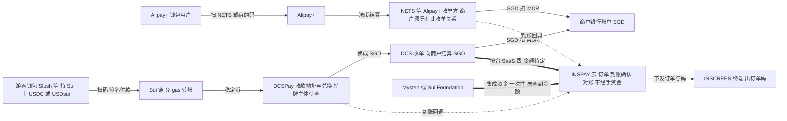

# 14 · Alipay+、DCS、INSPAY、Sui 如何合作

> 本章回答创始人的问题："Alipay+、DCS、INSPAY（硬件 SaaS）、Sui 如何合作？"**这是决策文档，不是法律意见或财务预测。** 截至 2026-10-18。
>
> * **证据标注**：同 [11 章](11-inscreen-stablecoin-acceptance.md)。**事实**（括号内为置信度 高/中/低）、**公司说法**、**推论**、**假设**；**未查到**是本轮没找到，**不等于不存在**。来源编号见文末。
> * **调研条件**：2026-10-18 按 Alipay+、DCS、Sui、监管四个主题各做一轮调研和一轮核实，本章只采信核实后的口径，被推翻的说法只以修正后的形式出现。dcscc.com、dcspay.com、sui.io、docs.sui.io、prtimes.jp、sbivc.co.jp、kucoin.com 等 WebFetch 全部失败（DNS 或代理 403），新事实几乎都依据 WebSearch 摘要，原文没有读到。已核实的 Alipay+、日本、新加坡事实沿用 [`docs/research/`](research/README.md) 与 01、11–13 章。审阅时另做了 4 次检索抽查：新加坡 PS Act 的收单定义、金融庁警告 KuCoin 的日期、经 PayPay 受理 Alipay+ 的方式、DCSPay 是否支持 Sui。
> * **INSCREEN 已知事实**：能显示动态码（创始人说法）；其余硬件规格、是否能受理卡、认证、成本都未知。"0% 手续费 + ¥2,000/月"是暂定方案，按假设处理。

## 0 各方是谁、现在有什么关系

| 方 | 是谁 | 依据与置信度 |
|---|---|---|
| **Alipay+** | Ant International（新加坡总部）运营的跨境钱包网络。官方文档的角色是 ACQP（收单服务商）、MPP（钱包）、TSP（为 ACQP 做开发测试的技术服务方）和商户，各国 QR 交换机作为网络伙伴接入（NETS/SGQR、PayNet/DuitNow、ZeroPay、HUMO 等）；Antom 是 Ant 自营收单服务商。日本经 40 多家本地收单方接入（2024-03），PayPay 是主要收单方 | 事实，高 [26][27]。规模口径不一：官网 2026-09 称 20 亿以上账户、50 家以上 MPP，另有来源称约 18 亿账户、40 个钱包（公司说法，低）[26] |
| **DCS** | 按 **DCS Group** 理解：DCS Card Centre（新加坡核心实体，原 Diners Club Singapore，2022-10 更名，持 MAS《银行法》下信用卡/签帐卡发卡牌照）+ DCS Fintech（全球业务；DCSPay 由 DCS Fintech (Hong Kong) Limited 运营）+ DCS PayAll（公司称负责商户收单）。DCS Card Centre 由 DCS Fintech Holdings 全资持有，最终受益人未查到 | 发卡牌照：事实，高 [13]；DCSPay 运营主体、PayAll：公司说法，中 [13][19] |
| **INSPAY** | 日本公司，做 INSCREEN 商户终端（动态码屏）+ SaaS 订阅，探索稳定币线下支付。2026-07-10 宣布与 Mysten Labs 依据 MOU 协作；称在日本超过 1 万台终端上运行 QR 支付系统；2026-07-01–09-30 与 JPYC、HashPort、Chério 在京都做自动售货机 JPYC 支付实证（所用链未查到） | MOU：公司说法，存在为高 [1]；"1 万台"：公司说法，中，口径可能含非 INSCREEN 设备，与 11 章按 200 台测算的口径不同 [2]；京都实证：中 [3] |
| **Sui** | Layer-1 公链，Mysten Labs 是原始贡献方，Sui Foundation 负责生态。2026-05 下旬起协议层免 gas 转账 7 种稳定币（含 USDC、USDsui）；USDsui 由 Bridge（Stripe 旗下）发行，2026-03-04 主网上线 | 事实，中–高 [4][5] |

**对"DCS"的理解**：没有查到名为"Alipay+ DCS"的 Alipay+ 产品，只查到 2022-11 的 Alipay+ D-store（数字门店方案）[25]。按"Alipay+ 与 DCS 两方"理解证据最充分：DCS 有稳定币支付产品，执行主席来自 Alipay+。但"不是产品名"只是没查到，没有被证伪。**若创始人指的是别的 DCS，本章 DCS 部分须重做，先向创始人确认。**

**已查到的公开关系**（截至 2026-10-18）：

| 两方 | 查到的关系 | 置信度 |
|---|---|---|
| INSPAY–Sui | **已有合作**：MOU（2026-07-10，条款未公开，MOU 通常不具约束力）；WebX 2026（07-13–14，东京）实演 Sui 上稳定币线下支付，INSPAY 自报两天 470 笔（USDC 205、USDsui 265）、确认多为 0.6–1 秒、用 Slush 钱包、含自动售货机和夹娃娃机。未见 Mysten 或 Sui 官方的对应公告（未专门检索）；7 月以后未查到进店商用 | 存在：高；笔数和速度：公司说法，中 [1][2] |
| Alipay+–DCS | 未查到公司级合作，也未查到 DCS 是 Alipay+ ACQP。有三条线索：① 人事——贾航（Jia Hang，中文名为音译推断）2025-11-25 任 DCS Group 执行主席，Ant 2022-03 任命他为东南亚区域总经理，DCS 稿件称他主导过 Alipay+ 全球扩张；② DCS 2023-08 更名时称计划受理 Alipay（不是 Alipay+）、SGQR、WeChat Pay，是否上线未查到；③ SGX 上有 OxPay 与 DCS 的 payment facilitator 协议公告，只见标题 | 任命：高 [15][16]；计划：低 [14]；OxPay：低 [22] |
| Alipay+–Sui | 未查到。Sui 的蚂蚁系伙伴是**蚂蚁数科**（Ant Digital Technologies）及其 ZAN：2024-08 起任 Sui RPC 节点，2024-12-13 宣布 ESG RWA 代币化。蚂蚁数科不是运营 Alipay+ 的 Ant International。2026-10-07 Sui 与阿里云的 Agent Payments 合作也与 Alipay+ 无关（阿里云不属于蚂蚁） | 事实，高 [8][9] |
| DCS–Sui | 未查到。DCS 已知用链：PlatON（DUS）、Ethereum（DUSD）、Polygon（DeCard 充值）；DCSPay 的链清单未公开 | 中 [17][21] |
| DCS–INSPAY | 未查到 | — |
| Alipay+–INSPAY | 没有直接关系。INSCREEN 只能经收单方（PayPay 等）或国家码受理 Alipay+ 钱包。经 PayPay 受理时，只支持外国用户扫店铺码、自己输入日元金额（媒体，中）[27]；PayPay 是否允许第三方终端调用其 API 显示可被 Alipay+ 钱包支付的动态码，未核实 | 推论 |

## 结论先行

* **没有现成的四方框架，不要签四方协议。** 四方之间唯一已签的是 INSPAY–Mysten MOU；Alipay+ 与 DCS 之间只有人事联系和一条 2023 年的受理计划；其余都是未查到。可行的做法是以 INSPAY 为中心，分别做双边合作。
* **各方的实际位置不对称（推论）。**
  * Alipay+ 是被动的**法币钱包受理通道**：INSCREEN 经收单方或国家码接入，不需要、也很难与 Ant 直签。Ant 对第三方稳定币结算谨慎：结算按合同约定的法币；稳定币布局只在机构间 treasury；据 FT 报道，内地 2025-10 叫停蚂蚁的香港稳定币计划（是否涵盖 Ant International 不明）；截至 2026-10 未见 Ant 获香港或新加坡牌照 [32][33]。
  * DCS 是新加坡（香港次之）的收单与稳定币换汇伙伴候选，但牌照主体未查清，在日本没有已知牌照。
  * Sui 是已有的链伙伴，生态资金是否到位取决于 MOU；缺日元稳定币，也缺已确认的日本境内出金通道。
* **按可行性排序（推论，第 2 节）。**
  * 现在能做：**D**（把 MOU 变成资金、激励和联合开发）。
  * 取决于收单方：**B 的 Alipay+ 部分**。监管负担在收单方，可行性中；但经 PayPay 受理的 Alipay+ 目前只见"扫店铺码、用户输金额"，INSCREEN 若只能显示静态店铺码，比一张贴纸多不了多少，商业价值低到中。
  * 3–9 个月（假设）：**A**（新加坡），可行性中低，取决于 DCS 能否答清三件事：谁收单、谁兑换、DCSPay 能否加 Sui。
  * 2027 以后：**C**（机构间 Sui 结算），低。
  * 当前不可行：经 DCSPay、KuCoin Pay 进日本（金融庁警告过 KuCoin，DCS 在日本无已知牌照）；向日本一般商户推 Sui 稳定币（未确认境内出金通道）。
* **推荐：现在做 D 和第 5 节的验证；四方合作的首个试点候选是 A，设闸门。**
  * A 不是最可行的模式，选它是因为在查过的日本、新加坡、香港三地中，只有新加坡四方都可能出场。日本已有商户收稳定币、拿日元的先例（Netstars Stablecoin Pay、PayPay×HIVEX×Binance Pay），但 DCS 在日本没有已知牌照，出不了场；香港处在立法空档。
  * A 的做法：在 DCS 收单的商户装 INSCREEN，同一台受理 DCSPay 稳定币（Sui 为支持链之一，须 DCS 新增）和 Alipay+ 钱包，商户收新元。Alipay+ 一路要求商户另有 NETS 等 Alipay+ 收单关系，因为未查到 DCS 是 Alipay+ ACQP。
  * A 的弱点：DCSPay 的兑换持牌主体未知；HitPay、dtcpay、Antom 的 EPOS360 已在场；新加坡动态码需求弱（12 章）。
  * 闸门：DCS 4 周内答不清收单主体或 DPT 兑换主体，A 就停止；答得清但 DCSPay 不能加 Sui，A 降为不含 Sui 的 DCS×INSPAY 合作。
  * 如果目标是 INSPAY 最快的收入，而不是四方合作本身，那么日本的 B（Alipay+ 部分）加 11 章路线优先于 A。
* **什么会推翻这个建议。**
  * PayPay 或 Netstars 同意 INSCREEN 显示可被 Alipay+ 钱包支付的动态码：日本 B 升为首个商用合作，A 退为第二。
  * DCS 答不清兑换持牌主体：A 停止；DCS 不愿加 Sui：A 降为不含 Sui 的 DCS×INSPAY 合作。
  * MOU 有排他条款或没有资金：D 价值下降，A 也失去出资方。
  * SBI VC Trade 或其他日本登记业者支持 Sui 网络的 USDC 或 USDsui：日本的 Sui 部分从低升为中。
  * Ant 公开向 ACQP 提供稳定币结算，或接纳稳定币钱包为 MPP：Alipay+ 从被动通道变为可谈的伙伴。
  * 创始人说的 DCS 不是 DCS Group：DCS 部分重做。
* **各方得到什么（推论）。** INSPAY：首个海外 B2B 买方和 SaaS 收入（金额待定）；若 MOU 带资金，还有 Mysten 的集成资金（是否有、多少，都未查到）。DCS：给收单商户的终端和 DCSPay 的线下交易量。Sui：亚洲线下交易和 USDsui 使用场景。Alipay+：多几个受理点，不需要它做任何事。
* **第一步。**
  * 内部：读 MOU 原文，查清 WebX 实演中谁持有收款私钥。
  * 向 Mysten 要资金和日本出金方案。
  * 向 DCS 问三件事：收单与 DPT 的持牌主体、DCSPay 能否加 Sui 并开放 API、新加坡商户与终端情况。
  * 向 PayPay、Netstars 问第三方终端能否调用其 API。
  * 取日本、新加坡各一份律师短意见。
  * 详见第 5 节。
* **现有方案要改两处。**
  * 11 章只按 EVM 设计，没写 Sui 路径和 MOU。
  * 据 SBI VC Trade 官方页面的搜索摘要，其 USDC 入出库只支持 Ethereum（中，原文未读，须向 SBI 确认）[12]。若属实，11 章"USDC 先上 Polygon"的出金前提也不成立。

## 1 各方能给什么、想要什么

| 方 | 能给（网络、牌照、商户、用户、链、硬件） | 想要（推论） | 给不了 / 限制 |
|---|---|---|---|
| **Alipay+** | 日本：经 PayPay 受理 17 国和地区的 35 项服务（2026-06-29），PayPay 费率 1.98% 税別，按店申请，仅 MPM，用户扫店铺码后自己输入日元金额 [27]；新加坡：经 NETS 接入 SGQR（2023-04 起）[31]；ACQP、TSP 角色；稳定币只有 StraitsX×Grab 一个 ACQP 层个案（XSGD，Avalanche，商户收 SGD）[32] | 低成本扩大受理面和跨境交易量；按自己的节奏做稳定币（Whale、HSBC 代币化存款、BREUR、MAS BLOOM、与 Deutsche Bank 探索性 MoU；据报与 Circle 合作，未证实）[33]；推广 Antom 的终端（EPOS360 Bluetap）[30] | 不对第三方提供稳定币结算（未查到）；未查到"认证终端 / SaaS"计划或公开 Antom ISV 计划；合作钱包中未见加密钱包；与 Sui 没有接口 |
| **DCS** | 新加坡发卡牌照；收单（自称支持 Visa、Mastercard、UnionPay、Diners）；DeCard（2025-11-11 起渣打为主要银行伙伴，USDC/USDT 充值、POS 时转法币）[17]；DCSPay（商户收稳定币、托管、换法币结算；2026-08-12 接 KuCoin Pay 扫码付，2026-09 与 Kotani Pay 做非洲出金，与韩国 Nexus 签 MOU）[19][20]；列在 Circle 合作伙伴目录 [39]；据一条个人 LinkedIn 帖文加入 Mastercard Crypto Partner Program（低，未见 Mastercard 名单）[40]；贾航的 Ant 人脉 | 给 DCSPay 带来线下受理量和新钱包、新链；执行主席的目标是"传统金融与区块链之间可互操作的支付流"（公司说法）[15]；给收单商户的差异化终端 | 未查到 PS Act MPI/DPT 牌照，过去数字资产兑换交给 Triple-A [18]；DCSPay 的链（检索未见 Sui）、费率、牌照、商户数都没公开；未查到日本业务；KuCoin 在日本未登记 [24]；DUS 是只能回兑为 DCS 卡额度的闭环代币 [21]；DeCard 在发卡侧，商户收到的是普通 Visa 交易，INSCREEN 只有能受理卡时才接得上（卡受理能力未知） |
| **INSPAY** | INSCREEN 动态码终端 + 云（订单签名、到账确认、对账）；11 章的非托管直收设计(a)；Sui MOU 与 WebX 演示经验；JPYC 自贩机实证；日本 QR 终端网络（自称 1 万台以上）；01–10 章跨境网络设计（未上线） | 单靠稳定币受理撑不起的收入（11 章），即多通道分润、B2B 设备销售；海外首个落地；Mysten 资金 | 无任何支付牌照；硬件规格、卡受理能力、认证都未知；不应持有、兑换或转移稳定币 |
| **Sui** | 免 gas 稳定币转账（拥堵时让位于付费交易，公司说法，未复核）[4]；USDsui 与原生 USDC [5][41]；Payment Kit（nonce + 金额 + 币种 + 收款人防重，发 PaymentReceipt）[6]；zkLogin、passkey、Slush 钱包 [7]；SUI 已在 bitbank、CoinTrade 上架 [11]；生态资金（USDsui 储备收益分给生态，公司说法） | 日本和亚太的真实线下交易量与案例（公开支付合作多在非洲：Paga、Daya [10]；亚洲查到的是卡：RedotPay 2026-04 宣布支持 SUI 和 Sui 原生 USDC [41]）；终端覆盖；USDsui 流通量 | Sui 上未查到日元、新元、港元稳定币；日本境内唯一卖 USDC 的 SBI VC Trade 据摘要只收 Ethereum 上的 USDC，未见 Sui 网络；未查到登记业者经手 USDsui [12]；未查到 NFC 或离线方案；与 Alipay+、DCS 无连接；未查到日本法人 |

## 2 合作模式

### 2.0 一览

| 模式 | 市场 | 谁出场 | 现在能做吗 | 主要阻断项 | 可行性 |
|---|---|---|---|---|---|
| **A** 新加坡多通道受理 | 新加坡（香港备选） | 四方（Alipay+ 被动，经 NETS 等收单方） | 否，3–9 个月（假设） | DCSPay 的兑换持牌主体；DCSPay 是否加 Sui；DCS 是否愿意；INSPAY 自身是否构成收单（须律师意见） | 中低（四方首个试点候选，设闸门） |
| **B** 日本入境受理 | 日本 | INSPAY + Alipay+（经收单方）+ 日本持牌稳定币伙伴；Sui 小众；DCS 几乎出不了场 | Alipay+ 部分：取决于收单方 API | PayPay 第三方终端 API 与动态码；日本无已确认的 Sui 稳定币出金；KuCoin | Alipay+ 部分：监管上中、商业价值低到中；Sui 部分低；DCS 部分低 |
| **C** 机构间 Sui 结算 | 新加坡、香港之间 | DCS、Sui，可选 INSPAY 网络；Alipay+ 不在内 | 否，2027+ | Sui 上没有亚洲本币受监管稳定币；两端都要持牌；监管上无优势 | 低 |
| **D** Sui 生态计划 | 日本起步，可延伸到 A | INSPAY + Sui；DCS 可被引荐 | 能 | MOU 条款；grant 规模（未查到） | 起步高，作为生意低 |

### 2.1 模式 A：新加坡，DCS 收单商户的多通道 INSCREEN（四方首个试点候选）

图例：细实线是商户货款（GMV），不是任何一方的收入；粗线是 INSPAY 的收入（SaaS 费是经常性收入，Mysten 资金是一次性的）；虚线是订单、码和回调数据。

| 项 | 内容 |
|---|---|
| 角色 | **INSPAY**：终端和云（出码编排、到账确认、对账导出），不持钥、不兑换，向 DCS 按台收费（B2B2M，与 12 章一致）。**DCS**：与商户签约收单（DCS Card Centre 或 DCS PayAll，待查）；DCSPay 提供收款地址并换成新元。**Alipay+**：不签约，Alipay+ 钱包经 NETS 线扫 SGQR 付款 [31]。前提是商户另有 NETS（或 Antom 等其他 Alipay+ 收单方）的收单关系，因为未查到 DCS 是 Alipay+ ACQP，DCS 2023 年说的"受理 Alipay"是否上线也未查到 [14]。NETS 载荷只能由 NETS 签发，INSCREEN 要出动态码就得经 NETS API 取码（12 章 12.3.1，模式 a）。**Sui**：DCSPay 支持的链之一（须 DCS 新增），Mysten 出集成资金（模式 D） |
| 资金流（GMV，是商户货款，不是任何一方的收入） | 稳定币：付款人 → Sui 上 DCSPay 地址 → DCSPay 或其持牌兑换方换 SGD → DCS → 商户银行账户，商户不持币。Alipay+：钱包 → Alipay+ → NETS 或其他 SGQR 收单方 → 商户。卡：只有 INSCREEN 能受理卡时才有（未知） |
| 数据流 | INSPAY 云从 DCSPay、SGQR 收单方取到账回调，再按订单查询复核；付款人身份信息只到 DCSPay 和 Alipay+，INSPAY 只存订单号、金额、tx hash |
| 谁持牌 | 收单：DCS Card Centre 作为《银行法》第57B条发卡持牌人，很可能按 PS Act 第13(1)(d)条豁免 merchant acquisition 的持牌要求，须以条文确认 [23]；公司又称收单由 DCS PayAll 负责，PayAll 的牌照未查到。稳定币换新元属 DPT 服务，须 MPI/SPI（DPT）主体来做，第13(1)(d)条的豁免看来不覆盖 DPT；DCS 未查到 DPT 牌照，DCSPay 在新加坡由谁兑换须尽调；DCSPay 的运营方在香港，向新加坡商户提供兑换和结算是否须在新加坡持牌，也要一并确认。**INSPAY**：不持钥、不兑换，原则上不属 DPT 服务（推论，低）。收单一项不能这么肯定：律所摘要称 PS Act 的 merchant acquisition 指"与商户签约、受理并处理支付交易、导致资金转给商户"的服务，**不论服务方是否经手资金**（中）[42]，12 章也提示过 INSCREEN 可能被纳入。INSPAY 只与 DCS 签约（B2B2M）、不与商户签收单合同、不处理交易，可以降低这一风险，但须新加坡律师意见 |
| 谁赚什么（收入） | DCS：MDR 与 DCSPay 手续费（费率未公开）。Alipay+、NETS：按现有合同（未公开）。INSPAY：按台 SaaS 或硬件销售，金额待定（假设）；与 DCSPay 兑换量挂钩的分成是否影响 INSPAY 的定性，须新加坡律师确认（推论，参照 11 章 2.1 的媒介风险）。Sui：链上交易量和 USDsui 流通量（储备收益分给生态，公司说法）[5] |
| 监管前提 | 新加坡律师意见：DCSPay 结构中的 DPT 持牌主体；INSPAY 是否构成 merchant acquisition（见上）；MAS PS-G02 限制的是 DPT 服务商在公共场所营销，不约束商户（凭记忆，低），终端上带 DCSPay 品牌的"用稳定币付"提示是否算 DPT 服务商的公众营销，须确认（dtcpay 已在 NETS 受理点受理稳定币，可作参照）[38]。MAS 稳定币框架终稿：2026-10-16 咨询截止，未出 [35]。Travel Rule（PSN02，S$1,500）由持牌兑换方执行。香港作备选：DCS Fintech（香港）的牌照未查到；VA 交易商/托管条例未刊宪（"2026 Q4 提交"为未核实的二手说法），处在立法空档 [34] |
| 依赖 | DCS 愿意合作并答清牌照；DCSPay 加 Sui（链清单未公开）；商户 SGQR 由谁签发、INSCREEN 能否经 API 取码；INSCREEN 硬件（卡受理和认证未知）；付款人一侧：Slush 在新加坡的用户数未查到，KuCoin Pay 用户可付 DCSPay 码（公司说法）[19] |
| 风险 | **竞争**：HitPay×Triple-A（称 2 万多家商户）、dtcpay（MPI-DPT，2025-07 在 SGQR/NETS 受理点上线）、OKX SG×GrabPay、StraitsX×Grab [38][32]；Antom 的 EPOS360 + Bluetap 柜台终端（EPOS 被称为 Antom 的中小企业平台，股权结构未披露；2025-11-12 发布，App 当时称"预计 2026 年初"上架，新加坡上线状态未核实）[30]；稳定币卡（RedotPay 已支持 Sui 原生 USDC [41]、DeCard）让持币者在任何刷卡终端消费，是 INSCREEN 链上受理的替代品。**DCSPay 自己也宣称做线下受理**（Nexus 报道），既可能是 INSCREEN 上的一个通道，也可能是竞品 [20]。**需求**：新加坡动态码需求弱（12 章），稳定币付款需求没有测过。**渠道**：DBS PayLah! 已直接加入 Alipay+（2025-11）[31]，DCS 作为 Alipay+ 渠道的价值不高。**尽调**：DCS 最终受益人不透明 |
| 可行性 | **中低**。优点是四方都可能出场，商户收稳定币换新元有持牌先例（dtcpay、HitPay），而 INSPAY 不碰资金。建议先做 20 家试点（规模为假设）；DCS 在 4 周内答不清收单主体和兑换主体，就停。DCSPay 不加 Sui 时，A 仍可作 DCS×INSPAY（加 Alipay+ 被动受理）的三方试点，但已不是四方合作 |

### 2.2 模式 B：日本入境，INSCREEN 在日本商户受理 Alipay+ 与稳定币钱包

| 项 | 内容 |
|---|---|
| 角色 | **INSPAY**：INSCREEN 作为多通道受理层（11 章定位）。**Alipay+**：经日本收单方受理，INSCREEN 作为 PayPay、Netstars 等的展示终端或 TSP [26][27]；Netstars 支持 Alipay/Alipay+ 是公司说法。**稳定币**：经日本持牌伙伴或设计(a)，即 JPYC 和 USDC（据摘要 SBI 只收 Ethereum 上的 USDC，中，须确认）[12]；Netstars Stablecoin Pay 可以是通道，也是竞品 [29]；海外 Binance 用户已能经 PayPay×HIVEX 付款，商户零接入 [28]。**Sui**：设计(a) 平移到 Sui，只给愿意持币的商户（加密人流店、无人机台）。**DCS**：在日本无已知牌照，只可能以这种结构出现：DCSPay 在境外收币、换成法币，与一家日本持牌收单方以法币结算，商户从收单方收日元，只服务非居民（仿 HIVEX×Binance Pay）。能不能签由日本收单方决定 |
| 资金流（GMV） | Alipay+：钱包 → Alipay+ → PayPay → 商户日元（1.98% 税別，月末締め）。Sui 稳定币：付款人 → 商户自有地址，INSPAY 不经手；换日元要商户自己跨链到 Ethereum 再存入 SBI（CCTP 是否支持 Sui 凭记忆，未核实），INSPAY 若替商户跨链或兑换，可能构成"管理"或"交換等" |
| 数据流 | 收单方回调；链上监听；Payment Kit 回执（registry 模式要调用合约、要付 gas，与免 gas 转账不一定能兼得，须技术核对）[6] |
| 谁持牌 | Alipay+ 一路：PayPay 与商户签约、审核并付日元（PayPay 是資金移動業者；其加盟店结算的法律构成 11 章记为凭记忆）。稳定币一路：SBI VC Trade（電子決済手段等取引業者第00001号）[37]、JPYC 社（資金移動業者）。INSPAY 不经手资金、不以自身名义招揽缔约时，原则上不需要登録（推论，低）。若收佣替 SBI 等日本登记业者招揽商户，可能须登记"電子決済手段・暗号資産サービス仲介業"（11 章 2.1）；该制度是所属制，只能隶属日本登记的取引業者，DCS 在日本没有登记，所以 INSPAY 替 DCS 招揽日本商户没有合法的仲介業路径，还可能被视为替无登录业者媒介（推论，须律师确认） |
| 谁赚什么（收入） | PayPay：MDR；Alipay+：批发层费用（未公开）。INSPAY：SaaS（¥2,000/月，假设；11 章显示单靠稳定币受理不回本）+ 持牌 PSP 分润（5–20 bps，假设）。Sui：日本线下案例。DCS：只有上述结构成立时，才有非居民交易的换汇费 |
| 监管前提 | 日本律师：Sui 上 USDC 直收的定性（推论与 11 章设计(a) 相同）。DCSPay 结构：INSCREEN 场景里付款的游客和受款的商户都在日本，境外的是 DCS，是否落入 2026-06-01 施行的跨境收纳代行（第2条の2第2号）未确认；更直接的抓手可能是：境外未登録业者为日本商户经手外国电子决济手段，落入電子決済手段等取引業（推论，低）[36]。KuCoin：金融庁的无登录业者一览把 KuCoin、Bybit、MEXC、Bitget 等列在 2024-11（令和6年11月）的警告栏，CoinPost 称这是对 KuCoin 的第二次警告；2025-02 金融庁要求 Apple、Google 下架这些 App，Apple 已下架 [24]（一览原文未读，依搜索摘要，中）；接 KuCoin Pay 是高风险和声誉阻断项 |
| 依赖 | PayPay 是否允许第三方终端经 API 生成或显示可被 Alipay+、HIVEX 钱包支付的码，是动态码还是只限店铺码（未核实；公开报道只见"外国用户扫店铺码、自己输入日元金额"）[27]；Netstars 是否为 Alipay+ ACQP、是否愿意下发到 INSCREEN；SBI 是否加 Sui 网络；USDsui 是否有日本登记业者（未查到） |
| 风险 | 只能显示静态店铺码时，INSCREEN 比一张打印码多出的价值有限；Netstars 0.98% 和 PayPay×HIVEX 已占位（11 章）；Sui 稳定币在日本商户那里收得到、换不了日元 |
| 可行性 | Alipay+ 部分：监管上**中**（负担在收单方，瓶颈是收单方的接入和商务意愿），商业价值**低到中**（只能显示静态店铺码时）；Sui 部分**低**（小众，出金未确认）；DCS 部分**低**（须律师意见，且与 HIVEX×Binance Pay 正面竞争） |

### 2.3 模式 C：机构间 Sui 结算，商户收法币

| 项 | 内容 |
|---|---|
| 角色 | DCS（或其持牌实体）与伙伴之间用 Sui 上的 USD 稳定币做净额结算。伙伴可以是 KuCoin Pay、Kotani Pay、Nexus 等 DCSPay 合作方，也可以是 INSPAY 跨境网络的新加坡枢纽与新、菲 LSP（04 章）。**Alipay+ 不在内**：它按合同以法币结算（ACQP T+2、MPP T+1），伙伴不能单方面改用 Sui；Sui 腿只能发生在 Alipay+ 合同之外。INSPAY 是网络运营方，或只提供结算软件 |
| 资金流 / 数据流 | 机构 A → Sui 上 USDC → 机构 B，按周期净额；用户付法币，商户收法币。批次与对账数据上链存证（04 章） |
| 谁持牌 | 两端都须持牌：新加坡 MPI-DPT（新加坡实体只服务境外客户也受 DTSP 约束，已持 PS Act 牌照或豁免者除外；DCSPay 的香港运营方不一定落入 DTSP）；香港待交易商/托管条例；日本侧保持日元（06 章 6.1）。INSPAY 若做网络运营方并持有、转移结算稳定币，其新加坡实体须持 MPI，或交给 StraitsX、dtcpay 等持牌方做兑换与托管、自己只做规则与技术（01 章 1.2、06 章 6.3）；只提供结算软件时不经手资产 |
| 谁赚什么 | 机构侧省下电汇和代理行成本（这是成本节省，不是收入，未量化）；Sui 得交易量；INSPAY 收网络费或软件费（10 章框架）。结算的 USDC 是机构间的货款头寸，不是任何一方的收入 |
| 监管前提 | 日、新、港都未查到按链名禁止或指定区块链的条文（推论，低）。Sui 上没有查到新元、日元、港元受监管稳定币，只能是 USD 腿；Sui 上的原生 USDC 由 Circle 发行（RedotPay 公告称其支持 Sui 原生 USDC，中）[41]，与 SBI 经手的 USDC 同一发行方，障碍在持牌中介是否支持 Sui 网络。Travel Rule 供应商是否支持 Sui，未核实 |
| 依赖 / 风险 | 对手方愿意上 Sui；托管方支持（Fireblocks 支持免 gas，公司说法）[4]；监管上没有优势，选 Sui 只能因为成本、速度或 Mysten 资金；链停摆（2024-11 约 2 小时，凭记忆，未核实） |
| 可行性 | **低（2027 以后）**。只有当成本或资金让它比 Ethereum、Polygon、Avalanche 更划算时才做 |

### 2.4 模式 D：Sui 生态计划

| 项 | 内容 |
|---|---|
| 角色 | Mysten / Sui Foundation 出集成资金、联合市场费用和商户、用户激励；INSPAY 把 Sui 收款做进 INSCREEN（免 gas 转账、Payment Kit、Slush 扫码），先在日本加密人流店、无人机台、活动会场落地；DCS 可被引荐为新加坡出金伙伴（由 Mysten 给 DCSPay 加 Sui 的激励）；Alipay+ 不参与 |
| 资金流 | 资金（grant、市场费）→ INSPAY；激励（如 USDsui 付款立减，假设）→ 付款人；交易本身同设计(a)，商户自持币 |
| 谁持牌 / 监管前提 | grant 本身不需要牌照。激励若与"在特定交易所购币"挂钩，在日本有媒介风险（11 章 3.4）。日本律师：INSPAY 用 sponsored transaction 代付 gas，是否与 EVM relayer 同样定性；协议层免 gas 让付款人钱包直接提交，可能减轻 11 章的 relayer 定性风险（推论，须确认） |
| 谁赚什么 | INSPAY：一次性或里程碑资金（金额未查到），不是经常性收入。Sui：亚洲线下交易和 USDsui 场景。Mysten 想要的正是 INSPAY 有的：日本线下案例（除 INSPAY 外未查到 Sui 的日本合作方）和终端覆盖（推论）[1] |
| 依赖 / 风险 | MOU 条款（排他性、资金、Mysten 的承诺）未公开；未查到 Sui 面向支付或硬件的专门 grant；展会笔数不代表零售需求 [2]；靠补贴的交易量会随补贴消失；排他条款会限制 INSCREEN 接 JPYC 和 EVM 链 |
| 可行性 | **起步高**（已有 MOU，可立即谈），**作为生意低**。它的作用是给 A 和 11 章的日本试点出钱、出技术 |

## 3 与 INSPAY 现有方案的关系

| 现有方案 | 关系 | 要改什么 |
|---|---|---|
| 01–10 章跨境网络（日本钱包扫东南亚国家码，机构间稳定币结算） | Alipay+ 是在位者，也是路径 C"借道"的选项（01 章 1.1、1.5）。本章证据支持 01 章的判断：Alipay+ 结算按合同法币，已有 XSGD 个案，"机构间稳定币结算"本身不是差异化 | Sui 可作 04 章结算层的候选链，只做 USD 腿，前提是新、菲伙伴支持 Sui（模式 C）。DCS 未查到 DPT 牌照，查清前不能当作新加坡枢纽的兑换方，枢纽仍须 MPI 或交给 StraitsX、dtcpay（06 章 6.3）。贾航可作接触 Ant 的引荐渠道，但不能当作 Alipay+ 对本网络的背书 |
| [11 章](11-inscreen-stablecoin-acceptance.md) 日本商户经 INSCREEN 受理稳定币 | 模式 B、D 都建立在 11 章的设计(a) 上；竞争格局不变：Netstars Stablecoin Pay（0.98%）、PayPay×HIVEX×Binance Pay。DCSPay×KuCoin Pay 进日本，会是 HIVEX×Binance Pay 的弱化版，而 KuCoin 在日本未登记 | ① 补 Sui 路径和 MOU：Move 链的签名格式、免 gas 机制、订单匹配都与 EIP-3009 不同；Payment Kit 用订单号作 nonce 能对应 11 章的 hash(invoiceId)，但 registry 调用要 gas。② 据搜索摘要，SBI VC Trade 的 USDC 只支持 Ethereum（中）[12]；确认后，"USDC 先上 Polygon"的出金前提要改。③ 商业模式结论不变：单靠稳定币受理在日本不成立 |
| [12 章](12-inscreen-sea-dynamic-qr.md) 东南亚动态码需求 | 新加坡动态码需求弱；SGQR 中的 NETS 载荷只能由 NETS 签发（模式 a）；12 章提示 PS Act 的收单定义不以经手资金为条件，INSCREEN 可能被纳入 | 模式 A 的卖点不是"能出动态码"，而是多通道受理 + 稳定币换新元 + 按单对账，买方是收单方（DCS），与 12 章的 B2B2M 结论一致；只与 DCS 签约、不与商户签收单合同，也是降低收单定性风险的做法（须律师确认） |
| [13 章](13-wallet-cases-paytm-truemoney-dana.md) 钱包案例 | 入境日本应接 Alipay+ 收单方、NTT DATA、Netstars 等聚合层，不逐个钱包签约 | 与模式 B 一致；TrueMoney、DANA 等 Alipay+ 钱包在 A、B 中都是被动受理 |

## 4 风险与待验证

| 风险 / 未知 | 影响 | 怎么验证 |
|---|---|---|
| DCSPay 在新加坡、香港由哪个持牌主体兑换并付法币（牌照未查到） | A 不能合规落地 | 向 DCS 要牌照号；查 MAS FID（DCS Card Centre UEN 197300502W）、SFC 名册、香港海关 MSO 名册 |
| DCS 的收单主体与豁免范围（DCS Card Centre 适用第13(1)(d)条，还是 DCS PayAll） | 不知道谁与商户签约 | DCS + 新加坡律师，核对 Singapore Statutes Online 条文 |
| INSPAY 在新加坡是否构成 merchant acquisition（定义不论是否经手资金）[42] | INSPAY 自己要持牌或须改合同结构 | 新加坡律师；合同只与 DCS 签，不与商户签收单合同 |
| A 中商户没有 NETS 等 Alipay+ 收单关系 | Alipay+ 出不了场，A 只剩稳定币一路 | 问 DCS 是否已受理 Alipay、以什么身份；试点选已接 NETS 的商户 |
| DCSPay 不支持 Sui，或不开放终端 API | Sui 出不了场，A 退化为 DCS×INSPAY 合作（Alipay+ 仍可被动受理），不再是四方 | 问 DCS；请 Mysten 出集成激励 |
| PayPay 不开放第三方终端 API，或只限店铺码（公开报道只见用户扫店铺码、自己输金额） | B 中 Alipay+ 部分价值低 | 问 PayPay、Netstars |
| 日本境内没有 Sui 稳定币出金通道（据摘要 SBI 只收 Ethereum USDC；未查到 USDsui 的登记业者） | Sui 在日本只适合想持币的商户 | 问 SBI、Mysten、Bridge |
| MOU 条款与 WebX 实演的托管结构 | 如果实演时由 INSPAY 持钥，可能已构成"管理"（推论，须律师确认） | 内部文件 |
| Ant 对稳定币谨慎 | Alipay+ 不会提供稳定币腿，C 拉不进 Alipay+ | 向 Ant 确认一次即可，不作为前提 |
| KuCoin（金融庁 2024-11 警告、2025-02 要求下架 App） | DCSPay×KuCoin Pay 不能进日本 | 日本律师；问 DCS、KuCoin 是否封锁日本居民和日本商户 |
| 竞争（HitPay、dtcpay、EPOS360、Netstars、HIVEX；稳定币卡如 RedotPay、DeCard） | 价格带被占；持币者可以不经 INSCREEN 直接刷卡 | 试点数据 |
| "Alipay+ DCS"另有所指 | 本章 DCS 部分的前提改变 | 向创始人确认 |
| DCS 最终受益人不透明 | 合规与声誉 | ACRA 查册、KYC |
| Sui 免 gas 的确切条件、终局、停摆历史 | 柜台和机台体验 | 读 docs.sui.io，测试网实测 |

## 5 第一步（最便宜的验证，按顺序）

1. **内部（1 周，¥0）**：读 MOU 原文（是否有约束力、排他性、资金、Mysten 的承诺）；查清 WebX 实演中谁是收款主体、谁持私钥、怎么出金；统一"1 万台"的口径；补 INSCREEN 硬件事实（卡受理、认证、联网方式）。
2. **Mysten / Sui Foundation（2–4 周）**：
   * 有没有面向支付或硬件的 grant、集成资金和联合市场预算，按什么里程碑发放？
   * 免 gas 的确切条件：是否只覆盖 address balance 的 send_funds？Payment Kit 的 registry 调用是否免 gas？能否与 sponsored transaction 组合？
   * 日本出金：能否推动 SBI VC Trade 支持 Sui 网络的 USDC？Bridge 或 Mysten 有没有让日本登记业者经手 USDsui 的计划？CCTP 是否支持 Sui 到 Ethereum？
   * 能否引荐 DCS，并为 DCSPay 加 Sui 提供激励？能否引荐东南亚钱包？
   * 韩国 T'order × Sui 韩元稳定币先例（约 2025-09，二手）的进展和条款 [10]。
   * Slush 能否在日本区 App Store、Google Play 下载，是否支持日语，能否扫 INSCREEN 动态码。
3. **DCS（经贾航或 DCS Fintech BD，2–4 周）**：
   * 新加坡收单由谁做（DCS Card Centre 还是 DCS PayAll），牌照或豁免是什么，收单商户数、终端数、终端供应商是谁？
   * DCSPay 在新加坡、香港由哪个持牌主体兑换稳定币、付法币，牌照号是多少？
   * DCSPay 支持哪些链和币，是否愿意加 Sui，费率、结算币种与周期、线下扫码商户数，是否给终端厂商开放 API？
   * 是否已受理 Alipay、SGQR、WeChat Pay，以什么身份（Alipay 收单方、Alipay+ ACQP，还是经 NETS）？它的收单商户里有多少同时接了 NETS（决定 A 中 Alipay+ 能否出场）？
   * KuCoin Pay × DCSPay 是否已封锁日本居民和日本商户？
   * 与 Ant International 有无未公开的合作？能否提供最终受益人等尽调资料？
4. **Alipay+ 一侧（经日本收单方，2–4 周）**：
   * 问 PayPay：第三方终端能否经 API 生成或显示可被 Alipay+、HIVEX 钱包支付的码？是动态码还是只限店铺码？合作条件是什么？
   * 问 Netstars：是否为 Alipay+ ACQP？能否下发到 INSCREEN？Stablecoin Pay 收 USDT 的牌照架构是什么，有无合作意向？
   * 若经贾航接触 Ant International：TSP 有无准入、认证或分润？有无认证终端或 ISV 计划？日本 ACQP 名单？是否考虑给 ACQP 提供稳定币结算，或接纳以稳定币为资金来源的钱包作 MPP？（预期答案为否，问一次即可。）
5. **律师（日本、新加坡各一份短意见）**：
   * 日本：Sui 上 USDC 直收（设计(a) 平移到 Sui）；DCSPay 境外换汇、付日元的结构是否落入跨境收纳代行或電子決済手段等取引業；INSPAY 收佣招揽是否须登记仲介業。
   * 新加坡：DCSPay 结构中谁须持 DPT 牌照；INSPAY 只与 DCS 签约、只做终端和软件时，是否仍构成 merchant acquisition（定义不论是否经手资金）[42] 或 DPT 服务；PS-G02 对终端上带 DCSPay 品牌的"用稳定币付"提示的影响。
6. **新加坡 20 家试点（第 3、5 步过关后，4–8 周，规模与周期为假设）**：DCS 收单商户中选游客区和加密人流店，测量每台每月的 Alipay+ 笔数、稳定币笔数（分链、分钱包）、放弃率、对账工时，以及 DCS 或商户愿付的每台月费。**继续的门槛（建议）**：DCS 愿意按台采购，或稳定币加 Alipay+ 的交易量足以让 DCS 承担 INSCREEN 的成本。

## 资料来源

置信度：高 = 一手来源出现在检索结果中（多数只看到摘要）；中 = 可靠二手或部分核实；低 = 单一来源、只见标题或未核实。

1. INSPAY × Mysten Labs MOU：https://coinpost.jp/?p=723771 ；https://www.neweconomy.jp/posts/591135 ；https://prtimes.jp/main/html/rd/p/000000002.000186424.html ，2026-07-10，高（存在；条款未公开，公司说法）
2. WebX 2026 实演结果与"1 万台"：https://prtimes.jp/main/html/rd/p/000000003.000186424.html ；https://coinpost.jp/?post_type=pressrelease&p=731751 ，2026-07，中（INSPAY 自报）
3. INSPAY × JPYC × HashPort × Chério 京都自动售货机实证：https://ascii.jp/elem/000/004/416/4416506/ ，2026-07，中
4. Sui 免 gas 稳定币转账：https://www.sui.io/blog/sui-launches-gasless-stablecoin-transfers ；https://docs.sui.io/develop/transaction-payment/gasless-stablecoin-transfers ；https://cryptobriefing.com/sui-gasless-stablecoin-transfers-mainnet/ ，2026-05 下旬，中
5. USDsui：https://blog.sui.io/sui-unveils-usdsui-native-stablecoin/ ；https://www.coindesk.com/business/2026/03/04/sui-s-native-stablecoin-goes-live-with-promise-of-treasury-yield-going-back-to-the-network ，2025-11-12 公布 / 2026-03-04 上线，高（储备收益用途为公司说法）
6. Mysten Payment Kit：https://sdk.mystenlabs.com/payment-kit ，2025–2026，高
7. Sui 钱包与 zkLogin、Slush：https://blog.sui.io/sui-wallets/ ，2025–2026，中
8. Sui × 蚂蚁数科 / ZAN：https://blog.sui.io/ant-digital-esg-focused-rwa/ ；https://chainwire.org/2024/12/13/sui-partners-with-ant-digital-technologies-on-its-rwa-project/ ，2024-12-13，高
9. Sui × 阿里云 Agent Payments：https://en.cryptonomist.ch/2026/10/07/sui-alibaba-cloud-partnership/ ，2026-10-07，中
10. Sui 支付合作：Paga https://en.cryptonomist.ch/2026/05/08/paga-sui-partnership/ （2026-05，中）；Daya https://www.sui.io/blog/daya-partners-with-sui-for-gasless-stablecoin-payments-in-africa （2026-09，中）；T'order https://beincrypto.com/sui-expands-real-world-reach-with-new-partners/ （约 2025-09，低）
11. SUI 在日本上架：https://bitbank.cc/blog/articles/180660873 （2025-08-14）；https://www.zaikei.co.jp/releases/3107130/ （CoinTrade，2025-09-24），高
12. SBI VC Trade 入出庫网络（USDC 只支持 Ethereum）：https://www.sbivc.co.jp/services/transfer ；https://www.sbivc.co.jp/columns/content/ahicnh-i0z3 ，2026-10 检索，中（只见摘要，页面更新日期未见）
13. DCS 公司概况与牌照、DCS PayAll：https://dcscc.com/about-us ；https://dcscc.com/dcs-rebranding-press-release ；https://technode.global/2023/08/02/diners-club-singapore-rebrands-to-dcs-card-centre-for-transformation/ ，2022-10 / 2023-08，中–高
14. DCS 2023 年受理 Alipay、SGQR、WeChat Pay 的计划：https://www.marketing-interactive.com/diners-club-singapore-rebrands-to-dcs-card-centre-as-it-eyes-product-expansion ，2023-08，低（计划，上线未查到）
15. 贾航任 DCS Group 执行主席：https://www.malaymail.com/news/money/mediaoutreach/2025/11/25/alibaba-group-veteran-payments-leader-jia-hang-joins-dcs-to-accelerate-a-new-era-of-payments-innovation/431111 ；https://www.finews.asia/people/44409-dcs-names-alibaba-veteran-as-executive-chairman ，2025-11-25，高（任命）/ 公司说法（履历与职责）
16. Ant 任命贾航为东南亚区域总经理：https://www.alipayplus.com/news/detail/new_regional_head ，2022-03，高
17. 渣打为 DeCard 主要银行伙伴：https://www.sc.com/en/press-release/standard-chartered-to-power-decard-in-singapore-through-partnership-with-dcs/ ；https://www.theblock.co/post/378311/standard-chartered-stablecoin-credit-card ，2025-11-11，高；DeCard 2025-05 上线、2025-10 经 Polygon 充值 https://fintechnews.sg/121479/digitalassets/standard-chartered-dcs-decard/ ，中
18. DCS × Triple-A 数字资产充值（兑换由 MAS 持牌的 Triple-A 做）：https://www.triple-a.io/newsroom/powered-by-triple-a-dcs-card-centre-customers-can-now-top-up-dcs-virtual-accounts-using-digital-assets ，2024-09-17，高
19. KuCoin Pay × DCSPay（DCSPay 由 DCS Fintech (Hong Kong) 运营）：https://www.kucoin.com/announcement/KuCoinPay-DCSPay-Partnership-Announcement ，2026-08-12，中（公司说法）
20. DCSPay × Kotani Pay：https://techtrendske.co.ke/2026/09/09/stablecoin-payments-africa-dcspay-kotani-pay/ （2026-09-09，中）；DCSPay × Nexus MOU：https://fintechnews.sg/133875/digitalassets/dcspay-nexus/ ；https://www.thelec.net/news/articleView.html?idxno=11845 （日期未确认，推断 2026，中）
21. DCS Tokens（DUS）：https://www.theblock.co/post/248759/dcs-card-centre-launches-payment-token-dus-to-be-first-deployed-and-issued-on-platon-network ，约 2023-08，中
22. OxPay 与 DCS 的 payment facilitator 协议（SGX 公告，只见标题）：https://links.sgx.com/1.0.0/corporate-announcements/YT8250WPCF76QIQ7/793656_OxPay_PF_Agreement_DCS_PR.pdf ，日期未见，低
23. 新加坡 PS Act 第13(1)(d)条（发卡持牌人豁免）：https://lawplayer.com/sg/act/PSA2019/13 ，中（须以 Singapore Statutes Online 条文核对）
24. 金融庁警告 KuCoin 等、要求下架 App：金融庁无登录业者一览 https://www.fsa.go.jp/ordinary/chuui/angoushisan_mutouroku.html （KuCoin 等列在令和6年11月，即 2024-11；搜索摘要，原文未读）；https://benzinga.com/content/43550230/bybit-bitget-mexc-kucoin-apps-removed-from-japanese-app-store （称 2024-11-28 发出警告）；https://coinpost.jp/?p=576429 （称对 KuCoin 是第二次警告）；https://www.theblock.co/amp/post/339501/japan-apple-google-block-crypto-apps （2025-02 下架），中–高
25. Alipay+ D-store：https://www.fintechfutures.com/press-releases/ant-group-launches-alipay-d-store-solution-at-singapore-fintech-festival-2022 ，2022-11，中
26. Alipay+ 角色（ACQP、MPP、TSP）与接口：https://docs.alipayplus.com/alipayplus/alipayplus/integration_tsp/overview ；https://docs.alipayplus.com/alipayplus/alipayplus/api_acq/pay_entry_code ，页面未标日期，高；规模口径 https://www.alipayplus.com/wallet-tech/ ，2026-09，低（公司说法，与其他来源不一致）
27. Alipay+ 在日本：https://www.businesswire.com/news/home/20240327604903/en （2024-03-27，40 多家收单方）；https://about.paypay.ne.jp/en/pr/20260629/01/ （2026-06-29，35 项服务）；https://paypay.ne.jp/help-merchant/b0076/ （1.98% 税別、按店申请、仅 MPM），高；用户扫店铺码、自己输入日元金额：https://www.watch.impress.co.jp/docs/news/1564491.html ；https://paymentnavi.com/?p=140640 （2024-01 前后，媒体，中）
28. PayPay × HIVEX × Binance Pay：https://paypay.ne.jp/notice-merchant/20260930/n-01/ ，2026-09-30，高
29. Netstars Stablecoin Pay（0.98%）：https://prtimes.jp/main/html/rd/p/000000185.000019526.html ，2026-07-13，高
30. Antom EPOS360 与 Bluetap：https://technode.com/2025/11/12/ant-internationals-antom-launches-all-in-one-finance-and-business-operations-app-for-msmes/ （2025-11-12）；https://www.businesswire.com/news/home/20260115763131/en （马来西亚经 TNG，2026-01-15），中
31. NETS 把 Alipay+ 接入 SGQR：https://kr-asia.com/alipay-payment-option-now-available-at-11000-stalls-in-singapore-hawker-centres （2023-04，中）；DBS PayLah! 加入 Alipay+：https://www.businesswire.com/news/home/20251112714266/en （2025-11，中）
32. StraitsX × Alipay+ × Grab（XSGD，Avalanche）：https://www.straitsx.com/case-study/alipay-grab ，2024-11-05，中–高
33. Ant 稳定币与代币化动向：牌照计划 https://www.scmp.com/tech/big-tech/article/3314150/chinese-fintech-giant-ant-international-seek-stablecoin-licence-hong-kong （2025-06）；内地叫停报道 https://fintechnews.hk/35975/blockchain/ant-group-jd-com-china-stablecoins-pause/ （2025-10，报道，是否涵盖 Ant International 不明）；BREUR https://en.paperjam.lu/article/cssf-grants-alipay-e-money-licence-paving-way-for-euro-stablecoin （2025-09-16）；HSBC 代币化存款 https://www.businesswire.com/news/home/20250522743088/en （2025-05）；Deutsche Bank https://www.ledgerinsights.com/ant-intl-explores-stablecoin-issuance-strikes-deutsche-bank-tokenized-deposit-deal/ （日期未确认，探索性），中
34. 香港：HKMA 首批稳定币发行人牌照 https://www.hkma.gov.hk/eng/news-and-media/press-releases/2026/04/20260410-4/ （2026-04-10，高）；许可要约人 https://www.mayerbrown.com/es/insights/publications/2025/07/hong-kongs-stablecoin-bill-key-amendments-and-next-steps-following-legislative-passage （2025-07，中）
35. MAS 稳定币框架咨询：https://www.bakermckenzie.com/en/insight/publications/2026/09/singapore-mas-introduces-stablecoins-framework-under-payments-legislation ，2026-09-01，高（摘要）
36. 日本跨境收纳代行（2026-06-01 施行）：https://amt-law.com/asset/pdf/bulletins2_pdf/260316.pdf ；https://lfb.mof.go.jp/kantou/kinyuu/pagekt_cnt_20250516001sikinidou.html ，2026-03 / 2026-06-01，中–高（适用方向未确认）
37. 金融庁 電子決済手段等取引業者登録一覧：https://www.fsa.go.jp/menkyo/menkyoj/denshikessaisyudan.pdf ，2025-03-04 起，高
38. 新加坡商户受理稳定币先例（dtcpay、HitPay×Triple-A、OKX SG）：仓库 [`SG-MY.json`](research/SG-MY.json)、[`STABLECOIN-INFRA.json`](research/STABLECOIN-INFRA.json)，2024–2025，中（HitPay 商户数为公司说法）
39. Circle 合作伙伴目录中的 DCS Card Centre：https://partners.circle.com/partner/dcs-card-centre ，2026-10 检索，中（合作内容未见）
40. Mastercard Crypto Partner Program：https://stablecoininsider.org/mastercard-launches-crypto-partner-program/ （2026-03，项目存在，中）；DCS 参与只见一条个人 LinkedIn 帖文 https://sg.linkedin.com/in/elsaqiu ，低
41. RedotPay 支持 SUI 与 Sui 原生 USDC：https://blog.sui.io/redotpay-integrates-sui-and-usdc-sui ；https://www.fxstreet.com/press-releases/redotpay-integrates-sui-and-usdc-sui-to-enable-seamless-stablecoin-based-payments-and-global-payouts-202604210642 ，2026-04-21，中（公司说法）
42. 新加坡 PS Act 的 merchant acquisition service（与商户签约受理并处理支付交易，不论是否经手资金）：https://nortonrosefulbright.com/en/knowledge/publications/30a3bc47/singapore-payment-services-act-impact-on-the-payments-industry ；https://conventuslaw.com/report/the-singapore-payment-services-act-and-what-you/ ，2019–2020，中（律所摘要；须以 https://sso.agc.gov.sg/Act/PSA2019 条文核对）

本章四个主题（Alipay+、DCS、Sui、监管）的调研事实清单尚未收入 `docs/research/`；已核实的前期事实见 [docs/research](research/README.md) 与 [09 章](09-sources.md)。
